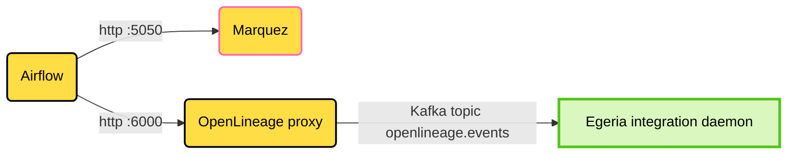

<!-- SPDX-License-Identifier: CC-BY-4.0 -->
<!-- Copyright Contributors to the ODPi Egeria project. -->

# Overview
This directory contains a sample Docker Compose setup to support the deployment of [Apache Airflow](https://airflow.apache.org/) and [Marquez ](https://github.com/MarquezProject/marquez)
to simplify experimentation with Airflow, OpenLineage and Egeria. This is a somewhat more advanced setup that requires
a few manual steps.

A local volume is mounted from the egeria-workspaces directory to externalize Airflow files that are useful to access. 
One of the subdirectories is a **dags** folder containing flows to be executed in Airflow. 
There are a few sample dags provided and more will be added over time. Workflows in Airflow are a natural extension
to Egeria's governance capabilities.

A second DAG bundle, **coco-dags**, is mounted from `exchange-quickstart/coco-dags`. It holds the Coco
Pharmaceuticals DAGs: the `coco_operations_*` DAGs, which simulate the company's day-to-day activity in the Coco
systems' databases; the `coco_feed_*` DAGs, which fill the Data Sharing Hub's digital products from those databases
as soon as their data changes; and the `coco_subscriptions_*` DAGs, which apply what the products' subscriptions
deliver to the subscribing systems. See [its README](../../../exchange-quickstart/coco-dags/README.md). 


The pyegeria and OpenLineage python packages are installed into the Airflow Docker image for your use.
Airflow emits an OpenLineage event as each task starts and finishes. By default each event goes to two places
(a composite transport):

* **Marquez**, over http to its API on port 5050.
* **Egeria**, by way of the OpenLineage proxy backend in shared-infra (container
  `egeria-shared-openlineage-proxy-backend`, port 6000). The proxy publishes each event to the `openlineage.events`
  topic on the shared Kafka server, where Egeria's **OpenLineageKafkaListener** integration connector picks it up
  and hands it to the **OpenLineageCataloguer**, which records the DAGs and tasks as processes with lineage between them.



`./switch-lineage.sh [marquez|egeria|both]` changes the target. It rewrites `AIRFLOW__OPENLINEAGE__TRANSPORT` in
`openlineage.env` (so the choice survives restarts) and recreates the Airflow containers.

## Receiving the events in Egeria

Egeria's listener does nothing until it is told which topic to listen on. That set-up is one governance action
process, *HarvestOpenLineageEvents::CreateAsCatalogTargetGovernanceActionProcess*: it catalogs the
`openlineage.events` topic as a `Topic` asset and makes it a catalog target of the OpenLineageKafkaListener.

* **In the quickstart portal it happens automatically.** The *OpenLineage Events* bootstrap batch
  (`exchange-quickstart/loading-bay/dr-egeria-inbox/OpenLineage Events/`) runs
  `harvest-open-lineage-events.ipynb` whenever the `openlineage.events` Topic is missing from Egeria, so it is
  redone after a demo reset wipes the metadata store. It is enabled by default; the admin panel's Data
  Initialization tab can turn it off.
* **By hand**, run that notebook, or the step-by-step
  [kafka-open-lineage-events](../../../workbooks/cataloguing-and-surveys/apache-kafka/kafka-open-lineage-events.ipynb) workbook.

To check it is working:

```bash
# Events arriving at the proxy
docker logs --since 5m egeria-shared-openlineage-proxy-backend 2>&1 | grep -c 'Received lineage event'
# Egeria cataloguing them
docker logs --since 5m quickstart-egeria-main 2>&1 | grep OPEN-LINEAGE-INTEGRATION-CONNECTOR
```

Both connectors are event-driven, so the Egeria Operations page shows them as WAITING even while they are working;
the log lines above are the reliable check. Events published while the listener was not set up stay on the
topic and are not replayed.

## Usage

`./quick-start-local --with-airflow-marquez` (from the egeria-workspaces root) starts Airflow and Marquez for you
after the quickstart containers, building the image on the first run; `--demo` does so by default
(`--skip-airflow-marquez` turns it off). The manual steps below do the same by hand.

This docker compose script is designed to run along-side the **egeria-quickstart** compose script. The **egeria-quickstart**
compose containers must already be running before you try to start the **airflow-marquez** docker compose script. This is because
both Airflow and Marquez are configured to share the same PostgreSQL database server as Egeria. Here are the steps to get
going:

1. Build the Airflow image with useful python packages and initialize Airflow:
`docker compose -f airflow-marquez.yaml up airflow-init --build`
2. Start up all the containers:
`docker compose -f airflow-marquez.yaml up`
3. Check the status of the containers using either your IDE, docker-desktop, or `docker ps`
4. You can experiment with the Egeria Workspaces OpenLineage demo notebook at http://localhost:8888/lab/tree/workbooks/cataloguing-and-surveys/marquez/publish-to-marquez.ipynb 
5. You can also run some airflow dags and see the OpenLineage results in Marquez.
6. You can directly run airflow commands from a command line - from the `airflow-marquez`
directory, type `./airflow.sh <command>`, where **command** might be an airflow command such as *info*, e.g: `./airflow.sh info`

### Airflow 
* WebUI is port 8072 (API server), user: *airflow*, password: *airflow*
* Configured with `CeleryExecutor` (Redis broker, plus scheduler/worker/triggerer containers) in Airflow 3.x
* Publishes OpenLineage events to Marquez and to Egeria (via the OpenLineage proxy) by default; use `./switch-lineage.sh [marquez|egeria|both]` to change the target
* Uses the shared PostgreSQL database server (host port 5442)

### Marquez
* Marquez UI is port 3000
* Listens to OpenLineage events on port 5050 (admin/health on 5051)

## Reaching Airflow and Marquez from another machine

With `--demo`, `quick-start-local` binds all of their ports to `127.0.0.1`, even though the rest of the demo
publishes on every interface. Airflow's admin login (`airflow`/`airflow`) can run arbitrary code, and its
connections include a superuser login to the shared Postgres; Marquez has no login at all. Use an SSH tunnel:

```bash
ssh -L 8072:localhost:8072 -L 3000:localhost:3000 <demo-host>
# then open http://localhost:8072 (Airflow) and http://localhost:3000 (Marquez)
```

Outside demo mode they follow `EGERIA_BIND_IP` like everything else (`--lan` widens it).

### Opening the Marquez UI to the internet

Do **not** just forward port 3000 on the router. `marquez-web` passes `/api/...` straight through to the Marquez
API, which has no authentication, so anyone who can load the UI can also add, change and delete lineage
(`POST /api/v1/lineage`, `PUT` and `DELETE` on namespaces, datasets and jobs).

To publish it, put it behind the demo's Apache, the way the two trellis apps are published
(`compose-configs/egeria-quickstart/sites-available/trellis-ssl-vhosts.conf`). This is what is needed:

1. **A hostname of its own**, e.g. `marquez.pdr-associates.com`. Marquez's UI uses root-absolute paths
   (`/api/...`, `/static/...`), so it cannot sit at a sub-path of the portal. The name must resolve publicly to
   the demo host.
2. **A certificate covering that name.** The demo's wildcard `*.pdr-associates.com` certificate already does.
3. **An Apache `VirtualHost` on 443** that proxies to `http://airflow-marquez-marquez-web-1:3000/` (Apache and
   `marquez-web` share `egeria_network`) and:
   * allows only reads: `<LimitExcept GET HEAD OPTIONS> Require all denied </LimitExcept>`, which blocks every
     write through the UI's `/api` pass-through;
   * requires a login of its own, such as HTTP basic auth from an `htpasswd` file. The portal's demo login only
     guards the portal's own pages and API, not other back ends Apache proxies to.
   * is wrapped in `<IfDefine MARQUEZ_SERVER_NAME>`, like the trellis vhosts. Apache resolves `ProxyPass`
     back ends when it starts, so it fails to start if the vhost is enabled while `marquez-web` is not running.
4. **No change to the published ports.** Apache reaches `marquez-web` over `egeria_network`, so port 3000 can
   stay on `127.0.0.1` and nothing new is forwarded on the router; 443 already is.

A starting point:

```apache
<IfDefine MARQUEZ_SERVER_NAME>
<VirtualHost *:443>
    ServerName ${MARQUEZ_SERVER_NAME}

    SSLEngine on
    SSLCertificateFile      ${SSL_CERT_FILE}
    SSLCertificateKeyFile   ${SSL_KEY_FILE}
    SSLCertificateChainFile ${SSL_CHAIN_FILE}

    ProxyPreserveHost On
    <Location "/">
        ProxyPass        http://airflow-marquez-marquez-web-1:3000/ retry=0
        ProxyPassReverse http://airflow-marquez-marquez-web-1:3000/
        AuthType Basic
        AuthName "Marquez"
        AuthUserFile /usr/local/apache2/conf/marquez.htpasswd
        Require valid-user
        <LimitExcept GET HEAD OPTIONS>
            Require all denied
        </LimitExcept>
    </Location>

    ErrorLog  /usr/local/apache2/logs/marquez-error.log
    CustomLog /usr/local/apache2/logs/marquez-access.log combined
</VirtualHost>
</IfDefine>
```

Test it from outside before announcing it: the UI should load after the login, and
`curl -u <user>:<pw> -X DELETE https://marquez.<domain>/api/v1/namespaces/egeria-workspace` should get `403`.

----
License: CC BY 4.0, Copyright Contributors to the ODPi Egeria project.