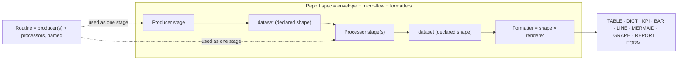
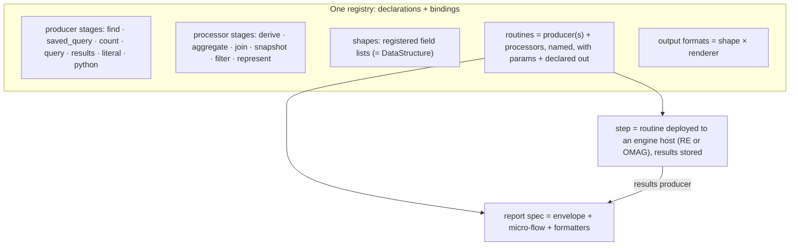

# Report specs as micro-flows: producer, processor, formatter

*Design note, 2026-11-05, revised 2026-11-06. Status: DRAFT v5.1, after the RE Architect's third review
(`~/.re-gate/OPINION-REPORT-SPEC-PIPELINE-V5-2026-11-06.md`, type facts re-verified by the coordinator against the live
6.3 types): four §8c mappings corrected to types that exist, the routine grammar widened to several producers, value
semantics moved to `DataValueSpecification`, the F60 guard placed on the role input, `completeness: unknown` made the
default under a person's client, and six §10 inconsistencies fixed. v5 followed the owner's review of v4.1 (sixteen
points, 2026-11-06) and renames the pipeline a **micro-flow**, states the grammar of routines, separates a function's
declaration from its per-environment bindings, builds the micro-flow at load time, splits formatters into shape ×
renderer, declares every field once (the `GLOSSARY_COLUMNS` double specification is gone), maps fields to `DataField`,
proposes the Egeria extensions the companions need, treats Resource Explorer as an engine host, and settles Dr.Egeria
and JSON as two spellings of one canonical spec. v4 followed the RE Architect's second review
(`~/.re-gate/OPINION-REPORT-SPEC-PIPELINE-V3-2026-11-05.md`), v3 the owner's five points, v2 the Architect's first
review (`~/.re-gate/OPINION-REPORT-SPEC-PIPELINE-2026-11-05.md`). Supersedes the action half of section 4 of
[report-specs-dashboards-egeria-model.md](report-specs-dashboards-egeria-model.md); sections 1 to 3 of that note (the
as-is model and the live Egeria types), its dashboard layer and its report-run elements still stand. The Egeria
mapping in §8 is a proposal for review with the Egeria team; the examples in §10 are re-cut at each revision.*

**Vocabulary used here.**

- A **micro-flow** is a declared, ordered sequence of **stages** that runs entirely within one thread of one process,
  with nothing persisted between stages. The word replaces "pipeline", which suggests something heavy that spans
  process boundaries; a micro-flow never does. The JSON key is `microflow`.
- A **stage** is a producer, a processor or a formatter: the executable leaf.
- A **routine** is a named, reusable micro-flow fragment: one or more producers followed by processors, with its own
  parameters and declared output. What we have called an analytic routine is exactly this.
- A **step** is a routine deployed to an **engine host**, which runs it on a schedule or on demand and stores its
  results as annotations. Resource Explorer's survey step host is an engine host in Egeria's terms, equivalent to the
  Java OMAG Engine Host; nothing in this note is specific to either.

## 1. Why the current model stops short

A pyegeria `FormatSet` today has one action with two unrelated execution paths:

- `function` (Dr.Egeria `find_method`): an element query; the result is a list of elements that the per-type pyegeria
  processor flattens into named fields (lifting Egeria's `mermaidGraph` string among them) and that `Format.attributes`
  projects into columns.
- `analytic_function` (`extra_find`): a registered routine; the result is passed through as `{"kind": "json"}` and never
  meets `Format.attributes`. Every KPI, bar or chart tile therefore needs a Python reshaper
  (`curation_coverage_tile` exists only for this), and presentation lives in code.

What the model cannot express, in one example: **a table whose rows come from a find and whose columns include values
computed by an analytic** (glossaries with their term count and definition completeness). Nor can it express a KPI over
a table, a report over a step's stored results, a join of Egeria and ODS data, or a time series of anything but the one
hard-coded `growth_series`. Inputs are bound three different ways (client by parameter-name convention, readers by
`analytic_binders`, everything else as free kwargs), composition exists in three ad hoc shapes (`metric_trend`,
`AnalyticActionSpec`, inline in `ai_ready_assets`), and `kind="step"` manifests sit in the same registry but cannot be
run from a spec at all. Column sets are Python constants (`GLOSSARY_COLUMNS = COMMON_COLUMNS + [...]`) that only a
Python process can expand, so no other environment can know a spec's shape without importing pyegeria.

What is solid and kept: the Trellis `Declaration` and result envelope (result kind, measures with unit / as-of / basis,
confidence, the four absence sentences), registered-name-only resolution, and the output type names users already know.

## 2. The model in one sentence, and its grammar

**A report spec is its envelope (heading, description, questions, perspectives, family, ...) around a micro-flow of
stages plus formatters; a stage is a producer or a processor with a declared input and output shape; a routine is a
named, reusable micro-flow fragment of one or more producers and their processors; a formatter renders the final
shape through a chosen renderer.**

```
spec       := envelope  microflow  formatters
microflow  := (routine | producer) processor*
routine    := producer+ processor*           # named; own params; declared out
producer   := find | saved_query | count | query | results | literal | python
processor  := derive | aggregate | join | snapshot | filter | represent
stage      := producer | processor | routine  # what a microflow entry names
formatter  := output_format -> (shape, renderer, options)
```

Both levels are reusable: the leaf functions by name, and the routine as a declared composition of them. A spec may
name a routine as its first stage, or a producer, and follow either with further processors. A routine may have
**several producers** (the Portal's overview routines union several counts over different criteria; the Architect's
census of the 37 live registry entries found most of the 24 Portal routines are of this kind): when it does, each
processor names which input(s) it reads (`in`), and `join` is kept for keyed merges of two datasets. A routine may
name another routine only as a `join` input, so no routine hides a data source.



*Full-size image: [`07-pipeline-overview.png`](../images/report-specs/07-pipeline-overview.png)*

## 2a. The spec envelope stays

The micro-flow replaces only the *action* half of today's `FormatSet`. Everything that identifies, describes and makes a
spec discoverable stays as the envelope around it, unchanged in meaning: label and heading, description,
`target_type`, `aliases`, `family`, `annotations`, the question spec (example questions and the perspectives they serve),
the preamble, and the dashboard-facing fields (emphasis, detail spec). In Egeria these are the properties and links the
earlier note already placed on the spec element and its `QuestionSpec` / `Question` / `Perspective` neighbours; nothing
in this note moves them. A spec is therefore: **envelope + micro-flow + formatters**.

## 2b. Declarations and bindings: how a function is specified so it is shareable

A producer, processor or routine is specified in two parts, and the split is what makes it portable.

**The declaration is data.** It is the same whatever environment runs it, and it is all a spec, a validator, a catalog
or Dr.Egeria ever needs to know:

| Declaration field | Meaning |
|---|---|
| `name`, `kind` | registered name; `producer` / `processor` / `routine` |
| `version`, `source` | the shipped `Declaration`'s own provenance pair |
| `inputs` | role inputs (§7): `egeria_client:<Class>`, `reader:<source>`, `viewer`, `subject`; never a credential |
| `params` | name, type, default, required; a routine's params map onto its stages' params |
| `in` | for processors: the shape(s) consumed, by registered shape name or by field list |
| `out` | the shape produced: a registered shape name, or an inline field list (§5) |
| `pushdown` | for producers: which of `sort`, `filter`, `as_of`, `paging`, `group_by`, `sum`, `avg`, `count`, `distinct` the source performs itself |
| `tile_safe` | `true` / `false` with `reason` (§7) |
| `admission` | `resource_types` it may run against; `test_only` keeps a producer out of every live tile |

**A binding names an implementation for one runtime.** A declaration carries one or more:

| Binding | Form | Honoured by |
|---|---|---|
| `python` | `pkg.module:function` (today's dotted path for binders, generalized) | plain pyegeria, the Portal, Resource Explorer: all three are Python, so one binding usually serves all |
| `egeria_query` | the `qualifiedName` of a `SavedQuery` | any executor with an Egeria client in the role input |
| `sql` | a named query on a `reader:<source>` | any executor whose environment supplies that reader |
| `step` | a `GovernanceActionType` request type | an engine host; a spec reaches it only through a `results` producer |

The rule: **an executor honours a binding it can, and refuses, with the stated reason, a stage whose declaration has
no binding it can honour.** It never guesses. A `python` binding is loaded by the registry's existing name-only
resolution; nothing resolves an arbitrary string from a spec.

**The guard travels with the role input, not with the stage.** The one call indirection of §7 is a property of the
`egeria_client:<Class>` object the executor supplies (F60's wrapped person client is exactly this), so a `derive`'s
per-row producer, an `egeria_query` binding and a `results` read all pass through it without the executor knowing the
stage structure, and a stage that received the object cannot bypass it. `sql` bindings carry no Egeria token and are
outside it; `step` bindings never run inside a micro-flow (only `results` reads their output, as the person).

In Egeria (§8) the declaration is the `Process` element, its declaration JSON in the typed `formula` / `formulaType`
pair, and each binding is one `ImplementedBy` link (`role` = the binding kind) to the implementation element, so "where
can this run?" is a catalog question.

## 2c. Building the micro-flow: at load time, not at run time

A spec is **resolved when it is loaded**, which happens at startup, on `refresh_specs`, when an archive is loaded, and
when Dr.Egeria's `Create Report Spec` is processed. Resolution:

1. each stage name and routine name is looked up in the registry; a routine is expanded in place to its stages;
2. every `$param` is matched to a declared spec parameter or a routine parameter, with a type;
3. each stage's `in` is checked against the previous stage's `out` (by field name and type), and `derive` /
   `aggregate` field references against the row shape they read;
4. every formatter's column, field, axis and key is checked against the final `out`; an output format name is checked
   against the (shape, renderer) registry and the final shape must be the one that renderer takes;
5. role inputs are listed, with **which environment supplies each** (the 401-versus-403 classifier and its words are
   per environment: Resource Explorer has `is_person_token_refused`, the Portal has none yet, plain pyegeria raises),
   so an executor can refuse before any stage runs (`CallerTokenExpired`, no such reader) in its own words;
6. admission and `tile_safe` are recorded, so a dashboard refuses to place a non-tile-safe spec as a live tile; a
   stage may be tile-safe **under a cap** (`tile_safe: {"cap": {"rows": 25}}`), in which case the sheet refuses the
   placement only when the cap is exceeded at run time and says so in the tile.

A spec that fails any check is **marked unrunnable with the failing check's words** and still listed, so a user sees
"spec X: formatter TABLE names field `term_count` that no stage produces" rather than a blank column. The resolved form
is cached; a registry change invalidates it. **A run is then a walk of resolved stages** with only the role inputs
supplied per run, and it stays within one thread of one process. A stage that needs more than that (minutes of
per-row Egeria calls, a background refresh) is not a stage: it is a step on an engine host, read back by `results`.

## 3. Producers: how a dataset is produced

A producer originates a dataset. It takes parameters, never a dataset. Types:

| Producer | What it is | Push-down (declared in `pushdown`) |
|---|---|---|
| `find` | one of the typed Egeria finds, with its existing pyegeria processor as the output shaping (flattening nested JSON into fields; lifting `mermaidGraph` and other representation fields) | as-of time, sequencing property and order, status filter, paging, search string: all Egeria parameters already |
| `saved_query` | an Egeria `SavedQuery` element (`queryURL`, `queryRequestBody`) run as stored; uses the ones that exist, never forces one per spec. **Roadmap (owner, 2026-11-06):** Egeria queries are gaining SQL push-down (`group by`, `sum`, `avg`, …). As that lands, a saved query's `pushdown` list grows, the executor leaves more in Egeria, and `count` below becomes one capability of this producer rather than a kind of its own. | whatever the stored query declares |
| `count` | Egeria's native count by search conditions. Settled live (2026-11-05, platform OpenAPI): `metadata-elements/by-search-conditions/count` and `relationships/by-search-conditions/count`; nothing else today. pyegeria 6.2.21 has no wrapper yet: a small pyegeria item precedes this producer. Kept as a named kind until `saved_query` absorbs it. | the count, with criteria |
| `query` | an external query, e.g. SQL against the ODS or another store, through a registered `reader:<source>` with a declared output shape; the successor of `analytic_binders` | the store's own filter / order / limit / group-by |
| `results` | stored results read back: survey annotations of a step, or a `GovernanceMetric`'s `GovernanceResults` | as-of, latest-only, by subject |
| `literal` | a fixed or parameter-supplied dataset (tests, Overview tiles, demos) | none |
| `python` | **new (owner, 2026-11-06):** any registered Python function with a declared `out`; a test-data generator, a synthetic series, a fixture. Admission `test_only` keeps it out of live tiles, and the generator refuses it in a Dr.Egeria-authored spec unless the spec itself is marked `test_only`, so a demo producer never reaches an archive. It is still a producer like any other so the rest of the micro-flow is exercised unchanged. | whatever it declares |

Rule: sort, filter, as-of, paging and (as Egeria grows) aggregation are **pushed into the producer** wherever the
producer declares it. The executor reads the `pushdown` list and performs in Python only what the source did not.

There is **no `routine` producer**; that is what stops a routine from hiding a data source. A Trellis library routine
that today reads its own source (`curation_coverage` reading the ODS through a bound reader) is a `query` producer plus
a processor, declared as a routine; see §7 and §10.4.

## 4. Processors: how a dataset is processed

A processor takes one or more datasets and yields a dataset. A processor is a standard analytic function with declared
input and output shapes; the same function serves the Portal, Trellis and plain pyegeria.

| Processor | What it does |
|---|---|
| `derive` | adds or replaces data: columns per row, rows, subtrees, text. May invoke a named producer or routine per row or per batch (the master-detail and enrichment case). Per-row Egeria calls do not scale to a live tile, so the stage declares `tile_safe` with a reason. |
| `aggregate` | count / sum / avg / group-by / distinct **when the producer did not push them down**; the executor consults the producer's `pushdown` and skips what Egeria already did. The fallback shrinks as Egeria's query push-down grows. Also `count_where`: a count of rows by a companion value (`rows.state = not_measured`), which is how a refusal count such as `files_refused` is computed; no source can push that down. In a routine with several producers, `in` names which input(s) the stage reads. |
| `join` | two datasets on a key (Egeria elements with ODS rows; two glossaries side by side). The one non-linear stage; it names a second producer **or a routine**, so two micro-flows can meet. |
| `snapshot` | re-runs the upstream at each as-of time in a window and stacks the results as a series. Replaces `metric_trend` and the hand-written windowing in `growth_series`. Tile-safe only over `count` or `results`, or when the window has few points: a snapshot over a `find` is N Egeria reads. |
| `filter` / `sort` / `limit` | only where push-down is impossible. |
| `represent` | **new (owner, 2026-11-06, points 6 and 7):** turns a dataset into a representation a renderer takes (a graph layout, a lineage structure, a tree outline), **only for data that did not arrive with one**. Egeria already returns `mermaidGraph` and pyegeria only renders it, so mermaid today needs no `represent`. This is the experimentation path for the lineage work: a Python `represent` stage is written first, and when a representation is pushed down into Egeria (as mermaid was) the stage is removed and the field becomes a representation field, with the spec otherwise unchanged. |

## 5. Datasets, shapes and value cells: declare every field once

Every stage declares its output shape. The shape is **the shipped Trellis `Declaration`** (`trellis_analytics.declaration`
0.2.0; pyegeria's `AnalyticDeclaration` is its validated minimum): `TableColumn` rows for the fields plus the result-kind
block. Nothing is invented here, but v5 is explicit about what one field carries and about where fields live.

**A field is declared in exactly one place**: in the `out` of the stage that produces it, or in a **registered shape**
that an `out` names. A field has a `kind` (`data`, the default; `cell`, a value with companions; `representation`, a
pre-built rendering such as `mermaidGraph`; `dataset`, nested rows of another shape, the master-detail case), `name`
(the data key, today's `Column.key`), `label` (the displayed column name, today's `Column.name`), `type`, optional
`unit`, `format` (whether the value is run through the type's formatter, today's `Column.format`), `detail_spec` (the
spec a click drills into), `valid_values`, for a `dataset` field its `shape`, and for a value cell its `companions`. **A user names a column by its `label` in the shape, and a formatter may override the label for one output
format** (a `columns` entry `{"field": "display_name", "label": "Glossary"}`); the formatter never introduces a field.

**Registered shapes replace the Python column constants.** Today's `COMMON_COLUMNS`, `GLOSSARY_COLUMNS`,
`TERM_COLUMNS`, … are lists of `Column(name, key, format, detail_spec, valid_values)` built at import time in
`base_report_formats.py`; only a Python process can expand them. They become shapes in the registry's CONFIG tier,
with `extends` for what `+` does today, so every executor and Dr.Egeria can read them, and the generator (§9.6) emits
them once from the constants:

```json
{
  "shapes": {
    "CommonRow": {"fields": [
      {"name": "display_name",   "label": "Display Name",   "type": "string"},
      {"name": "qualified_name", "label": "Qualified Name", "type": "string", "format": false},
      {"name": "category",       "label": "Category",       "type": "string"},
      {"name": "description",    "label": "Description",    "type": "string", "format": true},
      {"name": "type_name",      "label": "Type Name",      "type": "string"},
      {"name": "url",            "label": "URL",            "type": "string"}
    ]},
    "GlossaryRow": {"extends": "CommonRow", "fields": [
      {"name": "language",             "label": "Language", "type": "string"},
      {"name": "usage",                "label": "Usage",    "type": "string"},
      {"name": "folder_display_names", "label": "Folders",  "type": "list<string>"},
      {"name": "guid",                 "label": "GUID",     "type": "guid"},
      {"name": "mermaidGraph", "kind": "representation", "format": "mermaid"}
    ]}
  }
}
```

A shape **is** an Egeria `DataStructure` and each field a `DataField` (§8), which is why Dr.Egeria already has the
commands to author one (the Data Designer family: `Create Data Structure`, `Create Data Field`); `Create Report Spec`
only names shapes.

A **value cell** is the runtime pairing of a value with the companions its field's declaration says it carries:

| Companion | Source in the shipped Declaration |
|---|---|
| `state` | the absence vocabulary `ABSENCE_STATES` (`not_measured`, `not_permitted`, `not_applicable`, `measured_nothing`) plus `measured`. `not_permitted` is an explicit refusal (an Egeria 403 on one call) and the one Resource Explorer meets daily. A per-row refusal with a reason (today's live case: a file "cataloged twice in Egeria", the W68 sentence) is `not_measured` plus `reason`, per row, not a result-level state. |
| `completeness` | **replaces the boolean `capped` and the v3 idea of an `unknowable` state** (owner raised silent filtering; Architect: a value exists under it, so it is a companion, not an absence). Three values: `complete` · `lower_bound` (what `capped_field` says today; same meaning, no migration of meaning) · `unknown` (silently filtered, e.g. a zone filter that hides elements without refusing: not even a bound). **Who sets it:** no producer can see a silent filter, and the executor already knows whether the role input it supplied is a person's client, so **`unknown` is the default for every Egeria-reading stage run under a person's client** (Architect, v5 review: as an opt-in flag it is forgotten, as v5's own 10.3 showed). A stage opts out only with a reason (`completeness: {"complete": "daemon precomputed under all zones"}`); the daemon's all-zones reads are `complete` by the same rule. Rendering: the number with "at least" for `lower_bound`, "incomplete: some items may be hidden from you" for `unknown`; never a bare integer, never zero for either. (The result envelope's own states, `measured` / `nothing_found` / `not_established` / `not_applicable`, stay at the result level; the executor already maps them onto the absence words.) |
| absence sentence | **not carried in the cell.** Declared once per measure (`AbsenceSentences`); looked up from the declaration at render time. |
| confidence `score` | `ConfidenceDeclaration` (form ∈ measured / estimated / inferred / judged / generated, basis, method, score, calibrated) is declared per measure; a cell may carry the score, never a different form. Confidence is about the method. |
| `uncertainty` | the spread of the value itself, distinct from confidence in the method. Declared per measure with its *form* (`plus_minus` · `low_high` · `band`) and the unit it shares with the value; filled per cell. It has **its own absence word**: a measure that declares uncertainty but a cell that carries none says "spread not estimated", else an absent ± reads as exact. **Never declared on an exact count**: a count's only uncertainty is completeness. Not in the shipped Declaration today; added to it, not beside it. Egeria home: `DataValueSpecification` (`units`, `absoluteUncertainty`, `relativeUncertainty` exist at 6.3), the carrier the OSI note chose (§8b). |
| `unit`, `as_of` | `MeasureDeclaration.unit`, `.as_of` (a field name) |
| `basis` | `MeasureDeclaration.basis` (denominator field + label): a fraction whose denominator matters is exactly the per-cell case |
| `provenance` | the envelope's version + source + run triple, the same triple per cell |

**Release coupling.** The two vocabulary additions (`completeness`, `uncertainty`) land in trellis-analytics and
pyegeria in one release: trellis-analytics 0.3 first, then the pyegeria floor bump with the `AnalyticDeclaration`
minimum in one PR, then 8813 and the Portal re-synced. The safety net exists already: the engine host's
`versionIdentifier` range check and the "none missing" line refuse a step written against 0.3 words on a 0.2 host.

Formatters know the cell shape, so a table shows "not measured" in the cell rather than a blank, a KPI shows its score,
a chart omits unestablished points. Two things the cell model deliberately does not cover: result kinds that are not
measures (`finding`, `proposal`, `list`, `graph`) keep their per-result semantics (severity, decided-by, verdict) in the
Declaration's own block and render as today; and the chat `extents` (fields, rows, token cost, citation) stay declared per
result, because the chat compile reads them there.

A field may also be a **representation field**: a pre-built representation carried in the payload (`mermaidGraph`),
rendered directly by the matching renderer.

Shapes are declared before anything runs, so a spec is validated at load (§2c): a formatter asking for a field no stage
produces is a load-time refusal, not a blank column at run time.

## 6. Formatters: shape × renderer

`Format(types, attributes)` cannot carry this. A formatter has two independent axes: the **intermediate shape** it
takes, and the **renderer** that turns that shape into output. An **output format name** (`TABLE`, `KPI`, `MERMAID`, …:
the values a user types in `Output Format`) is a registered pair of the two, so today's names keep working and new
renderers add names without touching specs.

| Intermediate shape | Renderers today | Renderers in sight | Formatter options |
|---|---|---|---|
| tabular (rows × fields) | `table` (rich), `dict`, `json`, `md`, `form` | HTML grid (Portal) | `columns` (subset, order, label overrides), value formats, field groups for FORM |
| measure set (one row of cells) | `kpi` card, `md` | | value fields, unit, as-of, state words, subtitle rule; **`reduce`**: the one reduction a formatter may declare (`sum` / `count` / `avg` / `min` / `max` of one field of a tabular shape), because a KPI is a view of the table it sits on; it is declared, so load-time checks it, and it introduces no field a renderer can name |
| series (x, one or more y) | `bar`, `line`, `pie` (plotly in the Portal; rich/md table natively) | | axes, series keys, title, absence handling |
| tree (nested rows) | `report` (md sections), `master_detail` (expandable rows) | **`mermaid` (mindmap / flowchart from a tree, owner point 6; reuses the W69 per-type field→label maps of the Explorer's mermaid type diagrams)**, outline, `json` | section nesting, per-level columns; for master-detail: the master's columns, the detail stage per row, how the detail shows (expandable, side panel, drill link) |
| graph (nodes, edges) | `mermaid`, `interactive` (as Explorer draws it) | **other graph renderers for lineage, where mermaid is hitting complexity limits (owner point 7, short-term); whether a representation comes from Egeria or from a `represent` stage is invisible to the renderer** | node label and type fields, edge label and direction, grouping |
| document (sections, text) | `md`, `report`, `html` | | preamble, section order, embedded shapes |
| representation field | pass-through per `format` (`mermaid` today) | per new representation format | which field, fenced-block wrapper; no shaping |

Registered output format names, the ones that exist plus the ones this note adds:

| Output format | shape / renderer |
|---|---|
| `TABLE` `DICT` `JSON` `MD` `FORM` | tabular / table, dict, json, md, form |
| `KPI` | measure set / kpi |
| `BAR` `LINE` `PIE` | series / bar, line, pie |
| `REPORT` | tree / report (today's MD report with sections) |
| `MASTER_DETAIL` (new) | tree / master_detail |
| `TREE_MERMAID` (new, proposed name) | tree / mermaid |
| `GRAPH` (new) | graph / interactive |
| `MERMAID` | representation field / mermaid when the payload carries one; graph / mermaid when a `represent` stage built it |

**One rendering library (owner point 5).** The renderers live in pyegeria, one module per renderer under the view
package, with the shapes above as their input contract. Plain pyegeria calls them directly. The Portal and Trellis call
the same functions for the data-to-shape-to-markup step and add presentation on top (CSS, interactivity, the Portal's
dashboard grid); where either needs something the library lacks, it lands in the library, not in a reshaper. The gate
that proves the library serves all three is the Trellis curation-coverage tile: its JSON from the pyegeria renderer
must be byte-identical to the live tile's (§9.5), the same gate as the binder retirement.

Today's `Column` is the tabular renderer's unit unchanged in meaning; it now reads from a shape rather than a constant.
Every existing spec whose columns come from the per-type processor migrates as `find` producer, no processor, tabular
formatter over a generated shape; the specs that read `mermaidGraph` migrate as `find` plus representation field. The
migration lists both groups by name so the count is honest.

## 7. Routines and stages: one structure for Portal, Trellis and plain pyegeria

- **Stages** are the executable leaves: producers and processors, registered functions with a declaration (§2b) and
  one or more bindings.
- **Inputs are declared by role**: `egeria_client:<Class>` (the pyegeria client class, e.g. `GlossaryManager`, since
  Resource Explorer's factory `EgeriaClients.of(cls)` is per class and per server; a `find` or `count` producer implies
  it from its type), `reader:<source>` (a shared, configured engine such as the ODS reader, environment-supplied),
  `viewer` (identity words only: user id, admin flag; Resource Explorer's `_reader(request)`, used for cancel and zone
  decisions), `subject` (the resource in view), `param`. A role names **what** is needed, never **who** supplies it or
  how it is built: a stage never takes a credential and never a client it did not declare. The executor supplies each
  role: in Resource Explorer the Egeria client is the person's wrapped client (the F60 seam); in the Portal it is the
  signed-in user's client; in plain pyegeria it is the caller's. This replaces parameter-name introspection and
  `analytic_binders` without the binder coming back under a new name.
- **Admission is part of the contract.** As `survey_step_host.attach()` admits a step to a resource type, the executor
  refuses a spec whose routine is not admitted for the subject's `resource_types`, with the existing "not installed"
  words.
- **One call indirection.** Every call a stage makes to Egeria goes through the contract's `call(role_input, method,
  **params)`, the F60 `_GuardedCall` generalized. Three hard things live there and nowhere else: sync/async adaptation
  (the Portal awaits the `_async_*` twin, Resource Explorer runs sync pyegeria in a thread, plain pyegeria is sync; a
  leaf written once never chooses; this is also where the pending pyegeria nest_asyncio removal lands); the token-death
  rule (a dead person token **aborts the run** with the environment's own words, Resource Explorer's F58 401 body, and is
  never a cell state; **the partial dataset is discarded**, no card is drawn or stored and the previous card stays, so a
  `derive` that dies at row 30 of 50 never renders 30 rows; while an Egeria 403 on one call **is** that row's or cell's
  `not_permitted`, classified per environment inside the indirection); and pre-run refusal (`CallerTokenExpired` from
  role supply refuses before any stage runs, same words). The indirection is a property of the supplied client object
  (§2b), which is why no stage can route around it.
- **Micro-flows are read-only by contract.** No stage has a side effect (`results` is a read), so an executor may re-run
  freely, which is what `snapshot` relies on.
- **A routine** is `producer+ processor*`, named, with its own parameters mapped onto its stages' parameters and a
  declared output. A spec names a routine as one stage; a routine may name another routine only through `join`.
- **A report spec** is envelope + micro-flow + formatters.
- **A micro-flow is data; it has several executors.** The same spec must run in plain pyegeria (scripts, the CLI,
  Dr.Egeria, Jupyter: synchronous, mints its own token), in the Portal (FastAPI, async, the signed-in user's token,
  `exec_report_spec`'s successor), and in Resource Explorer (the person's wrapped client, per-request readers, its own
  session rules), while an engine host runs routines as steps. What is common is the **executor contract**: load and
  resolve (§2c), supply role inputs from the environment, walk the stages in order, hand the final dataset and the
  spec's formatter to the renderer, surface the envelope states the same way. Each environment implements that contract
  once; no spec knows which executor it is under.
- **Reusable analytic functions are the leaves** (processors and producers); **a routine is the reusable composition.**
  Both are what the registry holds and what a spec names (owner point 1).
- **A step** is a routine deployed to an engine host, whose output is stored as annotations and read back by a
  `results` producer. Same registry, same declaration, plus a `step` binding. The library's `kind="step"` entries (nine
  on 8813 today) already are this; Resource Explorer's survey step host is the engine host that runs them.

Migration does not require splitting on day one: an existing routine registers as a single opaque stage with its
declaration (which is what every entry is today) and is split into producer + processor as each is touched. The output
shape is declared either way, so formatters work from the first day.

What today's routines are, in these terms, and where each belongs:

| Routine | In micro-flow terms | Tile-safe as a processor? |
|---|---|---|
| `count_elements`, `counts_by_type` | `count` producer | yes; one call per type counted |
| the Portal's multi-count overview routines (`context_readiness_funnel`, `governed_coverage`, `people_counts`, …) | several `count` producers + one `aggregate` reading all of them (`in`) | yes; one call per count |
| `curation_coverage` | `query` (ODS) + `aggregate` | yes |
| `database_staleness` | `results` producer (prior report) + `query` producer (snapshots) met by `join` | step today |
| `ai_ready_assets` | `find` + `derive` (follow a relationship, per row) + `filter` | **no**: step + `results` |
| `metric_trend`, `growth_series` | `snapshot` over any of the above | over `count`/`results` yes; over `find` only for small N |
| `AnalyticActionSpec` (fetch + analytic) | producer + one processor | per its parts |

**Binders retire only in the PR that proves the replacement live**: the `analytic_binders` mechanism is today the only
way the Portal runs `curation_coverage` against the ODS (LS2 step 4, proven live 2026-11-05 17:17Z). Order and gate in
§9.5.



*Full-size image: [`08-registry-layers.png`](../images/report-specs/08-registry-layers.png)*

## 8. The Egeria mapping, revisited (proposal for review with the Egeria team)

Egeria already models this shape, so the mapping follows Egeria's lead rather than adding action properties. Egeria
types are single-inheritance, so **the spec is not itself a `Process`**. Everything below is for discussion with the
Egeria team (owner point 9); the light form needs one new type (`ReportSpec`, §9.1) and otherwise only types that exist.

**How heavy to go.** Execution never goes through Egeria; the executors run from the registry. Egeria holds the catalog
view, and there are two levels of it:

- **Light (the default).** The spec element carries its micro-flow as structured data (the ordered stage list with
  parameters), exactly as the JSON the executors read, **in a declared, typed property of the `ReportSpec` subtype**
  (JSON text in a typed string property is acceptable; a map of maps in `additionalProperties` is the earlier note's own
  forbidden pattern and is not). The spec links to the *reusable* things it names: each routine and each leaf function it
  uses is a plain `Process` element (not a governance action process) whose declaration JSON sits in the typed
  `formula` / `formulaType` pair, with one `ImplementedBy` per binding; and each shape is a `DataStructure` **held by
  the spec itself**, since `ReportType` ⊂ `DataSpec` ⊂ `Collection` and holding `DataStructure`s by
  `CollectionMembership` is what a `DataSpec` is for. That gives discovery ("which specs use `curation_coverage`?",
  "which produce this shape?", "where can this run?") with a handful of elements per spec and nothing to keep in step
  with an engine host. The links to functions are `ResourceList` with `resourceUse` = "stage N"; stage parameters stay
  in the `microflow` JSON (`ResourceList` has no properties map at 6.3). **Promotion is a retype in place**:
  `AnalyticalActionProcess` ⊂ `GovernanceActionProcess` ⊂ `Process`, so a plain `Process` becomes a step's process when
  deployed, with the same GUID and its links kept; that is why the light form costs nothing later.
- **Full lineage (opt-in).** For a spec worth drawing, the micro-flow is also materialized as `Process` stages under
  `ProcessHierarchy` with `DataFlow` between them. Explorer then draws it with no new code. This is a projection of the
  light form, generated, never hand-maintained: every generated element is **marked** (a classification or a property
  naming the spec and its version) so nobody curates it by hand, and regeneration is **idempotent by qualifiedName**
  (update, never delete-and-create: deletion is a shared write and loses lineage history).

`AnalyticalActionProcess` and `SurveyingActionProcess` are reserved for what an engine host actually runs (a routine
deployed as a step), as the 2026-11-03 model has them, whether that host is Resource Explorer or the OMAG Engine Host.
Every type, relationship and property named below exists in the live 6.3 types, except where marked *proposed* (§8b).
**How to repeat the check:** `ValidMetadataManager.get_typedef_by_name(<name>)` against qs-view-server, reading
`attributeDefinitions` (own properties), `superType`, `endDef1` / `endDef2` (the platform has no `/api/types` path;
v5 said it did). Done by the Architect and again by the coordinator on 2026-11-06.

### 8a. Element mapping

| Our term | Egeria element | Relationship |
|---|---|---|
| report spec (envelope + micro-flow) | `ReportSpec` ⊂ `ReportType` (⊂ `DataSpec` ⊂ `Collection`); typed property `microflow` = the ordered stage list with its parameters (§9.1) | `ResourceList` (`resourceUse` = "stage N") to the routines / functions it names; `CollectionMembership` to its shapes; `binders` gone |
| micro-flow (full lineage form only) | one `Process` | `ProcessHierarchy` to its stages; `DataFlow` orders them |
| routine, leaf function (reusable) | plain `Process`; its declaration JSON in `formula` with `formulaType` = `trellis-declaration/1` (the same shape as `microflow` on the spec; nothing in `additionalProperties`) | `ImplementedBy` (`role` = binding kind) → one implementation element per binding (an `EmbeddedProcess`, which is an `Action`, for `python`; `SavedQuery` for `egeria_query`; the reader's `DataSet` for `sql`; `GovernanceActionType` for `step`); the shape it produces is reached through the spec's `CollectionMembership`, since `DataDescription` ends at a `Collection`; promoted to `AnalyticalActionProcess` only when deployed to an engine host |
| stage (full lineage form only) | sub-`Process` under `ProcessHierarchy` | `ImplementedBy` → the leaf; `DataFlow` between stages |
| step | `SurveyingActionProcess`, with `GovernanceActionType` as its request type | `ImplementedBy` → `SurveyActionService` |
| shape | `DataStructure` | `MemberDataField` (`position` = field order) to its `DataField`s, **and nothing else**: `MemberDataField` is `DataStructure` → `DataField` only, so `extends` is flattened at generation (the parent's fields linked too) and a `dataset` field is a `DataField` with `NestedDataField` children (or `LinkedDataField` when the child rows are another structure's) |
| field | `DataField` | see §8c |
| value semantics of a cell (`unit`, `uncertainty`) | `DataValueSpecification` (`units`, `absoluteUncertainty`, `relativeUncertainty`, `dataType`), the carrier the OSI note chose; **one carrier, no duplicate** | from the `DataField`; the linking relationship for a plain specification (not a `DataClass`) is to confirm with the leads |
| measurement semantics of a cell (`completeness`, `basis`, `as_of`, confidence form, absence sentences) | **declared, not per element**: the proposed `MeasurementDeclaration` classification (§8b) | |
| formatter | `DisplayDataContainer` per output format (`displayName` = the output format name) | `DisplayDataField` per column, `inputField` → the `DataField`, `displayName` only for a label override; **column order**: `position` is not an own property of `SchemaAttribute` at 6.3, so where order lives (an inherited property or the containing relationship) is to verify before use; `sortOrder` exists and is not it |
| `saved_query` producer | `SavedQuery` | `DataSetContent` |
| `results` producer | `SurveyReport` annotations / `GovernanceResults` | `GovernanceResults` |
| report run | `Report` ⊂ `DataSet` with `ReportInstanceOf` / `ReportRunOf` as in the earlier note | |

### 8b. Proposed extensions (owner point 13)

The companions of §5 describe a value, not a column of data, so they must not become `MemberDataField`s (every consumer
would read them as data columns). They split in two, so that no companion has more than one Egeria home:

- **Value semantics** (`unit`, `uncertainty`, the value's `type`): Egeria already carries these on
  `DataValueSpecification` (`units`, `absoluteUncertainty`, `relativeUncertainty`, `dataType`), and the OSI note of
  2026-11-03 chose it as the export carrier. This model uses it rather than proposing a second home.
- **Measurement semantics** (completeness declared, basis field, as-of field, confidence form, absence sentences): no
  Egeria home exists; a classification on the `DataField` is proposed. It is per *field*; the 2026-11-03 ask for typed
  attributes on `GovernanceMetric` was per *measure*, and when a field is a declared measure (10.3, 10.4) both would
  carry basis and as-of. Rule: **the classification is the only home**; a `GovernanceMetric` points at the field
  (`GovernanceResults`) and duplicates nothing. That retires the 2026-11-03 ask rather than conflicting with it (§9.2).

| Need | Exists today | Proposed |
|---|---|---|
| spec carries its micro-flow | nothing typed on `ReportType` (own properties: `createdTime`, `lastModifiedTime`, `lastModifier`); `Referenceable` has no `aliases` | `ReportSpec` ⊂ `ReportType` with `microflow` (string, JSON), plus the envelope strings `targetType`, `aliases`, `outputTypes`, `includePreamble` (§9.1, **decided**) |
| field is a measured value: measurement semantics | `GovernanceMetric` (`measurement`, `target`); annotation `confidenceLevel` (a method word) | a **`MeasurementDeclaration` classification on `DataField`**: `completenessDeclared` (complete / lower_bound / unknown-possible), `confidenceForm`, `basisField`, `asOfField`, `absenceSentences` (map). A classification keeps it off the data columns and is the fallback the leads can accept even if typed attributes are refused |
| field is a measured value: value semantics | `DataValueSpecification` (`units`, `absoluteUncertainty`, `relativeUncertainty`) | no new type; confirm the relationship by which a plain `DataValueSpecification` (not a `DataClass`) is assigned to a `DataField` |
| routine carries its declaration | `Process.formula` / `formulaType` | no new type; `formulaType` = `trellis-declaration/1` |
| formatter names its renderer | `DisplayDataContainer` has no renderer word | `renderer` string property on `DisplayDataContainer` (or `additionalProperties.renderer` as fallback) |
| a function says where it can run | `ImplementedBy` has `role`, `description`, `designStep`, `transformation`, `iscQualifiedName` | use `role` = the binding kind (`python`, `egeria_query`, `sql`, `step`); no new type |
| a stage opts out of `completeness: unknown` | nothing | in the `microflow` JSON only; enough for the light form |

### 8c. JSON to Egeria, field by field (owner point 14)

| JSON | Egeria |
|---|---|
| spec key (`"Glossaries"`) | `ReportSpec.qualifiedName` = `ReportType::Glossaries`, `displayName` |
| `heading`, `description`, `family`, `target_type`, `aliases`, `annotations` | `ReportSpec` properties (`displayName`, `description`, `category`=family, `targetType`, `aliases`; wikilinks in `additionalProperties.annotations` as the earlier note has it) |
| `microflow` (the list, with every stage's `params` and the spec `params` / `defaults`) | `ReportSpec.microflow` (JSON text); `ResourceList` has no properties map at 6.3, so parameters live nowhere else |
| a stage's `function` / `routine` | `ResourceList` (`resourceUse` "stage N") → `Process` |
| `out: "GlossaryRow"` (registered shape) | `DataStructure` `GlossaryRow`, held by the spec through `CollectionMembership` (`ReportSpec` is a `Collection`); the producing `Process` is reached from the same spec, since `DataDescription` ends at a `Collection`, not at a `DataStructure` |
| `out: [ ... ]` (inline fields) | an anonymous `DataStructure` named `<spec>.<stage N>`, same membership |
| `shape.extends` | the parent's `DataField`s linked by `MemberDataField` as well (flattened at generation); `MemberDataField` cannot point at a `DataStructure` |
| `field.kind: dataset`, `shape` | a `DataField` whose children are `NestedDataField` links to the child shape's fields (or `LinkedDataField` when they are another structure's) |
| `field.name` (data key) | `DataField.namePatterns` = [key] (as the earlier note), `qualifiedName` = `<shape>::<name>` |
| `field.label` (displayed column name) | `DataField.displayName` |
| `field.type` | `DataField.dataType` |
| `field.unit`, `uncertainty` form | `DataValueSpecification` (`units`, `absoluteUncertainty` / `relativeUncertainty`) assigned to the `DataField` |
| `field.format` (bool) | not an Egeria concept; a scalar in `DisplayDataField.additionalProperties.format` (acceptable: not structured) |
| `field.detail_spec` | `DataDescription` from the `DataField` to the detail `ReportSpec` (a `Collection`, so the end type holds) |
| `field.valid_values` | `ValidValuesAssignment` to a `ValidValueDefinition` (a set is a definition with members; `ValidValueSet` does not exist) |
| `field.companions`, `kind: cell` | `MeasurementDeclaration` classification on the `DataField` (§8b, proposed) |
| `field.kind: representation`, `format` | `DataField.dataType` = `representation/mermaid` (string convention until a type is agreed) |
| `formatters.TABLE.columns` | `DisplayDataContainer` "TABLE" with one `DisplayDataField` per entry, `inputField` → the `DataField`, `displayName` only when the label is overridden; order: to verify where `position` lives (§8a) |
| `tile_safe`, `completeness` opt-out, `in` | in the `microflow` JSON (light form); on the stage sub-`Process` in the full form |

Explorer's existing lineage rendering then draws a report spec with no new code.

## 9. Open points, with the Architect's answers and the owner's review folded in

1. **`ReportType` with properties vs `ReportSpec` subtype.** **DECIDED (owner, 2026-11-05: "Confirm subtype").** The
   ask to the Egeria leads is one new entity type, `ReportSpec` ⊂ `ReportType`, with a typed `microflow` property plus
   the four envelope strings. Retyped in place, GUIDs and `ReportType::<label>` qualified names kept.
2. **Cell companions in Egeria.** §8b: value semantics on `DataValueSpecification` (exists), measurement semantics on
   a proposed `MeasurementDeclaration` classification on `DataField`; never extra member fields; a `GovernanceMetric`
   points at the field and duplicates nothing, which **retires the 2026-11-03 typed-`GovernanceMetric` ask**. For
   review with the Egeria team, including how a plain `DataValueSpecification` is assigned to a `DataField`.
3. **Native aggregation.** Settled live for today: count by search conditions for elements and relationships, nothing
   else; pyegeria wrapper is a prerequisite item. **Roadmap:** Egeria query push-down of `group by`, `sum`, `avg` is
   planned (owner, 2026-11-06); producers advertise `pushdown`, so the model needs no change when it lands, only the
   `saved_query` declaration's list grows and `count` folds into it.
4. **Micro-flow shape.** Settled: flat ordered list; `join` may name a second producer or a routine; a routine is
   `producer+ processor*` (several producers for the Portal's multi-count routines, each processor naming its `in`).
5. **Trellis library refactor, order and gate.** Gate = the live curation-coverage tile on 8813 and the Portal.
   (a) readers (`ods`, `catalogue_scope` in `trellis-analytics-re`) gain a declared shape without moving; (b) the tile
   runs as the `curation_coverage` routine (`query` + `aggregate`) under the Portal executor with the binder still present
   as fallback, and a test proves the two paths give byte-identical tile JSON (baseline: today's live answer with its
   17:17Z provenance line); (c) Resource Explorer runs the same routine for its own tile through the pyegeria renderer;
   (d) binder removed in its own PR. Each step a read-back; none touches Egeria or 5442 writes.
6. **Compact-command generator.** `find_method` → one producer stage; `extra_find` → producer + processor; the column
   constants → registered shapes with `extends`; `base_report_formats.py` regenerated once per generator change. The
   generated spec carries the declared output shape even for the one-stage case, and the generator refuses a spec whose
   formatter names a field no stage declares (the attribute-consumption audit in the dr-egeria-command-sync skill is the
   model).
7. **Delivery order.** (a) declared shapes + formatters from declarations: deletes `curation_coverage_tile` and every
   reshaper with no spec change, provable today on 8813's tile. **Census (Architect, 2026-11-06, 8813 venv):** of the
   37 registry entries, the 10 steps carry declarations and the 27 routines (24 Portal `overview_metrics`, 3 library)
   do not, so (a) starts by writing 27 declarations; (a′) the stage/step/micro-flow vocabulary and the §5
   words, before anything bakes words into registries or generators; (a″) declaration/binding split and load-time
   resolution (§2b, §2c), since (b) and (c) are checked by it; (b) inputs by role; (c) `find` as a producer stage and the
   routine split; (d) the renderer library consolidated in pyegeria with the Portal and Trellis calling it (§6), gated by
   the tile.
8. **Dr.Egeria or JSON as the specification mechanism (owner point 10).** **Both, with one canonical form.** The JSON
   of §10 is the canonical model every executor loads. Dr.Egeria's `Create Report Spec` (with `Update` and `View`) is an
   authoring and distribution path that **produces that JSON** and, when connected, writes the Egeria elements of §8.
   That gives, for free, Dr.Egeria's startup loading of documents and the archives that load automatically, and it keeps
   Python- and JSON-defined specs for library code. The rule that keeps the two honest: a Dr.Egeria spec and a JSON spec
   of the same name **round-trip to identical JSON**, and the generator (§9.6) is what emits the Dr.Egeria form from the
   JSON. Shapes are authored with the Data Designer commands that exist, since a shape is a `DataStructure`.
9. **Dr.Egeria syntax is provisional until the mapping is fixed (owner point 15).** The `Create Report Spec` blocks in
   §10 show the attributes the mapping of §8c needs; their names and the list syntax are not final and must follow the
   compact-command conventions once the Egeria elements are agreed.
10. **Renderers beyond mermaid (owner point 7).** Short-term (within a month) for lineage. The model places the work in a
    `represent` processor plus a new graph renderer and output format name; nothing else moves, and a later push-down into
    Egeria removes the stage. No decision needed now beyond keeping the shape/renderer axes separate.
11. **Examples are re-cut at each revision (owner point 16).** §10 is the review surface for the structure and the
    mappings; when the design hardens, the examples are checked against a running executor and the generator.
12. **One absence word for "nothing there".** The envelope says `nothing_found`, the cell says `measured_nothing`; the
    executor's `_ABSENCE_FOR_STATE` map hides the pair from code but not from a Dr.Egeria author. Pick one in v6, with
    the trellis-analytics 0.3 vocabulary release (§5).

## 10. Worked examples (owner's request 2026-11-05; JSON + Dr.Egeria 2026-11-06; re-cut for v5)

Each example gives (a) the spec as **JSON**, the canonical form the registry's CONFIG tier loads and every executor
reads; (b) how it is **authored and used from Dr.Egeria**: today's commands as they stand (`Create Report`,
`Create Dashboard Sheet`, `Link Report to Dashboard Sheet`, `Add Text on Dashboard Sheet`, from
`dr_test_dashboard_sheet.md` and the manual), plus the **proposed `Create Report Spec` command** (provisional syntax,
§9.9); and (c) the Egeria footprint in the light form.

Conventions in the JSON: `$name` is a parameter supplied at run time; `$row.x` is the current row's field inside a
`derive`; `out` is either a registered shape name or an inline field list; a field with `"kind": "cell"` is a value cell
and lists the companions it carries (§5); `formatters` is keyed by output format name, each a registered shape ×
renderer pair (§6), and `columns` lists field names from the final `out`, optionally with a label override.

### 10.1 A simple spec: `Glossaries` (today: find + `GLOSSARY_COLUMNS`)

**(a) JSON.** The shape is declared once, in the registry (§5 shows `CommonRow` and `GlossaryRow`); the spec names it.
```json
{
  "Glossaries": {
    "target_type": "Glossary",
    "heading": "Glossary Attributes",
    "description": "Attributes that apply to all Glossaries.",
    "family": "Glossary Manager",
    "annotations": {"wikilinks": ["[[Glossaries]]"]},
    "params": {"search_string": {"type": "string", "default": "*"},
               "as_of": {"type": "datetime", "required": false},
               "page_size": {"type": "int", "default": 100}},
    "microflow": [
      {"stage": "producer/find", "type": "Glossary",
       "params": {"search_string": "$search_string", "as_of": "$as_of", "page_size": "$page_size"},
       "out": "GlossaryRow"}
    ],
    "formatters": {
      "TABLE":   {"columns": ["display_name", "qualified_name", "category", "description", "language", "usage", "folder_display_names"]},
      "DICT":    {"columns": "*"},
      "MD":      {"columns": ["display_name", "description", "language", "usage"]},
      "FORM":    {"columns": "*", "groups": {"Identity": ["display_name", "qualified_name", "guid"], "Content": ["description", "language", "usage"]}},
      "MERMAID": {"field": "mermaidGraph"}
    }
  }
}
```
What changed from v4.1: no `GLOSSARY_COLUMNS` string. The displayed column name for `display_name` is `GlossaryRow`'s
`label`, "Display Name"; a formatter that wants "Glossary" writes `{"field": "display_name", "label": "Glossary"}`.
`columns: "*"` means every field of the shape in declared order, which is what today's `Column` list does.

**(b) Dr.Egeria.** Nothing changes for the user of the spec:
```markdown
## Create Report
### Display Name
Coco Glossaries
### Report Spec
Glossaries
### Output Format
TABLE
### Search String
Coco
```
Proposed authoring (provisional syntax). The shape is a `DataStructure`, authored with the Data Designer commands that
exist; `Create Report Spec` names it:
```markdown
## Create Report Spec
### Display Name
Glossaries
### Target Type
Glossary
### Report Spec Heading
Glossary Attributes
### Report Spec Family
Glossary Manager
### Parameters
search_string: string = *
as_of: datetime
page_size: int = 100
### Microflow
- producer/find: type=Glossary, params=search_string,as_of,page_size, out=GlossaryRow
### Formatters
TABLE: columns=display_name,qualified_name,category,description,language,usage,folder_display_names
DICT: columns=*
MD: columns=display_name,description,language,usage
MERMAID: field=mermaidGraph
```
**(c) Egeria, element by element** (§8c):

| JSON | Element |
|---|---|
| `"Glossaries"` + envelope | `ReportSpec` `ReportType::Glossaries` (`displayName` "Glossaries", `description`, `category` "Glossary Manager", `targetType` "Glossary") |
| `microflow` | `ReportSpec.microflow` = the one-stage list as JSON text |
| `out: "GlossaryRow"` | `CollectionMembership` from the `ReportSpec` → `DataStructure` `GlossaryRow`; its `MemberDataField`s (positions 1–11, `CommonRow` flattened in) → `DataField`s `GlossaryRow::display_name` (`displayName` "Display Name", `namePatterns` ["display_name"], `dataType` string), … `GlossaryRow::mermaidGraph` (`dataType` "representation/mermaid") |
| `formatters.TABLE` | `DisplayDataContainer` "TABLE" with seven `DisplayDataField`s in column order, each `inputField` → its `DataField`, no `displayName` (no label overridden) |
| `formatters.MERMAID` | `DisplayDataContainer` "MERMAID" with one `DisplayDataField` → `GlossaryRow::mermaidGraph` |
| the `find` | no `Process` element: `find` is a built-in producer, not a reusable function |

### 10.2 Master-detail: `Glossary-With-Terms`

**(a) JSON**
```json
{
  "Glossary-With-Terms": {
    "target_type": "Glossary",
    "heading": "Glossaries and their terms",
    "family": "Glossary Manager",
    "params": {"search_string": {"type": "string", "default": "*"}},
    "microflow": [
      {"stage": "producer/find", "type": "Glossary", "params": {"search_string": "$search_string"},
       "out": "GlossaryRow"},
      {"stage": "processor/derive", "per": "row", "into": "terms",
       "producer": {"stage": "producer/find", "type": "GlossaryTerm",
                    "params": {"glossary_guid": "$row.guid", "page_size": 50}, "out": "TermRow"},
       "out": [{"name": "terms", "label": "Terms", "kind": "dataset", "shape": "TermRow"},
               {"name": "terms.count", "label": "Term Count", "kind": "cell", "type": "int",
                "companions": ["completeness"]}],
       "tile_safe": false, "reason": "N finds; page_size 50 makes terms.count lower_bound when the page is full"}
    ],
    "formatters": {
      "MASTER_DETAIL": {"master": ["display_name", "description", "terms.count"], "detail": "terms",
                        "detail_columns": ["display_name", "status", "summary"], "show": "expandable"},
      "REPORT": {"sections": ["display_name"], "nested": "terms"},
      "TREE_MERMAID": {"root": "display_name", "children": "terms", "child_label": "display_name"},
      "TABLE": {"columns": ["display_name", "description", "terms.count"]}
    }
  }
}
```
`TREE_MERMAID` is the tree shape through the mermaid renderer (owner point 6): a glossary as a mindmap root and its
terms as leaves, generated from the tree, not read from a payload.

**(b) Dr.Egeria.** A report over it, with `MASTER_DETAIL` as a new output format value:
```markdown
## Create Report
### Display Name
Coco Glossaries with Terms
### Report Spec
Glossary-With-Terms
### Output Format
MASTER_DETAIL
### Search String
Coco
```
Proposed authoring block, the `derive` stage spelled out:
```markdown
### Microflow
- producer/find: type=Glossary, params=search_string, out=GlossaryRow
- processor/derive: per=row, into=terms, producer=find(type=GlossaryTerm, glossary_guid=$row.guid, page_size=50, out=TermRow)
### Formatters
MASTER_DETAIL: master=display_name,description,terms.count, detail=terms, detail_columns=display_name,status,summary, show=expandable
TREE_MERMAID: root=display_name, children=terms, child_label=display_name
```
**(c) Egeria.** `ReportSpec` holding, by `CollectionMembership`, `DataStructure`s `GlossaryRow`, `TermRow` and the
stage-2 shape `Glossary-With-Terms.stage 2`, whose `DataField` `terms` (kind `dataset`) has `NestedDataField` links to
`TermRow`'s fields (`MemberDataField` cannot point at a `DataStructure`), and whose `terms.count` `DataField` carries the
proposed `MeasurementDeclaration` classification (`completenessDeclared` lower_bound-possible). `terms.count` is `lower_bound` whenever the page came back full (paging contract: a short page is
not the last page, only an empty one is). Run on demand from a detail click, not in a tile.

### 10.3 With an analytic function: `Glossary-Term-Counts`

**(a) JSON**
```json
{
  "Glossary-Term-Counts": {
    "target_type": "Glossary",
    "heading": "Glossaries: term counts and definition completeness",
    "family": "Glossary Manager",
    "params": {"search_string": {"type": "string", "default": "*"}},
    "microflow": [
      {"stage": "producer/find", "type": "Glossary", "params": {"search_string": "$search_string"},
       "out": [{"name": "display_name", "label": "Glossary", "type": "string"},
               {"name": "guid", "label": "GUID", "type": "guid"}]},
      {"stage": "processor/derive", "per": "row", "into": "term_count",
       "function": "count_elements",
       "params": {"type_name": "GlossaryTerm", "anchor_guid": "$row.guid"},
       "out": [{"name": "term_count", "label": "Terms", "kind": "cell", "type": "int",
                "companions": ["state", "completeness", "as_of"]}],
       "tile_safe": {"cap": {"rows": 25}},
       "reason": "one native count per glossary, so a tile is honest only under a cap; anchor condition on by-search-conditions/count UNVERIFIED"},
      {"stage": "processor/derive", "per": "row", "into": "completeness_pct",
       "function": "term_definition_completeness",
       "params": {"glossary_guid": "$row.guid"},
       "out": [{"name": "completeness_pct", "label": "Defined", "kind": "cell", "type": "fraction", "unit": "%",
                "companions": ["state", "basis", "score", "uncertainty"]}]}
    ],
    "formatters": {
      "TABLE": {"columns": ["display_name", "term_count", "completeness_pct"]},
      "KPI":   {"reduce": {"sum": "term_count"}, "label": "Terms in matching glossaries"},
      "BAR":   {"x": "display_name", "y": "term_count"}
    }
  }
}
```
No `reads_egeria_as` flag: under a person's client every one of these three Egeria reads is zone-filtered, so the
executor sets `completeness: unknown` on `term_count` and on the glossary list by default (§5); the daemon would get
`complete`. `KPI.reduce` is the one reduction a formatter may declare (§6); it introduces no field. `tile_safe` under a
cap of 25 glossaries is what lets 10.6 place this spec's KPI as a tile: beyond the cap the sheet refuses the placement
and says so. The two `function`s are registered leaves with declarations and `python` bindings (§2b); at load time
(§2c) their `in` is checked against the row shape (`guid` present) and their `out` against the formatters.

**(b) Dr.Egeria.** Three reports over one spec; the KPI one is what a dashboard places:
```markdown
## Create Report
### Display Name
Coco Term Counts
### Report Spec
Glossary-Term-Counts
### Output Format
TABLE
### Search String
Coco

## Create Report
### Display Name
Coco Terms Total
### Report Spec
Glossary-Term-Counts
### Output Format
KPI
### Search String
Coco
```
Today's `Analytic Parameters` dictionary survives as the way to override a stage's defaults by key (here none needed).
Proposed authoring block:
```markdown
### Microflow
- producer/find: type=Glossary, params=search_string, out=display_name:Glossary,guid:GUID
- processor/derive: per=row, into=term_count, function=count_elements(type_name=GlossaryTerm, anchor_guid=$row.guid), tile_safe=cap(rows=25)
- processor/derive: per=row, into=completeness_pct, function=term_definition_completeness(glossary_guid=$row.guid)
### Formatters
TABLE: columns=display_name,term_count,completeness_pct
KPI: reduce=sum(term_count), label=Terms in matching glossaries
BAR: x=display_name, y=term_count
```
**(c) Egeria.** `ReportSpec` with `ResourceList` (`resourceUse` "stage 2", "stage 3") to the two reusable `Process`
elements `count_elements` and `term_definition_completeness` (declaration in `formula`), each `ImplementedBy` (`role`
"python") its `EmbeddedProcess`; the final `DataStructure` `Glossary-Term-Counts.stage 3`, held by the spec, whose
`term_count` and `completeness_pct` `DataField`s carry `MeasurementDeclaration` (the latter with `basisField`) and,
for `completeness_pct`, a `DataValueSpecification` (`units` "%", `absoluteUncertainty`); the `GovernanceMetric` each
measure is points at its field through `GovernanceResults` and duplicates nothing. **Honesty:** N native counts, no
batched count in pyegeria yet; tile-safe only under the 25-glossary cap, otherwise a step plus `results`.

### 10.4 A spec used by a local dashboard: `Trellis - Curation Coverage`, and the routine it names

Today: `analytic_function = curation_coverage_tile`, a Python reshaper over `curation_coverage`, which reads the ODS
through an `analytic_binders` reader. After, the routine is declared once in the registry and the spec names it.

**(a) JSON.** First the routine (a registry entry, not a spec), showing the declaration/binding split of §2b:
```json
{
  "routines": {
    "curation_coverage": {
      "version": "0.3.0", "source": "trellis-analytics",
      "inputs": ["reader:ods"],
      "params": {"resource_type": {"type": "string", "default": "database"}},
      "microflow": [
        {"stage": "producer/query", "reader": "ods", "query": "curation_record_by_resource",
         "params": {"resource_type": "$resource_type"},
         "pushdown": ["filter"],
         "out": [{"name": "resource_slug", "type": "string"}, {"name": "state", "type": "string"},
                 {"name": "blocked_reason", "type": "string"}, {"name": "decided_at", "type": "datetime"}]},
        {"stage": "processor/aggregate", "function": "curation_coverage_counts",
         "out": "CurationCoverage"}
      ],
      "out": "CurationCoverage",
      "envelope": ["state", "reason", "provenance"],
      "tile_safe": true,
      "admission": {"resource_types": ["database"]},
      "bindings": {"python": "trellis_analytics.curation:coverage"}
    }
  },
  "shapes": {
    "CurationCoverage": {"fields": [
      {"name": "published",         "label": "Published",         "kind": "cell", "type": "int"},
      {"name": "not_yet_published", "label": "Not yet published", "kind": "cell", "type": "int"},
      {"name": "blocked",           "label": "Blocked",           "kind": "cell", "type": "int"}
    ]}
  }
}
```
The shape is declared once, as a registered shape the last stage and the routine both name (§5); the routine's `out` is
the last stage's `out` by construction. `envelope` is the result-level triple of §5 (`state`, `reason`, `provenance`),
not a per-cell companion. Admission is `database` only, as today's manifest has it; a repository subject is refused by
admission with the existing "not installed" words before anything runs.
Then the spec, which is now small:
```json
{
  "Trellis - Curation Coverage": {
    "target_type": "Database",
    "heading": "Curation coverage",
    "family": "Curation",
    "params": {"resource_type": {"type": "string", "default": "database"}},
    "microflow": [
      {"stage": "routine", "name": "curation_coverage", "params": {"resource_type": "$resource_type"}}
    ],
    "formatters": {
      "KPI": {"fields": ["published", "not_yet_published", "blocked"], "subtitle": "state"},
      "BAR": {"x": ["published", "not_yet_published"], "y": ["published", "not_yet_published"]},
      "DICT": {"columns": "*"},
      "JSON": {"columns": "*"}
    }
  }
}
```
**(b) Dr.Egeria.** The report and its placement, exactly today's commands:
```markdown
## Create Report
### Display Name
Curation Coverage - Databases
### Report Spec
Trellis - Curation Coverage
### Output Format
KPI
### Analytic Parameters
resource_type: database

## Link Report to Dashboard Sheet
### Dashboard Sheet Name
Data Hub Health
### Report Name
Curation Coverage - Databases
### Placement Span
1
### Placement Emphasis
kpi
### Placement Perspectives
steward, owner
```
Proposed authoring block, the routine named as the whole micro-flow:
```markdown
### Microflow
- routine: curation_coverage, params=resource_type
### Formatters
KPI: fields=published,not_yet_published,blocked, subtitle=state
BAR: x=published,not_yet_published, y=published,not_yet_published
```
**(c) Egeria and the tile.** `curation_coverage_tile` is deleted; the KPI and BAR renderers do what it did, from
pyegeria's rendering library, in the Portal and in Resource Explorer alike (§6). The tile's states survive as
envelope words: `measured_nothing` + reason ("30 schemas known, no choice made"), `provenance` ("from
trellis-analytics 0.3.0 · curation coverage · as of …"); a repository never reaches the routine (admission). Elements:
`ReportSpec` → `ResourceList` "stage 1" → `Process` `curation_coverage` (the routine; declaration JSON in `formula`,
`formulaType` `trellis-declaration/1`) `ImplementedBy` (`role` "python") → `EmbeddedProcess` (an `Action`)
`trellis_analytics.curation:coverage`; the spec holds `DataStructure` `CurationCoverage` (three `DataField`s with
`MeasurementDeclaration`) by `CollectionMembership`; the ODS reader's `DataSet` linked from the producer stage only in
the full lineage form. Retiring the binder is §9.5's gate: byte-identical tile JSON on both paths.

### 10.5 A spec used by Trellis: `Data-Lake-File-Profiles` over a step's results

**(a) JSON**
```json
{
  "Data-Lake-File-Profiles": {
    "target_type": "FileSystem",
    "heading": "Profiled data files",
    "family": "Resource Explorer",
    "inputs": ["subject"],
    "microflow": [
      {"stage": "producer/results", "step": "profile-data-files", "subject": "$subject", "latest": true,
       "out": "FileProfile"},
      {"stage": "processor/aggregate", "group_by": "format",
       "measures": {"files": {"count": "*"},
                    "files_refused": {"count_where": {"rows.state": "not_measured"}},
                    "rows": {"sum": "rows"}},
       "out": [{"name": "format",        "label": "Format",        "type": "string"},
               {"name": "files",         "label": "Files",         "kind": "cell", "type": "int"},
               {"name": "files_refused", "label": "Files refused", "kind": "cell", "type": "int"},
               {"name": "rows",          "label": "Rows",          "kind": "cell", "type": "int",
                "companions": ["state", "completeness"]}]}
    ],
    "formatters": {
      "TABLE": {"columns": ["format", "files", "files_refused", "rows"]},
      "KPI": {"fields": ["files"], "label": "Files profiled"},
      "MASTER_DETAIL": {"master": ["format", "files", "files_refused"], "detail": "FileProfile", "detail_key": "format"}
    }
  }
}
```
`FileProfile` is the step's own declared annotation shape (`path`, `format`, `profiled_at`, `run_id`, `rows` as a cell
with `state`, `reason`, `completeness`, `columns` as a cell), registered once and shared by the step and this spec.
`subject` is a **role input** (§7), not a parameter: Resource Explorer supplies it from the page, the Portal from
`Report Parameters`. `files_refused` has a stated rule: `count_where` over the `rows` cell's `state` (§4). The
`results` read runs as the person, so `completeness: unknown` on the totals is the §5 default, not a flag.

**(b) Dr.Egeria.** Resource Explorer runs this spec itself for the resource in view, so there is no `Create Report` in
the normal path. For a Portal placement of the same results, the role input is supplied by name:
```markdown
## Create Report
### Display Name
Coco Data Lake File Profiles
### Report Spec
Data-Lake-File-Profiles
### Output Format
TABLE
### Report Parameters
resource: coco_data_lake
```
**(c) Egeria and today's live case.** On coco_data_lake the step refused all 16 files per row ("cataloged twice in
Egeria — by filescatnpa (…) and by filegovernanceengine (…) · Resource Explorer will not choose; reconcile on Curate",
the W68 sentence): each is a `FileProfile` row with `rows: cell{state: not_measured, reason: <sentence>}`, counted in
`files_refused`, never folded into `files`. Under Resource Explorer the `results` producer reads as the person (the F60
seam): an Egeria 403 on one row is `not_permitted` for that row; the daemon's annotations in a creator-only Project are
`not_permitted` for everyone but the creator; a zone that hides files silently gives `completeness: unknown` on the
totals. A dead person token aborts the run with the F58 401 body and appears in no cell. The step is the routine
`profile-data-files` deployed to Resource Explorer's engine host: a `SurveyingActionProcess` (`GovernanceActionType`
request type, `ImplementedBy` `role` "step" → `SurveyActionService`); the spec links to it as the source of its
`results`; `FileProfile` is one `DataStructure` shared by step and spec.

### 10.6 A local dashboard sheet: `Glossary Health` (Portal, several specs, perspectives, drill-down)

A sheet is the layer above specs. Today it is a record in `~/.pyegeria/dashboard_sheets.json`; its shape does not change
in this model, only what the placements point at.

**(a) JSON** (today's `DashboardSheet` / `Placement` shape, unchanged)
```json
{
  "glossary-health": {
    "name": "glossary-health",
    "heading": "Glossary Health",
    "description": "How complete and how used the glossaries are.",
    "aliases": ["Glossaries"],
    "family": "Glossary Manager",
    "placements": [
      {"ref": null, "content": "**Coverage** — counts and definition completeness per glossary.", "span": "full",
       "emphasis": "panel", "perspectives": [], "detail_spec": null},
      {"ref": "Coco Terms Total",        "span": "1",    "emphasis": "kpi",   "perspectives": ["steward", "owner"],   "detail_spec": "Glossary-Term-Counts"},
      {"ref": "Coco Term Counts",        "span": "2",    "emphasis": "panel", "perspectives": ["steward"],            "detail_spec": "Glossary-With-Terms"},
      {"ref": "Coco Glossaries",         "span": "full", "emphasis": "panel", "perspectives": ["consumer", "steward"], "detail_spec": "Glossary-With-Terms"}
    ]
  }
}
```
`ref` names a **Report** (a `Create Report` display name), not a spec: the report pins the spec, output format and
parameters; `detail_spec` names the spec a click drills into (10.2 for the detail, 10.3 for the table behind the KPI).
The sheet's refresh runs each placement's report through `POST /api/report-specs/execute` as today; what comes back
is the formatter's output for that placement's emphasis. The sheet refuses, at load, a placement whose report's spec is
not `tile_safe` under `emphasis: kpi` (§2c, check 6); "Coco Terms Total" passes because 10.3 is tile-safe under its
25-glossary cap, and if Coco ever has more glossaries than that the tile says so instead of a number.

**(b) Dr.Egeria**, today's commands end to end (the three `Create Report`s are 10.1 and 10.3 above):
```markdown
## Create Dashboard Sheet
### Display Name
glossary-health
### Dashboard Sheet Heading
Glossary Health
### Dashboard Sheet Description
How complete and how used the glossaries are.
### Dashboard Sheet Family
Glossary Manager

## Add Text on Dashboard Sheet
### Dashboard Sheet Name
glossary-health
### Placement Name
Coverage header
### MD Content
**Coverage** — counts and definition completeness per glossary.

## Link Report to Dashboard Sheet
### Dashboard Sheet Name
glossary-health
### Report Name
Coco Terms Total
### Placement Span
1
### Placement Emphasis
kpi
### Placement Perspectives
steward, owner
### Placement Detail Spec
Glossary-Term-Counts

## Link Report to Dashboard Sheet
### Dashboard Sheet Name
glossary-health
### Report Name
Coco Term Counts
### Placement Span
2
### Placement Emphasis
panel
### Placement Perspectives
steward
### Placement Detail Spec
Glossary-With-Terms

## Link Report to Dashboard Sheet
### Dashboard Sheet Name
glossary-health
### Report Name
Coco Glossaries
### Placement Span
full
### Placement Emphasis
panel
### Placement Perspectives
consumer, steward
### Placement Detail Spec
Glossary-With-Terms
```
**(c) Egeria** (the earlier note's dashboard layer, unchanged): one `Dashboard` ⊂ `DataSet` (`glossary-health`, with
`aliases`, `refreshSeconds`, `layoutStyle`), four `DashboardPlacement` ⊂ `DisplayDataField` (one `TEXT` with
`markdownContent`, three `REPORT` with `span`, `emphasis`), each `REPORT` placement linked `DashboardPlacementReport` →
the `Report` element `Create Report` made, and `DashboardPlacementDetail` → the `ReportSpec` it drills into;
`perspectives` as links to `Perspective` actors. Migration from the JSON store is one element per record and one per
placement; the Portal reads Egeria first and the JSON file as fallback until the file is retired.

### 10.7 A mixed sheet: `Data Hub Health` (Egeria specs and a Trellis routine side by side)

What the model buys at the dashboard level: a Trellis routine's tile and an Egeria find sit on one sheet with nothing
special about either, because both are specs with formatters rendered by the same library, and the sheet never knows
which executor produced what.

**(a) JSON**
```json
{
  "data-hub-health": {
    "name": "data-hub-health",
    "heading": "Data Hub Health",
    "description": "Curation, profiling and cataloging state of the Coco data hub.",
    "family": "Data Hub",
    "placements": [
      {"ref": "Curation Coverage - Databases",   "span": "1",    "emphasis": "kpi",   "perspectives": ["steward", "owner"], "detail_spec": "Trellis - Curation Coverage"},
      {"ref": "Coco Data Lake File Profiles",    "span": "1",    "emphasis": "kpi",   "perspectives": ["engineer"],         "detail_spec": "Data-Lake-File-Profiles"},
      {"ref": "Coco Terms Total",                "span": "1",    "emphasis": "kpi",   "perspectives": ["steward"],          "detail_spec": "Glossary-Term-Counts"},
      {"ref": null, "content": "**Detail** — what is behind the three numbers.", "span": "full", "emphasis": "panel", "perspectives": [], "detail_spec": null},
      {"ref": "Curation Coverage - Databases",   "span": "2",    "emphasis": "panel", "perspectives": ["steward"],          "detail_spec": null},
      {"ref": "Coco Data Lake File Profiles",    "span": "2",    "emphasis": "panel", "perspectives": ["engineer"],         "detail_spec": null}
    ]
  }
}
```
The same report (`Curation Coverage - Databases`) appears twice with different emphasis: the KPI renderer for the tile,
the BAR renderer for the panel. That is one spec, one report, two formatters, and it is why presentation must not live
in the routine.

**(b) Dr.Egeria** (abbreviated; same four commands as 10.6):
```markdown
## Create Dashboard Sheet
### Display Name
data-hub-health
### Dashboard Sheet Heading
Data Hub Health
### Dashboard Sheet Family
Data Hub

## Link Report to Dashboard Sheet
### Dashboard Sheet Name
data-hub-health
### Report Name
Curation Coverage - Databases
### Placement Span
1
### Placement Emphasis
kpi
### Placement Perspectives
steward, owner
### Placement Detail Spec
Trellis - Curation Coverage

## Link Report to Dashboard Sheet
### Dashboard Sheet Name
data-hub-health
### Report Name
Coco Data Lake File Profiles
### Placement Span
1
### Placement Emphasis
kpi
### Placement Perspectives
engineer
### Placement Detail Spec
Data-Lake-File-Profiles
```
**(c) What each tile says when it cannot answer.** The curation tile under a viewer without ODS access: the `query`
producer's role supply refuses pre-run and the tile shows the environment's "not available to you" words, not zeros.
The file-profiles tile for a viewer outside the project's zone: `not_permitted` rows, `files_refused` counted,
`completeness: unknown` on totals. The terms tile after an Egeria restart: the run aborts with the F58 sentence and the
tile keeps its previous card, never a blank. Egeria: one `Dashboard`, six `DashboardPlacement`s, the three `Report`s,
links to three `ReportSpec`s, of which one (`Trellis - Curation Coverage`) names a Trellis routine `Process` and one
(`Data-Lake-File-Profiles`) names a `SurveyingActionProcess` as its `results` source.

### What the seven show
10.1 is the mechanical migration and shows the field-to-`DataField` mapping end to end, with the column constant gone.
10.2 and 10.3 are the two things the current model cannot say, and both are honest about paging and about N calls;
10.2 also shows a tree rendered through mermaid and a `dataset` field mapped to `NestedDataField`. 10.3 shows a KPI
placed as a tile only because its stage is tile-safe under a cap, and `completeness: unknown` arriving by default rather
than by flag. 10.4 shows a routine declared once (producer + processor, declaration and binding, shape named once) and
named by a small spec, the same spec under two executors with the reshaper gone and the tile's
existing states kept as companions. 10.5 is an engine host (Resource Explorer's) and the Portal meeting through
`results` rather than through re-execution, with per-row `not_measured` + reason, `not_permitted` and
`completeness: unknown` each doing real work, and token death kept out of the cells. 10.6 and 10.7 show that the
dashboard layer does not change shape at all: a sheet still places Reports, and gains honest tiles, perspectives and
drill-downs for free because every spec beneath it now declares what it produces. The one new Dr.Egeria command this
model needs is `Create Report Spec` (with `Update`/`View`), whose `Microflow` and `Formatters` attributes are the JSON
above in Dr.Egeria's list form, with shapes authored by the Data Designer commands that exist; the compact-command
generator (§9.6) emits it for every existing spec, and a Dr.Egeria spec and a JSON spec of one name round-trip to the
same JSON (§9.8).
