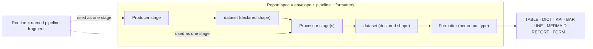
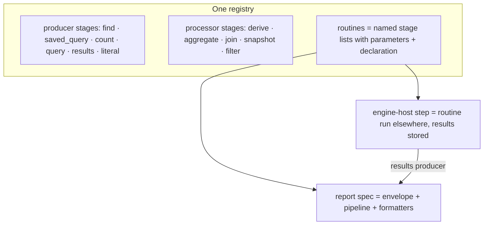

# Report specs as pipelines: producer, processor, formatter

*Design note, 2026-11-05. Status: DRAFT v4, after the RE Architect's second read-only review
(`~/.re-gate/OPINION-REPORT-SPEC-PIPELINE-V3-2026-11-05.md`): completeness replaces a fifth absence word, uncertainty gets its own absence word, the executor contract names its roles and its one call indirection, the pipeline gets a typed home, and the five examples are made honest. v3 folded the owner's five points (uncertainty and silent filtering, several executors, graph and master-detail outputs, a lighter Egeria mapping, worked examples in §10). v2 was revised after the Architect's first review
(`~/.re-gate/OPINION-REPORT-SPEC-PIPELINE-2026-11-05.md`). Supersedes the action half of section 4 of
[report-specs-dashboards-egeria-model.md](report-specs-dashboards-egeria-model.md); sections 1 to 3 of that note (the
as-is model and the live Egeria types), its dashboard layer, its report-run elements and its open point on
`ReportSpec` vs `ReportType` still stand.*

**Vocabulary used here.** A pipeline is made of **stages** (producer, processor, formatter). The word **step** is kept
for what the engine host runs (`GovernanceActionType` request type, `SurveyActionService`), as in the Trellis
extensibility model of 2026-11-03.

## 1. Why the current model stops short

A pyegeria `FormatSet` today has one action with two unrelated execution paths:

- `function` (Dr.Egeria `find_method`): an element query; the result is a list of elements that the per-type pyegeria
  processor flattens into named fields (lifting Egeria's `mermaidGraph` string among them) and that `Format.attributes`
  projects into columns.
- `analytic_function` (`extra_find`): a registered routine; the result is passed through as `{"kind": "json"}` and never
  meets `Format.attributes`. Every KPI, bar or chart tile therefore needs a Python reshaper
  (`curation_coverage_tile` exists only for this), and presentation lives in code.

What the model cannot express, in one example: **a table whose rows come from a find and whose columns include values
computed by an analytic** (glossaries with their term count and definition completeness). Nor can it express a KPI over
a table, a report over an engine-host step's stored results, a join of Egeria and ODS data, or a time series of
anything but the one hard-coded `growth_series`. Inputs are bound three different ways (client by parameter-name
convention, readers by `analytic_binders`, everything else as free kwargs), composition exists in three ad hoc shapes
(`metric_trend`, `AnalyticActionSpec`, inline in `ai_ready_assets`), and `kind="step"` manifests sit in the same
registry but cannot be run from a spec at all.

What is solid and kept: the Trellis `Declaration` and result envelope (result kind, measures with unit / as-of / basis,
confidence, the four absence sentences), registered-name-only resolution, and the Format output types.

## 2. The model in one sentence

**A report spec is its envelope (heading, description, questions, perspectives, family, ...) around a pipeline of stages
plus formatters; a stage is a producer or a processor with a declared input and output shape; a routine is a named,
reusable pipeline fragment; what we have been calling an analytic routine is a producer and one or more processors
bundled into one function.**



*Full-size image: [`07-pipeline-overview.png`](../images/report-specs/07-pipeline-overview.png)*

## 2a. The spec envelope stays

The pipeline replaces only the *action* half of today's `FormatSet`. Everything that identifies, describes and makes a
spec discoverable stays as the envelope around the pipeline, unchanged in meaning: label and heading, description,
`target_type`, `aliases`, `family`, `annotations`, the question spec (example questions and the perspectives they serve),
the preamble, and the dashboard-facing fields (emphasis, detail spec). In Egeria these are the properties and links the
earlier note already placed on the spec element and its `QuestionSpec` / `Question` / `Perspective` neighbours; nothing
in this note moves them. A spec is therefore: **envelope + pipeline + formatters**.

## 3. Producers: how a dataset is produced

A producer originates a dataset. It takes parameters, never a dataset. Types:

| Producer | What it is | Push-down |
|---|---|---|
| `find` | one of the typed Egeria finds, with its existing pyegeria processor as the output shaping (flattening nested JSON into fields; lifting `mermaidGraph` and other representation fields) | as-of time, sequencing property and order, status filter, paging, search string: all Egeria parameters already |
| `saved_query` | an Egeria `SavedQuery` element (`queryURL`, `queryRequestBody`) run as stored; uses the ones that exist, never forces one per spec | whatever the stored query carries |
| `count` | Egeria's native count by search conditions. **Settled live (2026-11-05, platform OpenAPI):** the view services expose `metadata-elements/by-search-conditions/count` and `relationships/by-search-conditions/count`; sum, group-by and distinct do not exist. pyegeria 6.2.21 has no wrapper yet: a small pyegeria item precedes this producer. | the count itself, with criteria |
| `query` | an external query, e.g. SQL against the ODS or another store, through a registered reader with a declared output shape; the successor of `analytic_binders` | the store's own filter / order / limit |
| `results` | stored results read back: survey annotations of an engine-host step, or a `GovernanceMetric`'s `GovernanceResults` | as-of, latest-only, by subject |
| `literal` | a fixed or parameter-supplied dataset (tests, Overview tiles, demos) | none |

Rule: sort, filter, as-of and paging are **pushed into the producer** wherever the source supports them. A processor
sorts or filters only when the producer cannot (`results`, some `query` sources).

There is **no `routine` producer**; that is what stops a routine from hiding a data source. A Trellis library routine
that today reads its own source (`curation_coverage` reading the ODS through a bound reader) is a `query` producer plus a
processor; see §7 for the migration and its gate.

## 4. Processors: how a dataset is processed

A processor takes one or more datasets and yields a dataset. A processor is a standard analytic function with declared
input and output shapes; the same function serves the Portal and Trellis.

| Processor | What it does |
|---|---|
| `derive` | adds or replaces data: columns per row, rows, subtrees, text. May invoke a named producer per row or per batch (the master-detail and enrichment case). Per-row Egeria calls do not scale to a live tile, so a routine declares whether it is **tile-safe** (batch input, or no further reads) or must run as an engine-host step whose output a `results` producer reads back. |
| `aggregate` | count / sum / group-by. A count with criteria is pushed into Egeria (the `count` producer); sum, group-by and distinct are computed locally, since Egeria offers none of them. |
| `join` | two datasets on a key (Egeria elements with ODS rows; two glossaries side by side). The one non-linear stage; it names a second producer **or a routine**, so two pipelines can meet. |
| `snapshot` | re-runs the upstream at each as-of time in a window and stacks the results as a series. Replaces `metric_trend` and the hand-written windowing in `growth_series`. Tile-safe only over `count` or `results`, or when the window has few points: a snapshot over a `find` is N Egeria reads. |
| `filter` / `sort` / `limit` | only where push-down is impossible. |
| representation generation | turns a dataset into the intermediate shape a representation needs, **only for data that did not come with one**. Egeria already returns `mermaidGraph` in the element payload and pyegeria only renders it, so mermaid needs no processor. No source needs this today; kept as a later addition, not a stage. |

## 5. Datasets and value cells: the declared shape IS a Declaration

Every stage declares its output shape. The shape is **the shipped Trellis `Declaration`** (`trellis_analytics.declaration`
0.2.0; pyegeria's `AnalyticDeclaration` is its validated minimum), not a second vocabulary: `TableColumn` rows for the
fields (name, type, unit, absence already live there) plus the result-kind block. Nothing is invented here.

A **value cell** is the runtime pairing of a value with the companions its column's declaration says it carries:

| Companion | Source in the shipped Declaration |
|---|---|
| `state` | the absence vocabulary `ABSENCE_STATES` (`not_measured`, `not_permitted`, `not_applicable`, `measured_nothing`) plus `measured`. `not_permitted` is an explicit refusal (an Egeria 403 on one call) and the one Resource Explorer meets daily. A per-row refusal with a reason (today's live case: a file "cataloged twice in Egeria", the W68 sentence) is `not_measured` plus `reason`, per row, not a result-level state. |
| `completeness` | **replaces the boolean `capped` and the v3 idea of an `unknowable` state** (owner raised silent filtering; Architect: a value exists under it, so it is a companion, not an absence). Three values: `complete` · `lower_bound` (what `capped_field` says today; same meaning, no migration of meaning) · `unknown` (silently filtered, e.g. a zone filter that hides elements without refusing: not even a bound). **Who sets it:** no producer can see a silent filter, so it is *declared on the stage* ("this Egeria read, run as a person, is subject to zone filtering") and the executor sets `unknown` whenever the role input is a person's client and the stage reads Egeria; the daemon's all-zones reads stay `complete`. Rendering: the number with "at least" for `lower_bound`, "incomplete: some items may be hidden from you" for `unknown`; never a bare integer, never zero for either. (The result envelope's own states, `measured` / `nothing_found` / `not_established` / `not_applicable`, stay at the result level; the executor already maps them onto the absence words.) |
| absence sentence | **not carried in the cell.** Declared once per measure (`AbsenceSentences`); looked up from the declaration at render time. |
| confidence `score` | `ConfidenceDeclaration` (form ∈ measured / estimated / inferred / judged / generated, basis, method, score, calibrated) is declared per measure; a cell may carry the score, never a different form. Confidence is about the method. |
| `uncertainty` | **new (owner, 2026-11-05)**: the spread of the value itself, distinct from confidence in the method. Declared per measure with its *form* (`plus_minus` · `low_high` · `band`) and the unit it shares with the value; filled per cell. It has **its own absence word**: a measure that declares uncertainty but a cell that carries none says "spread not estimated", else an absent ± reads as exact. **Never declared on an exact count**: a count's only uncertainty is completeness. Egeria home: with the measure's typed `GovernanceMetric` attributes (annotation `confidenceLevel` is a method word, not a spread). Not in the shipped Declaration today; added to it, not beside it. |
| `unit`, `as_of` | `MeasureDeclaration.unit`, `.as_of` (a field name) |
| `basis` | `MeasureDeclaration.basis` (denominator field + label): a fraction whose denominator matters is exactly the per-cell case |
| `provenance` | the envelope's version + source + run triple, the same triple per cell |

**Release coupling.** The two vocabulary additions (`completeness`, `uncertainty`) land in trellis-analytics and
pyegeria in one release: trellis-analytics 0.3 first, then the pyegeria floor bump with the `AnalyticDeclaration`
minimum in one PR, then 8813 and the Portal re-synced. The safety net exists already: the engine host's
`versionIdentifier` range check and the "none missing" line refuse a step written against 0.3 words on a 0.2 host.

Formatters know the cell shape, so a table shows "not measured" in the cell rather than a blank, a KPI shows its score,
a chart omits unestablished points. Two things the cell model deliberately does not cover: result kinds that are not
measures (`finding`, `proposal`, `list`, `graph`) keep their per-result semantics (severity, decided-by, verdict) in the
Declaration's own block and render as today; and the chat `extents` (fields, rows, token cost, citation) stay declared per
result, because the chat compile reads them there.

A field may also be a **representation field**: a pre-built representation carried in the payload (`mermaidGraph`),
rendered directly by the matching formatter.

Shapes are declared before anything runs, so a spec can be validated: a formatter asking for a field no stage produces is
a load-time refusal, not a blank column at run time.

## 6. Formatters: how a dataset is rendered

`Format(types, attributes)` cannot carry this; one formatter structure per output family, each shaping and rendering one
intermediate shape:

| Intermediate shape | Output types | Formatter structure, roughly |
|---|---|---|
| tabular (rows × fields) | TABLE, DICT, JSON, FORM, MD | columns (= today's `Column`: name, key, format, detail_spec, valid_values), order, labels, value formats, field groups for FORM |
| measure set (one row, cells) | KPI | value field, unit, as-of, state words, subtitle rule |
| series (x, one or more y) | LINE, BAR, PIE, SERIES | axes, series keys, chart kind, title, absence handling |
| tree (nested rows) | REPORT, outline, **MASTER_DETAIL** | section nesting, per-level columns; for master-detail: the master's columns, the detail stage per row, and how the detail shows (expandable row, side panel, drill link) |
| graph (nodes, edges) | **GRAPH** (interactive, as Explorer draws it), MERMAID when generated | node label and type fields, edge label and direction, grouping; only for data that did not arrive with a representation |
| document (sections, text) | MD, REPORT, HTML | preamble, section order, embedded shapes |
| representation field | MERMAID (Egeria's `mermaidGraph`) | which field, fenced-block wrapper; no shaping |

Today's `Column` is the tabular formatter's unit unchanged. Every existing spec whose columns come from the per-type
processor migrates as `find` producer, no processor, tabular formatter; the specs that read `mermaidGraph` migrate as
`find` plus representation field. The migration lists both groups by name so the count is honest.

## 7. Routines and stages: one structure for Portal and Trellis

- **Stages** are the executable leaves: producers and processors, registered functions with declared inputs and output
  shape.
- **Inputs are declared by role**: `egeria_client:<Class>` (the pyegeria client class, e.g. `GlossaryManager`, since
  Resource Explorer's factory `EgeriaClients.of(cls)` is per class and per server; a `find` or `count` producer implies
  it from its type), `reader:<source>` (a shared, configured engine such as the ODS reader, environment-supplied),
  `viewer` (identity words only: user id, admin flag; Resource Explorer's `_reader(request)`, used for cancel and zone
  decisions), `subject` (the resource in view), `param`. A role names **what** is needed, never **who** supplies it or
  how it is built: a stage never takes a credential and never a client it did not declare. The executor supplies each
  role: in Resource Explorer the Egeria client is the person's wrapped client (the F60 seam); in the Portal it is the
  signed-in user's client; in plain pyegeria it is the caller's. This replaces parameter-name introspection and
  `analytic_binders` without the binder coming back under a new name.
- **Admission is part of the contract.** As `survey_step_host.attach()` admits a step to a resource type, the executor
  refuses a spec whose routine is not admitted for the subject's `resource_types`, with the existing "not installed"
  words.
- **One call indirection.** Every call a stage makes to Egeria goes through the contract's `call(role_input, method,
  **params)`, the F60 `_GuardedCall` generalized. Three hard things live there and nowhere else: sync/async adaptation
  (the Portal awaits the `_async_*` twin, Resource Explorer runs sync pyegeria in a thread, plain pyegeria is sync; a
  leaf written once never chooses; this is also where the pending pyegeria nest_asyncio removal lands); the token-death
  rule (a dead person token **aborts the run** with the environment's own words, Resource Explorer's F58 401 body, and is
  never a cell state, while an Egeria 403 on one call **is** that row's or cell's `not_permitted`); and pre-run refusal
  (`CallerTokenExpired` from role supply refuses before any stage runs, same words).
- **Pipelines are read-only by contract.** No stage has a side effect (`results` is a read), so an executor may re-run
  freely, which is what `snapshot` relies on.
- **A routine** is a named, reusable pipeline fragment: an ordered list of stages, its own parameters mapped onto the
  stages' parameters, and a declaration of what comes out. A report spec includes a routine as one stage; a routine may
  include another.
- **A report spec** is envelope + pipeline + formatters.
- **A pipeline is data; it has several executors.** The same spec must run in plain pyegeria (scripts, the CLI, Dr.Egeria, Jupyter: synchronous, mints its own token), in the Portal (FastAPI, async, the signed-in user's token, `exec_report_spec`'s successor), and in Resource Explorer (the person's wrapped client, per-request readers, its own session rules), while the engine host runs routines as steps. What is common is the **executor contract**: resolve each stage by registered name, supply its role inputs from the environment, run the stages in order, hand the final dataset and the spec's formatter to the renderer, and surface the envelope states the same way. Each environment implements that contract once; no spec knows which executor it is under.
- **Reusable analytic functions are processors** (and the producers): the registered leaf functions. A routine is the reusable *composition* of them. Both are what the registry holds and what a spec names.
- **An engine-host step** is a routine run elsewhere, whose output is stored as annotations and read back by a `results`
  producer. Same registry, same declaration. The library's `kind="step"` entries (nine on 8813 today) already are this.

Migration does not require splitting on day one: an existing routine registers as a single opaque stage with its
declaration (which is what every entry is today) and is split into producer + processor as each is touched. The output
shape is declared either way, so formatters work from the first day.

What today's routines are, in these terms, and where each belongs:

| Routine | In pipeline terms | Tile-safe as a processor? |
|---|---|---|
| `count_elements`, `counts_by_type` | `count` producer | yes; one call per type counted |
| `curation_coverage` | `query` (ODS) + `aggregate` | yes |
| `ai_ready_assets` | `find` + `derive` (follow a relationship, per row) + `filter` | **no**: engine-host step + `results` |
| `metric_trend`, `growth_series` | `snapshot` over any of the above | over `count`/`results` yes; over `find` only for small N |
| `AnalyticActionSpec` (fetch + analytic) | producer + one processor | per its parts |

**Binders retire only in the PR that proves the replacement live**: the `analytic_binders` mechanism is today the only
way the Portal runs `curation_coverage` against the ODS (LS2 step 4, proven live 2026-11-05 17:17Z). Order and gate in
§9.5.



*Full-size image: [`08-registry-layers.png`](../images/report-specs/08-registry-layers.png)*

## 8. The Egeria mapping, revisited

Egeria already models this shape, so the mapping follows Egeria's lead rather than adding action properties. Egeria
types are single-inheritance, so **the spec is not itself a `Process`**.

**How heavy to go (owner, 2026-11-05: `AnalyticalActionProcess` is too heavy for executing routines and pipelines).**
Agreed: execution never goes through Egeria; the executors run from the registry. Egeria holds the catalog view, and
there are two levels of it:

- **Light (the default).** The spec element carries its pipeline as structured data (the ordered stage list with
  parameters), exactly as the JSON the executors read, **in a declared, typed property of the `ReportSpec` subtype**
  (JSON text in a typed string property is acceptable; a map of maps in `additionalProperties` is the earlier note's own
  forbidden pattern and is not). `ReportType` has no such property, which is what settles §9.1 toward the subtype. The
  spec links to the *reusable* things it names: each routine and
  each analytic function it uses is a plain `Process` element (not a governance action process) with `ImplementedBy`
  to its implementation, and each declared dataset shape is a `DataStructure`. That gives discovery ("which specs use
  `curation_coverage`?", "which produce this shape?") with a handful of elements per spec and nothing to keep in step
  with the engine host. The links are `ResourceList` with `resourceUse` = "stage N". **Promotion is a retype in
  place**: `AnalyticalActionProcess` ⊂ `GovernanceActionProcess` ⊂ `Process`, so a plain `Process` becomes an
  engine-host one when deployed with the same GUID and its links kept; that is why the light form costs nothing later.
- **Full lineage (opt-in).** For a spec worth drawing, the pipeline is also materialized as `Process` stages under
  `ProcessHierarchy` with `DataFlow` between them. Explorer then draws it with no new code. This is a projection of the
  light form, generated, never hand-maintained: every generated element is **marked** (a classification or a property
  naming the spec and its version) so nobody curates it by hand, and regeneration is **idempotent by qualifiedName**
  (update, never delete-and-create: deletion is a shared write and loses lineage history).

`AnalyticalActionProcess` and `SurveyingActionProcess` are reserved for what the engine host actually runs (a routine
deployed as a step), as the 2026-11-03 model has them. In the table, "pipeline" and "stage" rows apply to the full
lineage form; the light form has only the spec, the routine/function `Process` elements, and the shapes. Every type and
relationship named below exists in the live 6.3 type list (checked 2026-11-05 against the platform's `/api/types`).

| Our term | Egeria element | Relationship |
|---|---|---|
| report spec (envelope + pipeline) | `ReportSpec` ⊂ `ReportType`; typed property `pipeline` = the ordered stage list (§9.1) | `ResourceList` (`resourceUse` = "stage N") to the routines / functions it names (the earlier note's `ReportSpecAnalytic`, one per named routine, `defaultParameters` kept, `binders` gone) |
| pipeline (full lineage form only) | one `Process` | `ProcessHierarchy` to its stages; `DataFlow` orders them |
| routine, analytic function (reusable) | plain `Process` | `ImplementedBy` → implementation (`EmbeddedProcess` in-process); referenced from the spec; promoted to `AnalyticalActionProcess` only when deployed to the engine host |
| stage (full lineage form only) | sub-`Process` under `ProcessHierarchy` | `ImplementedBy` → the registered leaf function; `DataFlow` between stages |
| engine-host step | `SurveyingActionProcess`, with `GovernanceActionType` as its request type | `ImplementedBy` → `SurveyActionService` (as the 2026-11-03 model has it) |
| dataset shape | `DataStructure` with `MemberDataField` (`DataField`: `dataType`, `units`) | `DataDescription` from the stage |
| cell companions | **declared, not per element**: typed properties on the `DataField` where Egeria has them (`units`, `dataType`) and on the `GovernanceMetric` the measure already is (as-of field, basis, capped; the 2026-11-03 §5.2 "typed GovernanceMetric attributes" ask). A classification is the fallback if the leads refuse typed attributes. Never extra `MemberDataField`s: they would look like data columns to every consumer. | |
| `DataValueSpecification` | **not used by this model.** The OSI note (2026-11-03) names it as the export carrier for a measure's value semantics; one carrier each, no overlap. | |
| formatter | `DisplayDataContainer` / `DisplayDataField` | from the spec |
| `saved_query` producer | `SavedQuery` | `DataSetContent` |
| `results` producer | `SurveyReport` annotations / `GovernanceResults` | `GovernanceResults` |
| report run | `Report` ⊂ `DataSet` with `ReportInstanceOf` / `ReportRunOf` as in the earlier note | |

Explorer's existing lineage rendering then draws a report spec with no new code.

## 9. Open points, with the Architect's answers folded in

1. **`ReportType` with properties vs `ReportSpec` subtype.** **Settled toward the subtype** (Architect, v3 review):
   the `pipeline` needs a declared typed property, which `ReportType` does not have, so the subtype is needed for the
   pipeline alone, whatever the leads say about the four envelope strings (`targetType`, `aliases`, `outputTypes`,
   `includePreamble`). Retyped in place, GUIDs and `ReportType::<label>` qualified names kept. **DECIDED (owner,
   2026-11-05: "Confirm subtype").** The ask to the Egeria leads is therefore one new entity type, `ReportSpec` ⊂
   `ReportType`, with a typed `pipeline` property plus the four envelope strings.
2. **Cell companions in Egeria.** Settled as in §8: typed properties on `DataField` and `GovernanceMetric`;
   classification as fallback; never extra member fields.
3. **Native aggregation.** **Settled live**: count by search conditions for elements and relationships, nothing else.
   pyegeria wrapper is a prerequisite item.
4. **Pipeline shape.** Settled: flat ordered list; `join` may name a second producer or a routine.
5. **Trellis library refactor, order and gate.** Gate = the live curation-coverage tile on 8813 and the Portal.
   (a) readers (`ods`, `catalogue_scope` in `trellis-analytics-re`) gain a declared shape without moving; (b) the tile
   runs as `query` + `aggregate` under the Portal executor with the binder still present as fallback, and a test proves
   the two paths give byte-identical tile JSON (baseline: today's live answer with its 17:17Z provenance line); (c) Resource
   Explorer runs the same pipeline for its own tile; (d) binder removed in its own PR. Each step a read-back; none
   touches Egeria or 5442 writes.
6. **Compact-command generator.** `find_method` → one producer stage; `extra_find` → producer + processor;
   `base_report_formats.py` regenerated once per generator change. The generated spec carries the declared output shape
   even for the one-stage case (today's `Column` list is it), and the generator refuses a spec whose formatter names a
   field no stage declares (the attribute-consumption audit in the dr-egeria-command-sync skill is the model).
7. **Delivery order.** (a) declared shapes + formatters from declarations: deletes `curation_coverage_tile` and every
   reshaper with no spec change, provable today on 8813's tile; (a′) the stage/step rename and the §5 vocabulary
   alignment, before anything bakes words into registries or generators; (b) inputs by role; (c) `find` as a producer
   stage and the routine split, last.

## 10. Worked examples (owner's request, 2026-11-05)

Five specs in the pipeline shape, each with how it runs and how it sits in Egeria (light form). The notation is the
intended spec JSON, abbreviated; field lists are the declared shapes.

### 10.1 A simple spec: `Glossaries` (today: find + columns)

Today: `action.function = GlossaryManager.find_glossaries`, `required_params = [search_string]`, `Format(ALL,
GLOSSARY_COLUMNS)`.

```yaml
label: Glossaries                      # envelope unchanged: heading, description, family Glossary Manager, annotations
target_type: Glossary
pipeline:
  - stage: producer/find
    type: Glossary                     # the typed find and its pyegeria processor
    params: {search_string: $search_string, as_of: $as_of, page_size: $page_size}   # push-down
    out: GlossaryRow[display_name, qualified_name, guid, description, language, usage, mermaidGraph]
formatters:
  TABLE|DICT|MD|FORM: {columns: GLOSSARY_COLUMNS}        # today's Column list, unchanged
  MERMAID: {field: mermaidGraph}
```
Runs identically in pyegeria, the Portal and RE. Egeria: one `ReportSpec` element with `pipeline` as a property, one
`DataStructure` for `GlossaryRow`. No routine, no process element. This is the mechanical migration of every find spec.

### 10.2 Master-detail: `Glossary-With-Terms`

```yaml
label: Glossary-With-Terms
target_type: Glossary
pipeline:
  - stage: producer/find
    type: Glossary
    params: {search_string: $search_string}
    out: GlossaryRow[...]
  - stage: processor/derive
    per: row                            # master-detail: one detail dataset per master row
    producer: find
    type: GlossaryTerm
    params: {glossary_guid: $row.guid, page_size: 50}
    into: terms                         # a dataset-valued column
    out: GlossaryRow[..., terms: TermRow[display_name, qualified_name, status, summary]]
formatters:
  MASTER_DETAIL: {master: GLOSSARY_COLUMNS, detail: terms, detail_columns: TERM_COLUMNS, show: expandable}
  REPORT: {sections: [GlossaryRow], nested: terms}
  TABLE: {columns: GLOSSARY_COLUMNS + [terms.count]}        # terms.count: cell<int>{completeness} — see below
```
The per-row find is N Egeria calls, so the derive is marked tile-safe only under a page cap; the Portal runs it on
demand from a detail click, not in a dashboard tile. `terms.count` is the number of rows fetched under `page_size: 50`,
so it is `cell<int>{completeness: lower_bound}` whenever the page came back full (Egeria's paging contract: a short page
is not the last page, only an empty one is). Not a plain int. Egeria: `ReportSpec`, two `DataStructure`s (`GlossaryRow`,
`TermRow`), the nested shape as a `MemberDataField` of type `TermRow`.

### 10.3 With an analytic function: `Glossary-Term-Counts`

The example that the current model cannot express: rows from a find, a column from an analytic.

```yaml
label: Glossary-Term-Counts
target_type: Glossary
pipeline:
  - stage: producer/find
    type: Glossary
    params: {search_string: $search_string}
    out: GlossaryRow[...]
  - stage: processor/derive
    per: row                             # NOT tile-safe as written: one native count per glossary (see below)
    function: count_elements            # a reusable analytic function = a processor-side use of the count producer
    params: {type_name: GlossaryTerm, anchor_guid: $row.guid}   # anchor condition on by-search-conditions/count: UNVERIFIED
    into: term_count
    out: GlossaryRow[..., term_count: cell<int>{state, completeness, as_of}]
  - stage: processor/derive
    per: batch
    function: term_definition_completeness
    params: {glossary_guid: $row.guid}
    into: completeness
    out: GlossaryRow[..., term_count, completeness_pct: cell<fraction>{state, basis, score, uncertainty}]
formatters:
  TABLE: {columns: [display_name, term_count, completeness_pct]}
  KPI:   {aggregate: {sum: term_count}, label: "Terms in matching glossaries"}     # a KPI over the same table
  BAR:   {x: display_name, y: term_count}
```
**Honesty.** The live count endpoint takes one search condition per call and pyegeria has no batched count, so this
derive is N native counts: tile-safe only for a small glossary list under a page cap; for the whole catalog it is an
engine-host step whose counts a `results` producer reads back. Whether `by-search-conditions/count` accepts an
Anchors-classification condition is unverified and marked so. `term_count` is a value cell: the stage declares that it
reads Egeria as a person, so the executor sets `completeness: unknown` when a zone filter may hide terms from this
viewer, and the table shows the number with "incomplete" rather than a bare integer. `completeness_pct` (the measure)
is distinct from the `completeness` companion (the vocabulary word), hence the name. Egeria: `ReportSpec` linking to two reusable `Process` elements
(`count_elements`, `term_definition_completeness`), each `ImplementedBy` its function; the shape's `term_count` and
`completeness` fields are `DataField`s whose measure semantics (unit, basis, capped, uncertainty form) sit on the
`GovernanceMetric` each measure already is.

### 10.4 A spec used by a local dashboard: `Trellis - Curation Coverage` on a Portal sheet

Today: `analytic_function = curation_coverage_tile` (a Python reshaper over `curation_coverage`, which reads the ODS
through an `analytic_binders` reader). After:

```yaml
label: Trellis - Curation Coverage
target_type: Database
pipeline:
  - stage: producer/query
    reader: ods                          # role input `reader:ods`; the executor supplies it (Portal: the configured ODS; RE: per request)
    query: curation_record_by_resource
    params: {resource_type: database}
    out: CurationRow[resource_slug, state, blocked_reason, decided_at]
  - stage: processor/aggregate
    function: curation_coverage          # the reusable analytic function, now a processor over rows; it IS the grouping
    out: Coverage[published: cell<int>, not_yet_published: cell<int>, blocked: cell<int>]{state, reason, provenance}
formatters:
  KPI: {fields: [published, not_yet_published, blocked], subtitle: state}
  BAR: {x: [Published, Not yet published], y: [published, not_yet_published]}
```
`curation_coverage_tile` is deleted: the KPI and BAR formatters do what it did. The tile's honest states today all
survive as cell companions, not formatter text: `measured_nothing` with its reason ("30 schemas known, no choice made"),
and `not_applicable` with its reason when the subject is a repository (`resource_type: repository`), which the tile
already renders; the provenance line ("from trellis-analytics 0.2.0 · curation coverage · as of …") is the `provenance`
companion. The dashboard sheet is unchanged in
shape: `Placement(ref: "Trellis - Curation Coverage", span: 1, emphasis: kpi, perspectives: [...])` on a `DashboardSheet`;
only what the ref points at changed. Egeria: `ReportSpec` → `Process` `curation_coverage`; the `Dashboard` and
`DashboardPlacement` elements of the earlier note's dashboard layer; the ODS reader is a `query` producer with a
declared `CurationRow` shape, which is what retires the binder (§9.5 gate).

### 10.5 A spec used by Trellis: `Data-Lake-File-Profiles` over engine-host results

The engine host profiles the data lake's files as a step (`ResourceExplorerSurvey::profile-data-files`); the spec never
re-runs it, it reads what the step stored.

```yaml
label: Data-Lake-File-Profiles
target_type: FileSystem
pipeline:
  - stage: producer/results
    step: profile-data-files              # the engine-host step, by request type
    subject: $resource                    # role input `subject`: RE supplies the filesystem in view
    latest: true
    out: FileProfile[path, format, rows: cell<int>{state, reason, completeness}, columns: cell<int>, profiled_at, run_id]
  - stage: processor/aggregate
    group_by: format
    out: FormatSummary[format, files: cell<int>, files_refused: cell<int>, rows: cell<int>{state, completeness}]
formatters:
  TABLE: {columns: [format, files, rows]}
  KPI:   {fields: [files], label: "Files profiled"}
  MASTER_DETAIL: {master: FormatSummary, detail: FileProfile by format}
```
**Today's live case, in this shape.** On coco_data_lake the step refused all 16 files per row ("cataloged twice in
Egeria — by filescatnpa (…) and by filegovernanceengine (…) · Resource Explorer will not choose; reconcile on Curate",
the W68 sentence). Each is a `FileProfile` row with `rows: cell{state: not_measured, reason: <that sentence>}`, a
per-row refusal with a reason, not a result-level state; `FormatSummary` counts them in `files_refused`, never folded
into `files`. Under Resource Explorer the `results` producer reads annotations as the person (the F60 seam): an Egeria
403 on one row is `state: not_permitted` for that row, and the daemon's stored annotations in a creator-only Project are
`not_permitted` for everyone but the creator (true today). A zone that hides some files silently gives
`completeness: unknown` on the totals, set by the executor from the stage's declaration. A dead person token does not
appear in any cell: it aborts the run with the F58 401 body. Egeria: the step is a `SurveyingActionProcess` with its `GovernanceActionType` request type and
`SurveyActionService` implementation, as the 2026-11-03 model has it; the spec links to it as the source of its
`results`; the `FileProfile` shape is the step's declared annotation shape, so the `DataStructure` is shared between the
step's declaration and the spec.

### What the five show
10.1 is the mechanical migration and proves nothing new. 10.2 and 10.3 are the two things the current model cannot
say, and both are honest about paging and about N calls. 10.4 is the same spec under two executors with the reshaper
gone and the tile's existing states kept as companions. 10.5 is the engine host and the Portal meeting through
`results` rather than through re-execution, with per-row `not_measured` + reason, `not_permitted` and
`completeness: unknown` each doing real work, and token death kept out of the cells.
