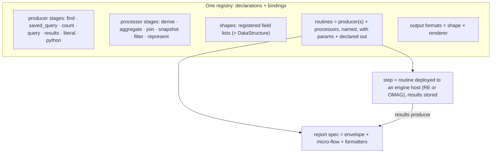

# Report specs as micro-flows: producer, processor, formatter

*Design note, 2026-11-05, revised 2026-11-06. Status: DRAFT v5.3, after the RE Architect's read-back of v5.2
(`~/.re-gate/OPINION-REPORT-SPEC-PIPELINE-V52-2026-11-06.md`; its type facts re-verified live by the coordinator, one
of them corrected: `DisplayDataField.inputField` is a boolean). v5.3 fixes the §8 mapping where it did not hold against
the 6.3 types: a routine stays a plain `Process` (the `*ActionProcess` types are governance definitions, not
processes); `GovernanceResults` cannot point at a field; layouts hang off a `DisplayDataSchemaType` through `Schema` and
`AttributeForSchema`; a display column has no property that can name its field (a new open question); every shape is
anchored to a per-source shapes collection. It also makes a processor's output additive, stops 10.3 from re-declaring
shared fields, scopes the JSON rule to the in-method path, recommends `Dashboard` ⊂ `DataSet`, adds §8e, a summary table of every Egeria proposal and mapping with its alternatives, and adds 10.8, the Egeria Overview rebuilt as one sheet against the code as reviewed on 2026-11-06, with the Trellis perspectives and §9.18–§9.22. v5.2 followed the
owner's review of v5.1 and a
review against pyegeria's own report-spec documentation, the Dr.Egeria Report-family commands and the Egeria Advisor
report-spec builder (2026-11-06). v5.2 decides: fields are shared between shapes rather than copied; field names carry
no dots (dots are paths); one executor, in pyegeria, serves every environment and both invocation paths (inside a
pyegeria method and from `run_report`); a caller's parameter value is never silently overridden; companions get their
Egeria home in a new `MeasurementSpecification` ⊂ `DataValueSpecification`, linked by `DataValueDefinition`;
allowed-value lists are Egeria valid values checked by the runtimes, with no per-element relationship; the chart
library is Vega-Lite; the dashboard types are new Egeria types inside this design; the Advisor-era `Create Report Spec`
markdown format is replaced. It also places pyegeria's materialization layer, fixes the output-format names against
the ones that exist, and closes the column-order question. v5.1 followed the RE Architect's third review
(`~/.re-gate/OPINION-REPORT-SPEC-PIPELINE-V5-2026-11-06.md`, type facts re-verified by the coordinator against the live
6.3 types): four §8c mappings corrected to types that exist, the routine grammar widened to several producers, value
semantics moved to `DataValueSpecification`, the F60 guard placed on the role input, `completeness: unknown` made the
default under a person's client, and six §10 inconsistencies fixed. v5 followed the owner's review of v4.1 (sixteen
points, 2026-11-06) and renames the pipeline a **micro-flow**, states the grammar of routines, separates a function's
declaration from its per-environment bindings, builds the micro-flow at load time, splits formatters into shape ×
renderer, declares every field once (the `GLOSSARY_COLUMNS` double specification is gone), maps fields to `DataField`,
proposes the Egeria extensions the companions need, treats Resource Explorer as an engine host, and settles Dr.Egeria
and JSON as two spellings of one canonical spec. v4 followed the RE Architect's second review
(`~/.re-gate/OPINION-REPORT-SPEC-PIPELINE-V3-2026-11-05.md`), v3 the owner's five points, v2 the Architect's first
review (`~/.re-gate/OPINION-REPORT-SPEC-PIPELINE-2026-11-05.md`). Supersedes the action half of section 4 of
[report-specs-dashboards-egeria-model.md](report-specs-dashboards-egeria-model.md); sections 1 to 3 of that note (the
as-is model and the live Egeria types), its dashboard layer and its report-run elements still stand. The Egeria
mapping in §8 is a proposal for review with the Egeria team; the examples in §10 are re-cut at each revision.*

**Vocabulary used here.**

- A **micro-flow** is a declared, ordered sequence of **stages** that runs entirely within one thread of one process,
  with nothing persisted between stages. The word replaces "pipeline", which suggests something heavy that spans
  process boundaries; a micro-flow never does. The JSON key is `microflow`.
- A **stage** is a producer, a processor or a formatter: the executable leaf.
- A **routine** is a named, reusable micro-flow fragment: one or more producers followed by processors, with its own
  parameters and declared output. What we have called an analytic routine is exactly this.
- A **step** is a routine deployed to an **engine host**, which runs it on a schedule or on demand and stores its
  results as annotations. Resource Explorer's survey step host is an engine host in Egeria's terms, equivalent to the
  Java OMAG Engine Host; nothing in this note is specific to either.

## 1. Why the current model stops short

A pyegeria `FormatSet` today has one action with two unrelated execution paths:

- `function` (Dr.Egeria `find_method`): an element query; the result is a list of elements that the per-type pyegeria
  processor flattens into named fields (lifting Egeria's `mermaidGraph` string among them) and that `Format.attributes`
  projects into columns.
- `analytic_function` (`extra_find`): a registered routine; the result is passed through as `{"kind": "json"}` and never
  meets `Format.attributes`. Every KPI, bar or chart tile therefore needs a Python reshaper
  (`curation_coverage_tile` exists only for this), and presentation lives in code.

What the model cannot express, in one example: **a table whose rows come from a find and whose columns include values
computed by an analytic** (glossaries with their term count and definition completeness). Nor can it express a KPI over
a table, a report over a step's stored results, a join of Egeria and ODS data, or a time series of anything but the one
hard-coded `growth_series`. Inputs are bound three different ways (client by parameter-name convention, readers by
`analytic_binders`, everything else as free kwargs), composition exists in three ad hoc shapes (`metric_trend`,
`AnalyticActionSpec`, inline in `ai_ready_assets`), and `kind="step"` manifests sit in the same registry but cannot be
run from a spec at all. Column sets are Python constants (`GLOSSARY_COLUMNS = COMMON_COLUMNS + [...]`) that only a
Python process can expand, so no other environment can know a spec's shape without importing pyegeria.

What is solid and kept: the Trellis `Declaration` and result envelope (result kind, measures with unit / as-of / basis,
confidence, the four absence sentences), registered-name-only resolution, and the output type names users already know.

## 2. The model in one sentence, and its grammar

**A report spec is its envelope (heading, description, questions, perspectives, family, ...) around a micro-flow of
stages plus formatters; a stage is a producer or a processor with a declared input and output shape; a routine is a
named, reusable micro-flow fragment of one or more producers and their processors; a formatter renders the final
shape through a chosen renderer.**

```
spec       := envelope  microflow  formatters
microflow  := (routine | producer) processor*
routine    := producer+ processor*           # named; own params; declared out
producer   := find | saved_query | count | query | results | literal | python
processor  := derive | aggregate | join | snapshot | filter | represent
stage      := producer | processor | routine  # what a microflow entry names
formatter  := output_format -> (shape, renderer, options)
```

Both levels are reusable: the leaf functions by name, and the routine as a declared composition of them. A spec may
name a routine as its first stage, or a producer, and follow either with further processors. A routine may have
**several producers** (the Portal's overview routines union several counts over different criteria; the Architect's
census of the 37 live registry entries found most of the 24 Portal routines are of this kind): when it does, each
processor names which input(s) it reads (`in`), and `join` is kept for keyed merges of two datasets. A routine may
name another routine only as a `join` input, so no routine hides a data source.


*Full-size image: [`07-pipeline-overview.png`](../images/report-specs/07-pipeline-overview.png)*

## 2a. The spec envelope stays

The micro-flow replaces only the *action* half of today's `FormatSet`. Everything that identifies, describes and makes a
spec discoverable stays as the envelope around it, unchanged in meaning: label and heading, description,
`target_type_name` (today's `FormatSet.target_type`), `aliases`, `family`, `annotations`, the question spec (example questions and the perspectives they serve),
the preamble, and the dashboard-facing fields (emphasis, detail spec). In Egeria these are the properties and links the
earlier note already placed on the spec element and its `QuestionSpec` folder (a `CollectionFolder` by naming
convention, not a type) / `Question` / `Perspective` neighbours; nothing
in this note moves them. A spec is therefore: **envelope + micro-flow + formatters**.

**Questions and perspectives already live in Egeria.** Since 2026-05-18 Egeria is the only system of record for
question specs: 74 `ReportType` elements, each with its `QuestionSpec` folder of shared `Question` terms scoped by
`Perspective`s, loaded at startup by `load_egeria_report_specs` (TTL cache, default one day) and merged into the
file-based spec by label. v5.2 keeps that and adds two rules. (1) Every authoring path links to the existing
`Question` and `Perspective` elements and never writes its own copy; the Advisor builder today writes perspectives and
questions into its own catalog file, and stops doing so (§9.13). (2) Once Egeria also holds the micro-flow (§8), the
precedence that today reads "the file wins, Egeria provides only the questions" becomes: **the registry's canonical
JSON wins, and the Egeria element is its projection**; the loader refuses, with both sources named, a label whose
Egeria micro-flow differs from the registry's, instead of picking one. `target_type`, today in the `ReportType`'s
`additionalProperties`, moves to the typed `targetTypeName` property when the element is retyped to `ReportSpec`; the
loader's type filter must find the retyped elements (a subtype query, checked in the migration's read-back).
**Naming (Egeria team, 2026-11-07):** the property is `targetTypeName`, not `targetType`, so it is not confused with
the other kinds of target in Egeria (action targets, catalog targets, survey targets). The canonical JSON follows it as
`target_type_name`. pyegeria's `FormatSet.target_type` keeps its name until the executor moves to the canonical form;
the loader maps `target_type` ↔ `target_type_name` in both directions, and a JSON carrying both with different values is
refused at load.

## 2b. Declarations and bindings: how a function is specified so it is shareable

A producer, processor or routine is specified in two parts, and the split is what makes it portable.

**The declaration is data.** It is the same whatever environment runs it, and it is all a spec, a validator, a catalog
or Dr.Egeria ever needs to know:

| Declaration field | Meaning |
|---|---|
| `name`, `kind` | registered name; `producer` / `processor` / `routine` (and `step` for a routine deployed to an engine host) |
| `description` | one line, as today's `AnalyticFunctionSpec.description` |
| `version`, `source` | the shipped `Declaration`'s own provenance pair |
| `family`, `tags` | the same `family` word and meaning as a spec's; free tags for authoring tools (today's manifest fields) |
| `generic`, `binding_note` | `generic: true` when what the function counts is itself a parameter (`count_elements(type_name=…)`); `false` when the vocabulary is fixed in the body (`governed_coverage`), with the note saying so. Carried over from `AnalyticFunctionSpec` unchanged |
| `result_kind` | the shipped `Declaration`'s kind: `measure`, `series`, `distribution`, `list`, `graph`, `finding`, `proposal`, `table`; with its `measures` block where the kind needs one |
| `annotation_type` | for a `step`: the annotation type its results are stored as, which is what a `results` producer reads |
| `inputs` | role inputs (§7): `egeria_client:<Class>`, `reader:<source>`, `viewer`, `subject`; never a credential |
| `params` | name, type, `default` or `required`, `category` (`content` · `shape` · `performance`, below); a routine's params map onto its stages' params |
| `constants` | values the stage always runs with (`metadata_element_type: "Agreement"`); **not parameters**, never exposed to a caller (below) |
| `in` | for processors: the shape(s) consumed, by registered shape name or by field list |
| `out` | the shape produced: a registered shape name, or an inline field list (§5) |
| `pushdown` | for producers: which of `sort`, `filter`, `as_of`, `paging`, `group_by`, `sum`, `avg`, `count`, `distinct` the source performs itself |
| `tile_safe` | `true` / `false` with `reason` (§7) |
| `admission` | `resource_types` it may run against; `test_only` keeps a producer out of every live tile |

**A binding names an implementation for one runtime.** A declaration carries one or more:

| Binding | Form | Honoured by |
|---|---|---|
| `python` | `pkg.module:function` (today's dotted path for binders, generalized) | plain pyegeria, the Portal, Resource Explorer: all three are Python, so one binding usually serves all |
| `egeria_query` | the `qualifiedName` of a `SavedQuery` | any executor with an Egeria client in the role input |
| `sql` | a named query on a `reader:<source>` | any executor whose environment supplies that reader |
| `step` | a `GovernanceActionType` request type | an engine host; a spec reaches it only through a `results` producer |

The rule: **an executor honours a binding it can, and refuses, with the stated reason, a stage whose declaration has
no binding it can honour.** It never guesses. A `python` binding is loaded by the registry's existing name-only
resolution; nothing resolves an arbitrary string from a spec. Concretely, pyegeria's ISSUE-173 rule stands: **a spec
names functions and routines only by registered name**; the dotted path lives in the registry entry's binding (code, not
spec data), and the module-prefix allow-list (`PYEGERIA_ANALYTIC_MODULE_PREFIXES`) applies to registry entries only.

**Parameters (owner, 2026-11-06).** Today pyegeria has two incompatible kinds: a find action's `spec_params` are pins
(a caller's value for the same key is silently overridden) and an analytic action's `analytic_spec_params` are
defaults; on top of that the find path has a `required_params` / `optional_params` whitelist and the analytic path has
none. v5.2 has one kind, with four rules:

1. **A caller's value always wins.** A parameter has a `default` or is `required`; nothing is overridden silently.
2. **What the spec must hold is not a parameter.** It is a stage `constant` (today's pin, e.g. the `metadata_element_type`
   a generated `Agreement` spec fixes). A caller who passes a constant's name is **refused** with words naming it.
3. **A required parameter without a value refuses the run** before any stage runs, naming the parameter.
4. **An unknown parameter is refused** with the list of declared ones, replacing today's reliance on Python's own
   `TypeError` for analytic functions and the silent drop elsewhere.

Each parameter carries one of the Egeria Advisor builder's three **categories**, adopted as a declared field: `content`
(what the report is about: `search_string`, a subject GUID, a status filter; front and centre in a run dialog),
`shape` (how the result is organized: sort, depth; a "configuration" panel) and `performance` (`page_size`,
`start_from`; an "advanced" panel). `content` and `shape` are part of a run's identity and `performance` is not, so two
runs differing only in `performance` values are comparable and a cache may serve one for the other. `find_*` producers
take `search_string` (substring / regex), `get_*` producers take `filter_string` (exact value); the preamble shows
whichever the run used, as today.

**The guard travels with the role input, not with the stage.** The one call indirection of §7 is a property of the
`egeria_client:<Class>` object the executor supplies (F60's wrapped person client is exactly this), so a `derive`'s
per-row producer, an `egeria_query` binding and a `results` read all pass through it without the executor knowing the
stage structure, and a stage that received the object cannot bypass it. `sql` bindings carry no Egeria token and are
outside it; `step` bindings never run inside a micro-flow (only `results` reads their output, as the person).

In Egeria (§8) the declaration is the `Process` element, its declaration JSON in the typed `formula` / `formulaType`
pair, and each binding is one `ImplementedBy` link (`role` = the binding kind) to the implementation element, so "where
can this run?" is a catalog question. A `step` binding is the one exception in direction: the deployment's
`GovernanceActionType`, a governance definition, is `ImplementedBy` the routine's `Process` (§8).

## 2c. Building the micro-flow: at load time, not at run time

A spec is **resolved when it is loaded**, which happens at startup, on `refresh_specs`, when an archive is loaded, and
when Dr.Egeria's `Create Report Spec` is processed. Resolution:

1. each stage name and routine name is looked up in the registry; a routine is expanded in place to its stages;
2. every `$param` is matched to a declared spec parameter or a routine parameter, with a type; no parameter shares a
   name with a stage constant; every `$row.x` and every dotted reference (`rows.state`) resolves to a declared field
   and companion (field names themselves carry no dots, §5);
3. each stage's `in` is checked against the previous stage's resulting shape (by field name and type), and `derive` /
   `aggregate` field references against the row shape they read. **A stage's resulting shape (v5.3):** a producer's is
   its `out`; a `derive`'s is its input shape **plus** the fields its `out` lists (additive: `out` names only what it
   adds, and replacing a field means declaring a new name); a `filter`, `sort` or `limit` passes its input shape
   through; an `aggregate`, `join`, `snapshot` or `represent` declares its **full** shape in `out`;
4. every formatter's column, field, axis and key is checked against the final `out`; an output format name is checked
   against the (shape, renderer) registry and the final shape must be the one that renderer takes; every column format
   option (`bulleted-list`, …) is one the renderer declares (§6), and every state set a field names exists and only
   narrows the shared vocabulary (§5);
5. role inputs are listed, with **which environment supplies each** (the 401-versus-403 classifier and its words are
   per environment: Resource Explorer has `is_person_token_refused`, the Portal has none yet, plain pyegeria raises),
   so an executor can refuse before any stage runs (`CallerTokenExpired`, no such reader) in its own words;
6. admission and `tile_safe` are recorded, so a dashboard refuses to place a non-tile-safe spec as a live tile; a
   stage may be tile-safe **under a cap** (`tile_safe: {"cap": {"rows": 25}}`), in which case the sheet refuses the
   placement only when the cap is exceeded at run time and says so in the tile;
7. **which pyegeria methods may seed the spec** is recorded (§7, the in-method path): a method may seed a spec whose
   first producer it can stand in for, which means the method's declared output shape is that producer's `out`.

A spec that fails any check is **marked unrunnable with the failing check's words** and still listed, so a user sees
"spec X: formatter TABLE names field `term_count` that no stage produces" rather than a blank column. The resolved form
is cached; a registry change invalidates it. **A run is then a walk of resolved stages** with only the role inputs
supplied per run, and it stays within one thread of one process. A stage that needs more than that (minutes of
per-row Egeria calls, a background refresh) is not a stage: it is a step on an engine host, read back by `results`.

## 3. Producers: how a dataset is produced

A producer originates a dataset. It takes parameters, never a dataset. Types:

| Producer | What it is | Push-down (declared in `pushdown`) |
|---|---|---|
| `find` | one of the typed Egeria finds, with its existing pyegeria processor as the output shaping (flattening nested JSON into fields; lifting `mermaidGraph` and other representation fields) | as-of time, sequencing property and order, status filter, paging, search string: all Egeria parameters already |
| `saved_query` | an Egeria `SavedQuery` element (`queryURL`, `queryRequestBody`) run as stored; uses the ones that exist, never forces one per spec. **Roadmap (owner, 2026-11-06):** Egeria queries are gaining SQL push-down (`group by`, `sum`, `avg`, …). As that lands, a saved query's `pushdown` list grows, the executor leaves more in Egeria, and `count` below becomes one capability of this producer rather than a kind of its own. | whatever the stored query declares |
| `count` | Egeria's native count by search conditions. Settled live (2026-11-05, platform OpenAPI): `metadata-elements/by-search-conditions/count` and `relationships/by-search-conditions/count`; nothing else today. pyegeria wraps both (`MetadataExpert.count_metadata_elements`, `count_relationships_between_elements`, with `push_down`). **Declares `population`** (§9.23; pyegeria 6.2.22's `count_elements(..., scope=)` keyword maps to it): `viewer` (`pushDown=false`, the server default since Egeria main of 2026-10-18) reads and checks every matching element, so the count is exactly what the caller may see and agrees with a find, at about 2 ms an element; `repository` (`pushDown=true`) has the repository count rows, well under a second at any size, keeps the search conditions, and skips the per-element visibility check. Kept as a named kind until `saved_query` absorbs it. | the count, with criteria, and its `population` |
| `query` | an external query, e.g. SQL against the ODS or another store, through a registered `reader:<source>` with a declared output shape; the successor of `analytic_binders` | the store's own filter / order / limit / group-by |
| `results` | stored results read back: survey annotations of a step, or a `GovernanceMetric`'s `GovernanceResults` | as-of, latest-only, by subject |
| `literal` | a fixed or parameter-supplied dataset (tests, Overview tiles, demos) | none |
| `python` | **new (owner, 2026-11-06):** any registered Python function with a declared `out`; a test-data generator, a synthetic series, a fixture. Admission `test_only` keeps it out of live tiles, and the generator refuses it in a Dr.Egeria-authored spec unless the spec itself is marked `test_only`, so a demo producer never reaches an archive. It is still a producer like any other so the rest of the micro-flow is exercised unchanged. | whatever it declares |

Rule: sort, filter, as-of, paging and (as Egeria grows) aggregation are **pushed into the producer** wherever the
producer declares it. The executor reads the `pushdown` list and performs in Python only what the source did not.

**Where pyegeria's materialization layer goes.** Between Egeria's JSON and today's columns pyegeria does a lot of work
that no spec declares. v5.2 places each piece, so the in-method path and `run_report` do the same thing (§7):

| Today (pyegeria) | In the model |
|---|---|
| `materialize_egeria_summary`, the per-type extractor (`extract_properties_func`), the namespaced keys it pre-computes (`template_display_name`, `target_display_name`, …), dotted keys with snake/camel fallback (`zoneMembership.type.typeCategory`) | the **`find` producer's mapping**: part of its binding, which maps raw Egeria JSON paths onto the declared `out` fields. Raw paths live here and only here; a field is named `target_display_name` and the mapping says it comes from `relatedElement.properties.displayName`. This is also the planned "dot notation" of pyegeria's docs, moved to where two producers can fill one field from different places |
| `get_additional_props` (a per-type function adding properties after the fetch) | a declared `derive` processor |
| schema-driven promotion of nested elements into a `detail_spec` column (by the detail spec's `target_type`) | the producer's mapping filling a `dataset` field whose `shape` is the detail's; declared, not inferred from `target_type` |
| recursive aggregation with GUID de-duplication (`aggregation_depth`, the `MyProfile` projects case) | a declared `derive` with a `depth` parameter and `dedupe_by: guid` |
| smart summarization of nested lists in table cells | a **renderer option** on the list-valued column (§6), not a data change |
| auto-generated `<key>BarGraph` / `<key>PieGraph` Vega-Lite fields for any numeric dict | a declared `represent` processor (or fields the producer's `out` declares); **never undeclared fields**, so the load-time check of §2c holds and Report-Spec-Schema shows only what a spec can name |
| `Report-Spec-Schema` / `discover_element_schema` (flattened paths of a materialized element) | kept as the **authoring aid for producer mappings**: it lists raw paths a mapping can read, not fields a spec can name |
| `target_type = None` falls back to `Referenceable` | kept, as a load-time warning on the envelope |

There is **no `routine` producer**; that is what stops a routine from hiding a data source. A Trellis library routine
that today reads its own source (`curation_coverage` reading the ODS through a bound reader) is a `query` producer plus
a processor, declared as a routine; see §7 and §10.4.

## 4. Processors: how a dataset is processed

A processor takes one or more datasets and yields a dataset. A processor is a standard analytic function with declared
input and output shapes; the same function serves the Portal, Trellis and plain pyegeria.

| Processor | What it does |
|---|---|
| `derive` | adds data: columns per row, rows, subtrees, text. Its `out` lists **only the fields it adds**; the rows keep every field they arrived with (§2c check 3). May invoke a named producer or routine per row or per batch (the master-detail and enrichment case). Per-row Egeria calls do not scale to a live tile, so the stage declares `tile_safe` with a reason. |
| `aggregate` | count / sum / avg / group-by / distinct **when the producer did not push them down**; the executor consults the producer's `pushdown` and skips what Egeria already did. The fallback shrinks as Egeria's query push-down grows. Also `count_where`: a count of rows by a companion value (`rows.state = not_measured`), which is how a refusal count such as `files_refused` is computed; no source can push that down. In a routine with several producers, `in` names which input(s) the stage reads. |
| `join` | two datasets on a key (Egeria elements with ODS rows; two glossaries side by side). The one non-linear stage; it names a second producer **or a routine**, so two micro-flows can meet. |
| `snapshot` | re-runs the upstream at each as-of time in a window and stacks the results as a series. Replaces `metric_trend` and the hand-written windowing in `growth_series`. Tile-safe only over `count` or `results`, or when the window has few points: a snapshot over a `find` is N Egeria reads. |
| `filter` / `sort` / `limit` | only where push-down is impossible. |
| `represent` | **new (owner, 2026-11-06, points 6 and 7):** turns a dataset into a representation a renderer takes (a graph layout, a lineage structure, a tree outline), **only for data that did not arrive with one**. Egeria already returns `mermaidGraph` and pyegeria only renders it, so mermaid today needs no `represent`. This is the experimentation path for the lineage work: a Python `represent` stage is written first, and when a representation is pushed down into Egeria (as mermaid was) the stage is removed and the field becomes a representation field, with the spec otherwise unchanged. |

## 5. Datasets, shapes and value cells: declare every field once

Every stage declares its output shape. The shape is **the shipped Trellis `Declaration`** (`trellis_analytics.declaration`
0.2.0; pyegeria's `AnalyticDeclaration` is its validated minimum): `TableColumn` rows for the fields plus the result-kind
block. Nothing is invented here, but v5 is explicit about what one field carries and about where fields live.

**A field is declared in exactly one place**: in the `out` of the stage that produces it, or in a **registered shape**
that an `out` names. A field has a `kind` (`data`, the default; `cell`, a value with companions; `representation`, a
pre-built rendering such as `mermaidGraph`; `dataset`, nested rows of another shape, the master-detail case), `name`
(the data key, today's `Column.key`), `label` (the displayed column name, today's `Column.name`), `type`, optional
`unit`, `detail_spec` (the spec a click drills into), `valid_values`, for a `dataset` field its `shape`, and for a value
cell its `companions`. **A user names a column by its `label` in the shape, and a formatter may override the label for
one output format** (a `columns` entry `{"field": "display_name", "label": "Glossary"}`); the formatter never introduces
a field. Today's `Column.format` (`true` / `false` / `"bulleted-list"` / …) is **not** a field property in this model:
how a value is shown is a column option of the formatter (§6), because the same field shows differently in a TABLE and
a REPORT.

**Field names are plain identifiers; a dot is always a path (v5.2).** A field's `name` matches
`[A-Za-z_][A-Za-z0-9_]*`. Dots are reserved for references: `rows.state` in a `count_where` reaches the `state`
companion of the `rows` cell, and a formatter's detail key may reach into a `dataset` field the same way. Every dotted
reference is resolved at load (§2c). The dotted keys pyegeria accepts today (`relatedElement.properties.displayName`)
describe where a value sits in Egeria's JSON, not what the field is called, so they move into the producer's mapping
(§3). (v5.1's `terms.count` is now `term_count`.)

**Field types.** `string`, `int`, `float`, `fraction`, `bool`, `datetime`, `guid`, `list<T>` for a list of plain values,
`map<string, T>` for a dictionary (new in v5.2; today a dict in a table cell has no declared type, so no renderer can
choose how to show it), and `representation/<format>` for a representation field. A list of **rows** is not
`list<…>`: it is a `dataset` field with a `shape`.

**Fields are shared between shapes, not copied (v5.2).** A field belongs to the shape that **declares** it, and other
shapes reuse that one field: `extends` reuses every field of the parent, and `include` reuses single fields of
another shape (`{"include": "CommonRow.description"}`). In Egeria (§8) a shared field is one `DataField`, named after
its declaring shape (`CommonRow::display_name`), linked by `MemberDataField` from every structure that uses it, each
with its own `position`. A field that means something different in another shape is a different field with its own
name; it is never a shared field with a changed `label` (a label override belongs to a formatter).

**Registered shapes replace the Python column constants.** Today's `COMMON_COLUMNS`, `GLOSSARY_COLUMNS`,
`TERM_COLUMNS`, … are lists of `Column(name, key, format, detail_spec, valid_values)` built at import time in
`base_report_formats.py`; only a Python process can expand them. They become shapes in the registry's CONFIG tier,
with `extends` for what `+` does today, so every executor and Dr.Egeria can read them, and the generator (§9.6) emits
them once from the constants:

```json
{
  "shapes": {
    "CommonRow": {"fields": [
      {"name": "display_name",   "label": "Display Name",   "type": "string"},
      {"name": "qualified_name", "label": "Qualified Name", "type": "string"},
      {"name": "category",       "label": "Category",       "type": "string"},
      {"name": "description",    "label": "Description",    "type": "string"},
      {"name": "type_name",      "label": "Type Name",      "type": "string"},
      {"name": "url",            "label": "URL",            "type": "string"}
    ]},
    "GlossaryRow": {"extends": "CommonRow", "fields": [
      {"name": "language",             "label": "Language", "type": "string"},
      {"name": "usage",                "label": "Usage",    "type": "string"},
      {"name": "folder_display_names", "label": "Folders",  "type": "list<string>"},
      {"name": "guid",                 "label": "GUID",     "type": "guid"},
      {"name": "mermaidGraph", "kind": "representation", "format": "mermaid"}
    ]}
  }
}
```

`GlossaryRow` has eleven fields: the six it reuses from `CommonRow` and the five it declares. A `TermRow` that also
`extends` `CommonRow` reuses the same six, so there is one `display_name` field in the registry and in Egeria, not one
per shape.

A shape **is** an Egeria `DataStructure` and each field a `DataField` (§8), which is why Dr.Egeria already has the
commands to author one (the Data Designer family: `Create Data Structure`, `Create Data Field`,
`Link Data Field to Data Structure`, `Link Nested Data Field`); `Create Report Spec` only names shapes.

A **value cell** is the runtime pairing of a value with the companions its field's declaration says it carries:

| Companion | Source in the shipped Declaration |
|---|---|
| `state` | the absence vocabulary `ABSENCE_STATES` (`not_measured`, `not_permitted`, `not_applicable`, `nothing_found`) plus `measured`. `not_permitted` is an explicit refusal (an Egeria 403 on one call) and the one Resource Explorer meets daily. A per-row refusal with a reason (today's live case: a file "cataloged twice in Egeria", the W68 sentence) is `not_measured` plus `reason`, per row, not a result-level state. |
| `completeness` | **replaces the boolean `capped` and the v3 idea of an `unknowable` state** (owner raised silent filtering; Architect: a value exists under it, so it is a companion, not an absence). Three values: `complete` · `lower_bound` (what `capped_field` says today; same meaning, no migration of meaning) · `unknown` (silently filtered, e.g. a zone filter that hides elements without refusing: not even a bound). **Who sets it:** no producer can see a silent filter, and the executor already knows whether the role input it supplied is a person's client, so **`unknown` is the default for every Egeria-reading stage run under a person's client** (Architect, v5 review: as an opt-in flag it is forgotten, as v5's own 10.3 showed). A stage opts out only with a reason (`completeness: {"complete": "daemon precomputed under all zones"}`); the daemon's all-zones reads are `complete` by the same rule. Rendering: the number with "at least" for `lower_bound`, "incomplete: some items may be hidden from you" for `unknown`; never a bare integer, never zero for either. (The result envelope's own states, `measured` / `nothing_found` / `not_established` / `not_applicable`, stay at the result level; the executor already maps them onto the absence words.) |
| absence sentence | **not carried in the cell.** Declared once per measure (`AbsenceSentences`); looked up from the declaration at render time. |
| confidence `score` | `ConfidenceDeclaration` (form ∈ measured / estimated / inferred / judged / generated, basis, method, score, calibrated) is declared per measure; a cell may carry the score, never a different form. Confidence is about the method. |
| `uncertainty` | the spread of the value itself, distinct from confidence in the method. Declared per measure with its *form* (`plus_minus` · `low_high` · `band`) and the unit it shares with the value; filled per cell. It has **its own absence word**: a measure that declares uncertainty but a cell that carries none says "spread not estimated", else an absent ± reads as exact. **Never declared on an exact count**: a count's only uncertainty is completeness. Not in the shipped Declaration today; added to it, not beside it. Egeria home: the inherited `DataValueSpecification` properties (`units`, `absoluteUncertainty`, `relativeUncertainty`, at 6.3) of the field's `MeasurementSpecification` (§8b), the carrier the OSI note chose. |
| `unit`, `as_of` | `MeasureDeclaration.unit`, `.as_of` (a field name) |
| `basis` | `MeasureDeclaration.basis` (denominator field + label): a fraction whose denominator matters is exactly the per-cell case |
| `provenance` | the envelope's version + source + run triple, the same triple per cell |

**Release coupling.** The two vocabulary additions (`completeness`, `uncertainty`) land in trellis-analytics and
pyegeria in one release: trellis-analytics 0.3 first, then the pyegeria floor bump with the `AnalyticDeclaration`
minimum in one PR, then 8813 and the Portal re-synced. The safety net exists already: the engine host's
`versionIdentifier` range check and the "none missing" line refuse a step written against 0.3 words on a 0.2 host.

**What a field declares, and what a cell carries (v5.2).** The vocabularies above are fixed and shared: no field
defines its own state words. A field declares only **which** companions its cells carry, and may **narrow** a closed
companion to a named **state set**:

```json
{"name": "term_count", "label": "Terms", "kind": "cell", "type": "int",
 "companions": [{"name": "state", "valid_values": "CountStates"}, "completeness", "as_of"]}
```

A plain string (`"completeness"`) means "any value of the shared vocabulary". `CountStates` is a registered set
(`measured`, `not_measured`, `nothing_found`: a count read under the daemon cannot be `not_permitted`). A set may
only narrow the shared vocabulary, never add a word, because formatters and absence sentences know only the shared
words. Each cell then carries **one actual value** per companion, produced by the run. The executor checks both ends:
at load, that every named set exists and is a subset (§2c); at run time, that a cell's state is in its field's set (a
value outside it is an executor error, not something to render). The same mechanism serves the other closed
companions (`completeness`, the `uncertainty` form). How the sets reach Egeria is §8b: they are valid values checked by
the runtimes, with no per-element relationship.

**A cell with no `companions` list** carries `state` only, with the shared vocabulary. A field whose values need no
state at all is a `data` field, not a cell. (Proposed default; v5.1's 10.4 and 10.5 declared cells without companions
and left this open.)

Formatters know the cell shape, so a table shows "not measured" in the cell rather than a blank, a KPI shows its score,
a chart omits unestablished points. Two things the cell model deliberately does not cover: result kinds that are not
measures (`finding`, `proposal`, `list`, `graph`) keep their per-result semantics (severity, decided-by, verdict) in the
Declaration's own block and render as today; and the chat `extents` (fields, rows, token cost, citation) stay declared per
result, because the chat compile reads them there.

A field may also be a **representation field**: a pre-built representation carried in the payload (`mermaidGraph`),
rendered directly by the matching renderer. Declaring `kind: representation` with its `format` **replaces today's
detection by key name**: pyegeria fences a value as mermaid only when its camelCase key is in `MERMAID_ATTRIBUTE_KEYS`
(or its column title in `MERMAID_GRAPH_TITLES`), so a snake_case key silently prints the graph as text. With the kind
declared, the renderer knows, the two lists retire, and a new Egeria graph attribute needs a shape entry rather than a
code change.

Shapes are declared before anything runs, so a spec is validated at load (§2c): a formatter asking for a field no stage
produces is a load-time refusal, not a blank column at run time.

## 6. Formatters: shape × renderer

`Format(types, attributes)` cannot carry this. A formatter has two independent axes: the **intermediate shape** it
takes, and the **renderer** that turns that shape into output. An **output format name** (`TABLE`, `KPI`, `MERMAID`, …:
the values a user types in `Output Format`) is a registered pair of the two, so today's names keep working and new
renderers add names without touching specs.

| Intermediate shape | Renderers today | Renderers in sight | Formatter options |
|---|---|---|---|
| tabular (rows × fields) | `table` (rich, terminal), `list` (markdown table with `[details]` links to detail sections below it), `dict`, `json`, `md`, `form` | HTML grid (Portal) | `columns` (subset, order, label overrides), per-column format options, field groups for FORM |
| measure set (one row of cells) | `kpi` card, `md` | | value fields, unit, as-of, state words, subtitle rule; **`reduce`**: the one reduction a formatter may declare (`sum` / `count` / `avg` / `min` / `max` of one field of a tabular shape), because a KPI is a view of the table it sits on; it is declared, so load-time checks it, and it introduces no field a renderer can name |
| series (x, one or more y) | `bar`, `series` (line), `pie`, as **Vega-Lite** (decided, owner 2026-11-06; rich/md table natively) | | axes, series keys, title, absence handling |
| tree (nested rows) | `report` (md sections), `master_detail` (expandable rows), `report_graph` (anchor-linked markdown, one section per element, recursion without cycles) | **`mermaid` (mindmap / flowchart from a tree, owner point 6; reuses the W69 per-type field→label maps of the Explorer's mermaid type diagrams)**, outline, `json` | section nesting, per-level columns; for master-detail: the master's columns, the detail stage per row, how the detail shows (expandable, side panel, drill link) |
| graph (nodes, edges) | `mermaid`, `interactive` (as Explorer draws it) | **other graph renderers for lineage, where mermaid is hitting complexity limits (owner point 7, short-term); whether a representation comes from Egeria or from a `represent` stage is invisible to the renderer** | node label and type fields, edge label and direction, grouping |
| document (sections, text) | `md`, `report`, `html` (HTML around markdown), `graph_page` (a standalone HTML page that embeds the Vega-Lite charts) | | preamble, section order, embedded shapes |
| representation field | pass-through per `format` (`mermaid`, `vega-lite` today) | per new representation format | which field, fenced-block wrapper, mermaid normalization (today's `PYEGERIA_NORMALIZE_MERMAID`, now a renderer option); no shaping |

Registered output format names. **The names that exist keep their meaning** (v5.1 reused `GRAPH` and renamed
`SERIES`; both are corrected):

| Output format | shape / renderer | Status |
|---|---|---|
| `TABLE` `LIST` `DICT` `JSON` `MD` `FORM` | tabular / table, list, dict, json, md, form | exist |
| `REPORT` | tree / report | exists |
| `REPORT-GRAPH` | tree / report_graph | exists |
| `HTML` | document / html | exists |
| `GRAPH` | document / graph_page (Vega-Lite charts in a standalone HTML page) | exists, meaning unchanged |
| `BAR` `SERIES` `PIE` | series / bar, series, pie (Vega-Lite) | exist (today dispatched before the Format lookup; now ordinary formatters) |
| `MERMAID` | representation field / mermaid when the payload carries one; graph / mermaid when a `represent` stage built it | exists |
| `KPI` | measure set / kpi | new as an output format (the Portal's tile emphasis today) |
| `MASTER_DETAIL` | tree / master_detail | new |
| `TREE_MERMAID` | tree / mermaid | new, proposed name |
| `NETWORK` | graph / interactive (nodes and edges as Explorer draws them) | new, proposed name (v5.1 called it `GRAPH`, which is taken) |

**One chart library: Vega-Lite (owner, 2026-11-06).** pyegeria and the Portal already use it (the Portal's dashboards,
Overview and Explorer load `vega@5`, `vega-lite@5`, `vega-embed@6`; v5.1's "plotly in the Portal" was wrong). It keeps
a markdown form (a `vega-lite` fenced block for REPORT, the Dr.Egeria outbox and Obsidian) and keeps a chart as
declared JSON, like every other part of the micro-flow. Resource Explorer is the one Plotly user (a vendored
`plotly.min.js` and about 26 Python figure builders behind `/api/stats/…/charts`); its charts migrate to the library's
Vega-Lite renderers as part of delivery step (d) (§9.7).

**Choosing a formatter for a requested format.** Today a spec holds several `Format` rows, each with its own column
list, and the executor picks: the row whose `types` names the format, else a row with `ALL`, else the first row. v5.2
keeps that rule in formatter terms: `formatters` is keyed by output format name, a key `"ALL"` is the fallback, and with
neither the spec is refused for that format with the list of formats it supports (today's "known report, unsupported
format" message, kept distinct from "unknown report"). The generated `DrE-Basic` / `DrE-Advanced` specs, which repeat
one attribute set in a `LIST` row and an `ALL` row in a different order, become one shape and two formatter column
lists.

**Column format options are a declared, closed list per renderer (v5.2).** Each renderer declares the options it
supports for a column, and the load-time check refuses any other (§2c). For the tabular renderers they cover how a
list or a dictionary is shown in one cell, which today is implicit "smart summarization":

| Value type | Options (tabular renderers) | Default |
|---|---|---|
| `list<T>` | `joined` (comma-separated) · `bulleted-list` (today's option) · `count` | `joined` |
| `dataset` (rows) | `names` (joined display names, today's summarization) · `count-with-details` (a count and a `[details]` link to the detail section) · `expand` (MASTER_DETAIL only) | `names` |
| `map<string, T>` | `key-value-lines` · `mini-table` · `details-link` | `key-value-lines` |
| any | `guid-safe` (today's `format: true` on a GUID column) · `as-is` | `as-is` |

The option a column uses is written in the formatter (`{"field": "folder_display_names", "format": "bulleted-list"}`).
For Dr.Egeria drop-downs the options are published as Egeria valid metadata values (§8b), so the drop-down and the
renderer read one list.

**Results keep today's executor contract.** Whatever the formatter, `exec_report_spec`'s normalized result kinds stay:
`{"kind": "empty"}`, `{"kind": "json", "data": …}`, `{"kind": "text", "mime": …, "content": …}`, and
`{"kind": "absent", "content": <sentence>, "absence": {…}, "envelope": {…}}` with no top-level `data`, so no tile can
show placeholder zeros as an answer (ISSUE-171). The MCP tools and the CLI read these unchanged.

**One rendering library (owner point 5).** The renderers live in pyegeria, one module per renderer under the view
package, with the shapes above as their input contract. Plain pyegeria calls them directly. The Portal and Trellis call
the same functions for the data-to-shape-to-markup step and add presentation on top (CSS, interactivity, the Portal's
dashboard grid); where either needs something the library lacks, it lands in the library, not in a reshaper. The gate
that proves the library serves all three is the Trellis curation-coverage tile: its JSON from the pyegeria renderer
must be byte-identical to the live tile's (§9.5), the same gate as the binder retirement.

Today's `Column` is the tabular renderer's unit unchanged in meaning; it now reads from a shape rather than a constant.
Every existing spec whose columns come from the per-type processor migrates as `find` producer, no processor, tabular
formatter over a generated shape; the specs that read `mermaidGraph` migrate as `find` plus representation field. The
migration lists both groups by name so the count is honest.

## 7. Routines and stages: one structure for Portal, Trellis and plain pyegeria

- **Stages** are the executable leaves: producers and processors, registered functions with a declaration (§2b) and
  one or more bindings.
- **Inputs are declared by role**: `egeria_client:<Class>` (the pyegeria client class, e.g. `GlossaryManager`, since
  Resource Explorer's factory `EgeriaClients.of(cls)` is per class and per server; a `find` or `count` producer implies
  it from its type), `reader:<source>` (a shared, configured engine such as the ODS reader, environment-supplied),
  `viewer` (identity words only: user id, admin flag; Resource Explorer's `_reader(request)`, used for cancel and zone
  decisions), `subject` (the resource in view), `param`. A role names **what** is needed, never **who** supplies it or
  how it is built: a stage never takes a credential and never a client it did not declare. The executor supplies each
  role: in Resource Explorer the Egeria client is the person's wrapped client (the F60 seam); in the Portal it is the
  signed-in user's client; in plain pyegeria it is the caller's. This replaces parameter-name introspection and
  `analytic_binders` without the binder coming back under a new name.
- **Admission is part of the contract.** As `survey_step_host.attach()` admits a step to a resource type, the executor
  refuses a spec whose routine is not admitted for the subject's `resource_types`, with the existing "not installed"
  words.
- **One call indirection.** Every call a stage makes to Egeria goes through the contract's `call(role_input, method,
  **params)`, the F60 `_GuardedCall` generalized. Three hard things live there and nowhere else: sync/async adaptation
  (the Portal awaits the `_async_*` twin, Resource Explorer runs sync pyegeria in a thread, plain pyegeria is sync; a
  leaf written once never chooses; this is also where the pending pyegeria nest_asyncio removal lands); the token-death
  rule (a dead person token **aborts the run** with the environment's own words, Resource Explorer's F58 401 body, and is
  never a cell state; **the partial dataset is discarded**, no card is drawn or stored and the previous card stays, so a
  `derive` that dies at row 30 of 50 never renders 30 rows; while an Egeria 403 on one call **is** that row's or cell's
  `not_permitted`, classified per environment inside the indirection); and pre-run refusal (`CallerTokenExpired` from
  role supply refuses before any stage runs, same words). The indirection is a property of the supplied client object
  (§2b), which is why no stage can route around it.
- **Micro-flows are read-only by contract.** No stage has a side effect (`results` is a read), so an executor may re-run
  freely, which is what `snapshot` relies on.
- **A routine** is `producer+ processor*`, named, with its own parameters mapped onto its stages' parameters and a
  declared output. A spec names a routine as one stage; a routine may name another routine only through `join`.
- **A report spec** is envelope + micro-flow + formatters.
- **A micro-flow is data; it has several executors.** The same spec must run in plain pyegeria (scripts, the CLI,
  Dr.Egeria, Jupyter: synchronous, mints its own token), in the Portal (FastAPI, async, the signed-in user's token,
  `exec_report_spec`'s successor), and in Resource Explorer (the person's wrapped client, per-request readers, its own
  session rules), while an engine host runs routines as steps. What is common is the **executor contract**: load and
  resolve (§2c), supply role inputs from the environment, walk the stages in order, hand the final dataset and the
  spec's formatter to the renderer, surface the envelope states the same way. **v5.2: the contract is implemented once,
  in pyegeria**, and each environment supplies a small adapter for exactly three things: its role inputs (which client,
  which readers, which viewer), sync versus async (already confined to the call indirection above), and its own refusal
  words. Three executors would drift exactly as the Portal's dual files did; one executor with adapters cannot. No spec
  knows which environment it runs under. Egeria Advisor, the MCP server (`pyegeria-mcp`), `hey_egeria` and Dr.Egeria
  are plain-pyegeria callers of the same executor.
- **Two invocation paths, one executor (owner, 2026-11-06).** A spec runs either **inside a pyegeria method**
  (`find_glossaries(..., output_format="DICT", report_spec="Glossaries")`: the method fetches, then today calls
  `_generate_formatted_output`) or **from outside** (`run_report`, `exec_report_spec`, a tile). The executor has one
  entry point with an optional **seed dataset**. In the in-method path the seed is the method's result: the method
  **stands in for the first producer**, whose stage is skipped, and every later stage (processors, then the formatter)
  runs exactly as in the external path, so one spec gives one dataset however it is invoked. Rules: (1) the method may
  seed the spec only if its declared output shape is that producer's `out` (recorded at load, §2c check 7); a `count`
  spec handed to a `find` method is refused with words, not silently formatted; (2) the method's own arguments were the
  producer's parameters and were already pushed down to Egeria, so the executor never re-applies them, and it takes
  `completeness` from the method's paging (a full page is `lower_bound`); (3) a spec with several producers or a `join`
  gets only its first producer seeded; the executor runs the others with the method's own client as the
  `egeria_client` role input, and refuses in this path any spec that needs a role the method cannot supply (an ODS
  `reader`); (4) **in the in-method path**, `output_format="JSON"` keeps today's meaning, the raw elements with no spec
  applied: the explicit "producer only" escape. In the external path `run_report` / `exec_report_spec` map `JSON` to
  `DICT` today (`format_set_executor.py`, pyegeria 6.2.21), and that also stays: there is no raw response to return when
  the executor itself produced the data. Every other format runs processors and the formatter in both paths.
- **Where long work runs.** A micro-flow needs no server, queue or orchestrator: it is read-only, takes seconds and stays
  in one thread of one process (§2c), which is why it runs in plain pyegeria at all. Anything longer is a step on an
  engine host, read back through `results`. Prefect belongs at that level only, as one of Resource Explorer's dispatch
  routes for steps (its measured fixed dispatch overhead, about 8–10 s per step, is longer than a whole micro-flow
  should take; it is also off by default in Resource Explorer since the 2026-09-04 ephemeral-server leak). The Portal has
  no engine host of its own and reads `results` written by Resource Explorer or the OMAG Engine Host.
- **`snapshot` and stored history.** `snapshot` re-runs upstream stages at each past as-of time, which works anywhere
  because it stores nothing. A trend over values Egeria cannot answer historically needs stored history, and stored
  history is a step's results: plain pyegeria sees such a trend only where some engine host has been storing it.
- **Reusable analytic functions are the leaves** (processors and producers); **a routine is the reusable composition.**
  Both are what the registry holds and what a spec names (owner point 1).
- **A step** is a routine deployed to an engine host, whose output is stored as annotations and read back by a
  `results` producer. Same registry, same declaration, plus a `step` binding. The library's `kind="step"` entries (nine
  on 8813 today) already are this; Resource Explorer's survey step host is the engine host that runs them.

Migration does not require splitting on day one: an existing routine registers as a single opaque stage with its
declaration (which is what every entry is today) and is split into producer + processor as each is touched. The output
shape is declared either way, so formatters work from the first day.

What today's routines are, in these terms, and where each belongs:

| Routine | In micro-flow terms | Tile-safe as a processor? |
|---|---|---|
| `count_elements`, `counts_by_type` | `count` producer | yes; one call per type counted |
| the Portal's multi-count overview routines (`context_readiness_funnel`, `governed_coverage`, `people_counts`, …) | several `count` producers + one `aggregate` reading all of them (`in`) | yes; one call per count |
| `curation_coverage` | `query` (ODS) + `aggregate` | yes |
| `database_staleness` | `results` producer (prior report) + `query` producer (snapshots) met by `join` | step today |
| `ai_ready_assets` | `find` + `derive` (follow a relationship, per row) + `filter` | **no**: step + `results` |
| `metric_trend`, `growth_series` | `snapshot` over any of the above | over `count`/`results` yes; over `find` only for small N |
| `AnalyticActionSpec` (fetch + analytic) | producer + one processor | per its parts |

**One registry, several kinds of entry (v5.2; the owner allows registry changes).** Today pyegeria has two registries
with the same tier shape: report specs (`get_report_registry()`) and analytic functions (`get_analytic_registry()`).
v5.2 makes them one registry holding **specs, shapes, functions, routines and state sets**, each kind under the same
rules, so a new kind needs no second mechanism:

- **Tiers**, as today: `BUILTINS` (hand-maintained in pyegeria), `GENERATED` (written by `refresh_specs`), `CONFIG`
  (installed packages' entry points, then the user's JSON directory), `RUNTIME` (`register_*` calls); plus an `EGERIA`
  view of the same entries, read through `load_egeria_report_specs`, which never wins over the canonical JSON (§2a).
- **Entry points**, as today: `pyegeria.report_specs` and `pyegeria.analytics`, extended to carry shapes, routines and
  state sets (a callable returning a bundle keyed by kind), so trellis-analytics registers its routine, its shape and its
  report spec by installing.
- **Collisions**, as today: a label held by another source raises (`ReportFormatCollision` /
  `AnalyticRegistryCollision`), re-registering from the same source replaces, and **a bad entry is skipped whole and
  reported** without stopping the rest (`refresh_report_specs()` returns the skips). Shape and field names share the
  rule: two sources cannot define `GlossaryRow`.
- **Discovery**: one payload for authoring tools lists every kind with its declaration, so the Explorer's Analytic
  Functions tab, Dr.Egeria's drop-downs and the Advisor builder read one list.

**Binders retire only in the PR that proves the replacement live**: the `analytic_binders` mechanism is today the only
way the Portal runs `curation_coverage` against the ODS (LS2 step 4, proven live 2026-11-05 17:17Z). Order and gate in
§9.5.



*Full-size image: [`08-registry-layers.png`](../images/report-specs/08-registry-layers.png)*

## 8. The Egeria mapping, revisited (proposal for review with the Egeria team)

Egeria already models this shape, so the mapping follows Egeria's lead rather than adding action properties. Egeria
types are single-inheritance, so **the spec is not itself a `Process`**. Everything below is for discussion with the
Egeria team (owner point 9). **The type request (v5.2)** is one package, raised together: `ReportSpec` (§9.1),
`MeasurementSpecification` (§8b), and the dashboard types (§8d: `Dashboard`, `DashboardPlacement` and their
relationships, plus the two report-run relationships), which the owner put inside this design on 2026-11-06. Everything
else uses types that exist.

**How heavy to go.** Execution never goes through Egeria; the executors run from the registry. Egeria holds the catalog
view, and there are two levels of it:

- **Light (the default).** The spec element carries its micro-flow as structured data (the ordered stage list with
  parameters), exactly as the JSON the executors read, **in a declared, typed property of the `ReportSpec` subtype**
  (JSON text in a typed string property is acceptable; a map of maps in `additionalProperties` is the earlier note's own
  forbidden pattern and is not). The spec links to the *reusable* things it names: each routine and each leaf function it
  uses is a plain `Process` element (not a governance action process) whose declaration JSON sits in the typed
  `formula` / `formulaType` pair, with one `ImplementedBy` per binding; and each shape is a `DataStructure` the spec
  **links to** by `CollectionMembership`, since `ReportType` ⊂ `DataSpec` ⊂ `Collection` and holding `DataStructure`s
  that way is what a `DataSpec` is for. **Anchoring (v5.3):** a registered shape is anchored to its source's shapes
  `Collection` (`Shapes::<source>`), never to a spec, so deleting a spec cannot cascade into a field another shape
  shares, and a shape only a step uses (`FileProfile`) still has a holder; an inline stage shape (`<spec>::stage-N`) is
  anchored to its spec. That gives discovery ("which specs use `curation_coverage`?",
  "which produce this shape?", "where can this run?") with a handful of elements per spec and nothing to keep in step
  with an engine host. The links to functions are `ResourceList` with `resourceUse` = "stage N"; stage parameters stay
  in the `microflow` JSON (`ResourceList` has an `additionalProperties` map at 6.3, which this design does not use for
  structured values, by the house rule above). **Deployment adds, it never retypes (v5.3).** v5.2 said a plain
  `Process` is retyped to `AnalyticalActionProcess` on deployment; it cannot be: `AnalyticalActionProcess`,
  `SurveyingActionProcess` and `GovernanceActionProcess` are `GovernanceAction` ⊂ `GovernanceControl` ⊂
  `GovernanceDefinition`, not `Process` subtypes (verified 6.3). So a routine stays a plain `Process` for good, and
  deploying it as a step **adds** the governance side: a `GovernanceActionType` (and, where steps are chained, a
  `SurveyingActionProcess` definition) linked `ImplementedBy` to the routine's `Process`. Each run is recorded by the
  engine as an `EngineAction` or a `GovernanceActionProcessInstance`, which are `Process` subtypes. The light form
  still costs nothing later: the routine's GUID and links never change.
- **Full lineage (opt-in).** For a spec worth drawing, the micro-flow is also materialized as `Process` stages under
  `ProcessHierarchy` with `DataFlow` between them. Explorer then draws it with no new code. This is a projection of the
  light form, generated, never hand-maintained: every generated element is **marked** (a classification or a property
  naming the spec and its version) so nobody curates it by hand, and regeneration is **idempotent by qualifiedName**
  (update, never delete-and-create: deletion is a shared write and loses lineage history).

`GovernanceActionType`, `SurveyingActionProcess` and `AnalyticalActionProcess` describe, as governance definitions,
what an engine host runs (a routine deployed as a step), whether that host is Resource Explorer or the OMAG Engine
Host; the thing they describe is the routine's plain `Process`. Every type, relationship and property named below
exists in the live 6.3 types, except where marked *proposed* (§8b, §8d) or changed by Egeria for §9.17 (`SchemaAttributeDefinition` one to many). v5.1's §10.6 named the
dashboard types without marking them proposed; v5.2 marks them.
**How to repeat the check:** `ValidMetadataManager.get_typedef_by_name(<name>)` against qs-view-server, reading the
`typeDef` (or the top-level dict when it is absent): `attributeDefinitions` / `propertiesDefinition` (own properties,
with their types), `superType`, `endDef1` / `endDef2`; and `get_sub_types(<base>)` and
`get_valid_relationship_types(<entity>)` (results under `typeDefs`) to find types by shape rather than by name, which is
how `Schema` and `DisplayDataSchemaType` were found. The platform has no `/api/types` path. Done by the Architect and
again by the coordinator on 2026-11-06 (v5.1, v5.2 and v5.3).

### 8a. Element mapping

| Our term | Egeria element | Relationship |
|---|---|---|
| report spec (envelope + micro-flow) | `ReportSpec` ⊂ `ReportType` (⊂ `DataSpec` ⊂ `Collection`); typed property `microflow` = the ordered stage list with its parameters (§9.1) | `ResourceList` (`resourceUse` = "stage N") to the routines / functions it names; `CollectionMembership` to its shapes (membership, not anchoring); `Schema` to its one `DisplayDataSchemaType` (the formatters, below); `binders` gone |
| micro-flow (full lineage form only) | one `Process` | `ProcessHierarchy` to its stages; `DataFlow` orders them |
| routine, leaf function (reusable) | plain `Process`; its declaration JSON in `formula` with `formulaType` = `trellis-declaration/1` (the same shape as `microflow` on the spec; nothing in `additionalProperties`) | `ImplementedBy` (`role` = binding kind) → one implementation element per binding (an `EmbeddedProcess`, which is an `Action`, for `python`; `SavedQuery` for `egeria_query`; the reader's `DataSet` for `sql`; for `step` the direction reverses: the deployment's `GovernanceActionType` is end 1, `ImplementedBy` the routine's `Process`); the shape it produces is reached through the spec's `CollectionMembership`, since `DataDescription` ends at a `Collection`; stays a plain `Process` when deployed (above) |
| stage (full lineage form only) | sub-`Process` under `ProcessHierarchy` | `ImplementedBy` → the leaf; `DataFlow` between stages |
| step (a routine deployed to an engine host) | the routine's own plain `Process`, plus the governance definitions that describe the deployment: `GovernanceActionType` (the request type) and, for chained steps, a `SurveyingActionProcess` | `ImplementedBy` from the `GovernanceActionType` → the routine's `Process`; the engine's own service (`SurveyActionService`) as today; runs recorded as `EngineAction` / `GovernanceActionProcessInstance` (both `Process` subtypes) |
| shape | `DataStructure` | `MemberDataField` (`position` = field order in **this** structure) to its `DataField`s, **and nothing else**: `MemberDataField` is `DataStructure` → `DataField` only. A field reused through `extends` or `include` is the **declaring shape's one `DataField`**, linked from every structure that uses it (v5.2; v5.1 copied it per shape); a `dataset` field is a `DataField` with `NestedDataField` children (or `LinkedDataField` when the child rows are another structure's) |
| every registered shape, including a parent no spec names (`CommonRow`) and a step-only shape (`FileProfile`) | `DataStructure`, **anchored** to its registry source's shapes `Collection` (`Shapes::pyegeria`, `Shapes::trellis-analytics`) | `CollectionMembership` from that collection, which is also the anchor; specs only add their own membership. A field's anchor chain is field → declaring `DataStructure` → source collection, so no spec deletion can remove a shared field (v5.3, Architect) |
| field | `DataField` | see §8c |
| value and measurement semantics of a cell (`unit`, `uncertainty`, `completeness`, `basis`, `as_of`, confidence form, state set, absence sentences) | **one carrier**: the proposed `MeasurementSpecification` ⊂ `DataValueSpecification` (§8b), which inherits `units`, `absoluteUncertainty`, `relativeUncertainty`, `dataType` | `DataValueDefinition` (`Referenceable` → `DataValueSpecification`, many to many, no properties; verified 6.3) from the `DataField`; `DataValueHierarchy` (one parent, many children) from a shared general specification to a field's own |
| formatters (all of a spec's) | one `DisplayDataSchemaType` (⊂ `RootSchemaType` ⊂ `ComplexSchemaType`; exists) per spec | `Schema` from the `ReportSpec` (`Referenceable` → `SchemaType`, one to one at both ends; verified 6.3) |
| formatter (one output format) | `DisplayDataContainer` (`displayName` = the output format name) | `AttributeForSchema` from the spec's `DisplayDataSchemaType` (containers attach only to a `ComplexSchemaType`) |
| formatter column | `DisplayDataField`; `displayName` only for a label override | `NestedSchemaAttribute` from its container, whose `position` is the column order (verified 6.3). **Which `DataField` it shows** is `SchemaAttributeDefinition` (`DataField` → `SchemaAttribute`), which Egeria is making one to many (§9.17, DECIDED 2026-11-07), so one shared field can back the columns of several formatters; at 6.3 it is still one to one at both ends, and `inputField` is a **boolean** (a form-input flag) |
| `saved_query` producer | `SavedQuery` | `DataSetContent` |
| `results` producer | `SurveyReport` annotations / `GovernanceResults` | `GovernanceResults` |
| report (a configured run of a spec: `Create Report`) | `Report` ⊂ `DataSet` (exists); typed properties proposed in §8d | *proposed* `ReportInstanceOf` (`ReportSpec` → `Report`); `ReportSubject` (exists) to the element a GUID parameter names |
| report run (optional history) | `ResultsSet` ⊂ `Collection` (exists) | *proposed* `ReportRunOf` (`Report` → `ResultsSet`) with the envelope state |
| dashboard, placement | *proposed* `Dashboard`, `DashboardPlacement` (§8d) | §8d |

### 8b. Proposed extensions (owner point 13)

The companions of §5 describe a value, not a column of data, so they must not become `MemberDataField`s (every consumer
would read them as data columns).

**Decided (owner, 2026-11-06): one carrier, a new subtype of `DataValueSpecification`.** v5.1 split the companions
between `DataValueSpecification` (value semantics) and a proposed `MeasurementDeclaration` classification on
`DataField` (measurement semantics). v5.2 replaces both with **`MeasurementSpecification` ⊂ `DataValueSpecification`**,
a sibling of `DataClass` (what a value looks like) and `DataGrain` (how it is grained: `granularityBasis`, `interval`).
Reasons: it follows the pattern Egeria already has for "a specification of a data value"; it inherits the value
semantics (`units`, `absoluteUncertainty`, `relativeUncertainty`, `dataType`), so unit, uncertainty and the measurement
words share one element; and a specification is an element, so many fields can share one, which a classification
cannot.

- **Link:** `DataValueDefinition` from the `DataField` (end 1, any `Referenceable`) to the `MeasurementSpecification`
  (end 2), many to many, no properties. It means "this specification is part of the field's definition", which is a
  design-time fact. `DataValueAssignment` (same ends, with stewardship properties `assignmentStatus`, `confidence`,
  `method`, `steward`, `threshold`, `source`) means "the data was found to conform", proposed by a survey and confirmed
  by a steward; it is not used here. Both verified live at 6.3.
- **Sharing:** `DataValueHierarchy` (one parent, many children) lets a **general** specification hold everything that
  does not depend on one field (completeness, confidence form, state set, absence sentences: e.g. "a count read under a
  person's client"), with a small **child** per measured field adding only its own basis and as-of field links
  (below). Fields share what they have in common; the field references stay one per field.
- **References are relationships (owner, 2026-11-07, with the Egeria team's preference).** The three things a
  specification points at are links, not strings:
  - **State set:** `ValidValuesAssignment` from the `MeasurementSpecification` (end 1, `validValuesConsumer`) to the
    state set's `ReferenceDataSet` (end 2, at most one), with `strictRequirement` = true (verified on the 6.3 platform
    deployed 2026-11-07: end 2 is any `ValidValueDefinition`, and `ReferenceDataSet` ⊂ `ReferenceDataValue` ⊂
    `ValidValueDefinition`). Usually on the general parent, so the runtime walks `DataValueHierarchy` up to find it.
  - **Basis field:** a new `BasisDataField` from the child `MeasurementSpecification` (end 1, any number) to the
    `DataField` the measure is relative to (end 2, at most one): the denominator of a percentage, the total a share is
    taken of. A basis field can serve many measures, because a shared `DataField` has one element (§5, §8c).
  - **As-of field:** a new `AsOfDataField`, same ends and cardinalities, to the `DataField` that holds the measurement
    time. The Egeria team will implement it alongside `BasisDataField` (2026-11-07), one type per role rather than one
    `MeasurementDataField` with a `role` property.

  The canonical JSON keeps names (`"valid_values": "CountStates"`, a basis or as-of field by its name in the same
  shape); the mapping to Egeria resolves each name and writes the relationship, and the loader reads it back as the
  name.
- **Unit has one home:** the inherited `units`. `DataField.units` also exists at 6.3 and is left unset, so the two
  cannot disagree.
- **It retires the 2026-11-03 typed-`GovernanceMetric` ask**, because `MeasurementSpecification` is the measure's
  design-time home and needs no twin (§9.2). v5.2 said a `GovernanceMetric` points at the field through
  `GovernanceResults`; it cannot: that relationship ends at an `Asset`, and a `DataField` is not one (verified 6.3).
  Where a governance metric is wanted, `GovernanceResults` points at the `Report` or `SurveyReport` that holds the
  results, as the companion note has it.

**Allowed-value lists are Egeria valid values, checked by the runtimes, with no per-element relationship (owner,
2026-11-06).** Egeria has two mechanisms (pyegeria's `reference-data-and-valid-metadata-mechanisms.md`), and each closed
list in this design uses the one that fits:

- **Valid metadata values** constrain Egeria's own properties, keyed by property name and type, with nothing linked to
  any element: `setup_valid_metadata_value(property, type, …)`, `get_valid_metadata_values(property, type)` for a
  drop-down, `validate_metadata_value(…)` for a check; map-valued properties have the `_map_name` / `_map_value` forms.
  Dr.Egeria already validates its "Valid Value" attributes against this registry. Used for:
  `MeasurementSpecification.completenessDeclared`, `.confidenceForm`, `.uncertaintyForm`; the binding kinds in
  `ImplementedBy.role`; `DisplayDataContainer.renderer`; the column format options (§6) as the map value `format` of
  `DisplayDataField.additionalProperties`; `DashboardPlacement.placementKind`, `.span`, `.emphasis`; and `Report`'s
  output format, whose list is generated from the format registry (Dr.Egeria's `Output Format` list today names only
  eight formats and omits `KPI`, the charts, `REPORT-GRAPH` and `HTML`).
- **Reference data** holds named business-style lists as elements: a `ReferenceDataSet` with `ReferenceDataValue`
  members through `ValidValueMember` (never a plain `ValidValueDefinition`, which the Reference Data service does not
  return by default). Used for the **per-field state sets** of §5 (`CountStates`, …), which are not keyed by an Egeria
  property: a field's `MeasurementSpecification` links to its set by `ValidValuesAssignment` with
  `strictRequirement` = true (above; a string `stateSet` until 2026-11-07), and the runtime reads the set's members to
  validate a cell or fill a drop-down. The consumer is the specification, never the field, so this link cannot be
  confused with the field's own data valid values below.
- The governed-data `valid_values` of a field (today's `Column.valid_values`, e.g. the `confidentiality_classification`
  levels in the generated specs) are a different thing, the allowed values of the data itself, and keep
  `ValidValuesAssignment` (§8c).

| Need | Exists today | Proposed |
|---|---|---|
| spec carries its micro-flow | nothing typed on `ReportType` (own properties: `createdTime`, `lastModifiedTime`, `lastModifier`); `Referenceable` has no `aliases` | `ReportSpec` ⊂ `ReportType` with `microflow` (string, JSON), plus the envelope strings `targetTypeName`, `aliases`, `outputTypes`, `includePreamble` (§9.1, **decided**) |
| field is a measured value (value and measurement semantics) | `DataValueSpecification` (`units`, `absoluteUncertainty`, `relativeUncertainty`, `dataType`, `specification`, `specificationDetails`); `DataClass`, `DataGrain` as siblings; `GovernanceMetric` (`measurement`, `target`) | a **`MeasurementSpecification` ⊂ `DataValueSpecification`** with `completenessDeclared` (valid metadata: `complete`, `lower_bound`, `unknown`), `confidenceForm` (valid metadata: `measured`, `estimated`, `inferred`, `judged`, `generated`), `uncertaintyForm` (valid metadata: `plus_minus`, `low_high`, `band`), `absenceSentences` (map: state → sentence); linked `DataValueDefinition` from the `DataField`, shared through `DataValueHierarchy`; its state set by `ValidValuesAssignment` (`strictRequirement` true), its basis and as-of fields by new `BasisDataField` and `AsOfDataField` relationships to `DataField`s |
| routine carries its declaration | `Process.formula` / `formulaType` | no new type; `formulaType` = `trellis-declaration/1` |
| formatter names its renderer | `DisplayDataContainer` has no renderer word | `renderer` string property on `DisplayDataContainer` (or `additionalProperties.renderer` as fallback) |
| a function says where it can run | `ImplementedBy` has `role`, `description`, `designStep`, `transformation`, `iscQualifiedName` | use `role` = the binding kind (`python`, `egeria_query`, `sql`, `step`); no new type |
| a stage opts out of `completeness: unknown` | nothing | in the `microflow` JSON only; enough for the light form |
| dashboards, placements, report runs | nothing (`Dashboard`, `DashboardPlacement` and their relationships are not in 6.3) | §8d |

### 8c. JSON to Egeria, field by field (owner point 14)

| JSON | Egeria |
|---|---|
| spec key (`"Glossaries"`) | `ReportSpec.qualifiedName` = `ReportType::Glossaries`, `displayName` |
| `heading`, `description`, `family`, `target_type`, `aliases`, `annotations` | `ReportSpec` properties (`displayName`, `description`, `category`=family, `targetTypeName`, `aliases`; wikilinks in `additionalProperties.annotations` as the earlier note has it) |
| `microflow` (the list, with every stage's `params` and the spec `params` / `defaults`) | `ReportSpec.microflow` (JSON text); parameters live nowhere else (`ResourceList` has an `additionalProperties` map at 6.3, not used for structured values by the house rule) |
| a stage's `function` / `routine` | `ResourceList` (`resourceUse` "stage N") → `Process` |
| `out: "GlossaryRow"` (registered shape) | `DataStructure` `GlossaryRow`, held by the spec through `CollectionMembership` (`ReportSpec` is a `Collection`); the producing `Process` is reached from the same spec, since `DataDescription` ends at a `Collection`, not at a `DataStructure` |
| `out: [ ... ]` (inline fields) | an anonymous `DataStructure` named `<spec>::stage-N` (no dot: dots are paths, §5), anchored to the spec |
| `shape.extends`, `include` | the **declaring** shape's existing `DataField`s, linked by `MemberDataField` from this structure too, with this structure's `position`s; `MemberDataField` cannot point at a `DataStructure`, so the link is per field |
| `field.kind: dataset`, `shape` | a `DataField` whose children are `NestedDataField` links to the child shape's fields (or `LinkedDataField` when they are another structure's) |
| `field.name` (data key) | `DataField.namePatterns` = [name] (a plain identifier, §5), `qualifiedName` = `<declaring shape>::<name>` (v5.2: the shape that declares the field, not every shape that uses it) |
| producer mapping (raw Egeria JSON paths, §3) | not on the `DataField`: in the routine's or producer's declaration JSON (`Process.formula`), because two producers may fill one field from different places |
| `field.label` (displayed column name) | `DataField.displayName` |
| `field.type` | `DataField.dataType` (`map<string, T>` and `list<T>` as strings until Egeria agrees a type vocabulary) |
| `field.unit`, `uncertainty` form | the inherited `units`, `absoluteUncertainty` / `relativeUncertainty` of the field's `MeasurementSpecification` (§8b); `DataField.units` left unset |
| a column's format option (`bulleted-list`, …; §6) | the map value `format` in `DisplayDataField.additionalProperties`, its allowed values published as valid metadata map values (§8b) |
| `field.detail_spec` | `DataDescription` from the `DataField` to the detail `ReportSpec` (a `Collection`, so the end type holds) |
| `field.valid_values` (governed values of the data) | `ValidValuesAssignment` to a `ReferenceDataSet` (a set is a definition with members; `ValidValueSet` does not exist) |
| `field.companions`, `kind: cell` | `DataValueDefinition` to a *proposed* `MeasurementSpecification` (§8b), child of a shared general one through `DataValueHierarchy` |
| a companion's state set (`{"name": "state", "valid_values": "CountStates"}`) | `ValidValuesAssignment` (`strictRequirement` true) from the `MeasurementSpecification` to the `CountStates` `ReferenceDataSet` |
| a measure's basis field and as-of field (by name in the same shape) | `BasisDataField` and `AsOfDataField` from the child `MeasurementSpecification` to those `DataField`s (*proposed*, §8b) |
| `field.kind: representation`, `format` | `DataField.dataType` = `representation/mermaid` (string convention until a type is agreed) |
| `formatters.TABLE.columns` | `DisplayDataContainer` "TABLE", under the spec's `DisplayDataSchemaType` by `AttributeForSchema`, with one `DisplayDataField` per entry by `NestedSchemaAttribute` (`position` = column order); `displayName` only when the label is overridden; which `DataField` each shows is linked by `SchemaAttributeDefinition` once Egeria makes it one to many (§9.17) |
| `formatters.ALL` | `DisplayDataContainer` "ALL" under the same schema type (the fallback formatter, §6) |
| `tile_safe`, `completeness` opt-out, `in` | in the `microflow` JSON (light form); on the stage sub-`Process` in the full form |

Explorer's existing lineage rendering then draws a report spec with no new code.

### 8d. Dashboards, placements and report runs (proposed types; in scope since 2026-11-06)

The owner put the dashboard types inside this design, to be requested with `ReportSpec` and
`MeasurementSpecification`. The types follow the companion note's §4 proposal, with three changes: a placement's drill
target uses the relationship fields already use; a nested sheet is a nested container, so it needs no relationship of
its own (v5.3); and a report carries one parameter document.

| New entity type | Supertype | Own properties | Replaces |
|---|---|---|---|
| **`Dashboard`** | `DataSet` (sibling of `Report`, `Form`) **— base type DECIDED (owner, 2026-11-06)** | `aliases` (array), `refreshSeconds` (int), `layoutStyle` (string); heading = `displayName` | the `DashboardSheet` record in `~/.pyegeria/dashboard_sheets.json` |
| **`DashboardPlacement`** | `DisplayDataField` (⊂ `SchemaAttribute`) | `placementKind` (REPORT · TEXT), `span` (ONE · TWO · FULL), `emphasis` (KPI · PANEL), `markdownContent` (TEXT only); the placement's name is its `displayName`, its order the `position` of `NestedSchemaAttribute` | `Placement` |

| New relationship | End 1 → End 2 | Properties | Replaces |
|---|---|---|---|
| `DashboardPlacementReport` | `DashboardPlacement` → `Report` | — | `Placement.ref` (a report's display name) |
| `ReportInstanceOf` | `ReportSpec` → `Report` | — | `Report.additionalProperties.reportSpec` (today the only link) |
| `ReportRunOf` | `Report` → `ResultsSet` | `resultState` (MEASURED · NOTHING_FOUND · NOT_ESTABLISHED · NOT_APPLICABLE), `resultStateReason`, `resultLocation` | — (optional run history) |

Existing types do the rest (verified 6.3). **The layout chain (v5.3, Architect):** `Dashboard` —`Schema`
(`Referenceable` → `SchemaType`, one to one)→ a `DisplayDataSchemaType` (⊂ `RootSchemaType` ⊂ `ComplexSchemaType`)
—`AttributeForSchema` (with `position`)→ the sheet's `DisplayDataContainer`(s) —`NestedSchemaAttribute` (with
`position`)→ its `DashboardPlacement`s and any nested `DisplayDataContainer` (a nested sheet, which replaces the
companion note's `DashboardPlacementSection` and the SECTION placement kind). The companion note's `AssetSchemaType` is
not a 6.3 name; `Schema` is the relationship, and the same chain holds a spec's formatters (§8a). Also existing:
`DataDescription` from a placement to the
`ReportSpec` it drills into (a `ReportSpec` is a `Collection`, so the end type holds; the companion note's proposed
`DashboardPlacementDetail` is not needed); `ScopedBy` from a placement to each `Perspective`; `DataSetContent` from the
`Dashboard` to each `Report` it shows, generated for lineage; `ReportSubject` from a `Report` to the element a GUID
parameter names; `Ownership` and `ZoneMembership` on the `Dashboard` (per-user and shared dashboards); a family folder
by `CollectionMembership`.

**`Report`'s parameters get one home.** `Report` inherits `formula` / `formulaType` from `DataSet` (verified 6.3), so
the parameter document has a typed home today with no new type (`formula` = the parameter JSON, `formulaType` =
`report-parameters/1`), the same pattern as a routine's declaration in `Process.formula`; it is validated at load
against the spec's declared parameters (§2b). Proposed on top, and optional: a typed `outputFormat` (valid metadata,
generated from the format registry) and a `reportParameters` map if the leads prefer a map. Today's
`Create Report` holds parameters three ways: about two dozen flattened find attributes (`Search String`, `Page Size`,
`Graph Query Depth`, …), a `Report Parameters` map and an `Analytic Parameters` map, mirroring today's split between
pinned values and defaults. With one parameter kind the three collapse into one document; the Dr.Egeria command keeps its
common attributes as authoring sugar that writes into it.

**Emphasis and output format.** A placement's `emphasis` is a layout hint, not a second output format: `KPI` renders
the placement's report through its spec's `KPI` formatter, and `PANEL` through the report's own `outputFormat`. That is
how 10.7 shows one report twice, as a tile and as a panel. Dr.Egeria's `Placement Emphasis` values `kpi` / `panel` keep
their meaning; the overlap with the `KPI` output format name is now defined rather than accidental.

**The base type of `Dashboard`: `DataSet`. DECIDED (owner, 2026-11-06), as recommended, with the Architect's agreement.** The comparison is kept for the Egeria type review:

| | `Dashboard` ⊂ `DataSet` (recommended; the companion note's choice) | `Dashboard` ⊂ `Collection` (pyegeria's dashboard model docstring; Dr.Egeria's `Create Dashboard Sheet` bundle inherits `Collection Base`) |
|---|---|---|
| lineage (the deciding row) | `DataSetContent` already means "the assets this data set draws from", so a dashboard's reports are its lineage | none |
| siblings | `Report`, `Form`, `InformationView` are `DataSet`s: a dashboard sits beside them | collections are folders and specs |
| layout | the `Schema` chain above | the same: `Schema` starts at any `Referenceable`, so layout does not decide (v5.2 argued it did) |
| ownership, zones | as any asset | as any collection |
| cost | Dr.Egeria's dashboard bundles move from `Collection Base` to the asset base; the docstring's plan changes | no bundle change |

Migration (the companion note's step 3, unchanged in substance): `Create Dashboard Sheet`, `Link Report to Dashboard
Sheet` and `Add Text on Dashboard Sheet` keep their names and syntax and start writing these elements (their `OM_TYPE`
is empty today); `local_dashboards_handler` reads Egeria first and the JSON file as fallback until the file retires.

### 8e. Summary: what we ask Egeria for, and what we reuse

One place for the review with the Egeria team. **Status** says where each item stands: *decided* (the owner's word),
*recommended* (our proposal, the owner or the leads decide), *to agree* (needs the Egeria leads), *reuse* (existing
6.3 types, no ask). Every "exists" was verified live at 6.3 on 2026-11-06.

**New types and properties (the type request, raised as one package):**

| # | Proposal | Status | Alternatives considered | Why the recommendation |
|---|---|---|---|---|
| 1 | `ReportSpec` ⊂ `ReportType`, typed `microflow` (JSON text) plus `targetTypeName`, `aliases`, `outputTypes`, `includePreamble` (§9.1) | decided | `ReportType` with values in `additionalProperties` | a map of maps in `additionalProperties` is the pattern the earlier note forbids; a subtype keeps today's 74 `ReportType` GUIDs and names by retyping within one branch |
| 2 | `MeasurementSpecification` ⊂ `DataValueSpecification` (`completenessDeclared`, `confidenceForm`, `uncertaintyForm`, `absenceSentences`; its state set by `ValidValuesAssignment`, 2a and 2b below) (§8b) | decided | a `MeasurementDeclaration` classification on `DataField` (v5.1); typed attributes on `GovernanceMetric` (the 2026-11-03 ask) | follows Egeria's own pattern (`DataClass`, `DataGrain` are siblings); inherits unit and uncertainty, so one carrier; an element can be shared, a classification cannot |
| 2a | `BasisDataField` (`MeasurementSpecification` → `DataField`, end 2 at most one) (§8b) | decided (owner, 2026-11-07; the Egeria team will implement it) | `basisField`, the field's name as a string (v5.3) | a typed link Egeria can resolve and query ("which measures are relative to this total?") |
| 2b | `AsOfDataField` (`MeasurementSpecification` → `DataField`, end 2 at most one) (§8b) | decided (Egeria team will implement it, 2026-11-07) | `asOfField` string (v5.3); one `MeasurementDataField` with a `role` property | same shape as 2a; one type per role is easier to query and validate |
| 3 | `Dashboard` ⊂ `DataSet` (`aliases`, `refreshSeconds`, `layoutStyle`) (§8d) | decided | `Dashboard` ⊂ `Collection` (pyegeria's model docstring, Dr.Egeria's current bundle) | `DataSetContent` makes a dashboard's reports its lineage, and `Report`, `Form`, `InformationView` are its natural siblings; layout works either way |
| 4 | `DashboardPlacement` ⊂ `DisplayDataField` (`placementKind` REPORT · TEXT, `span`, `emphasis`, `markdownContent`) | recommended | plain `DisplayDataField` with span, emphasis and kind in `additionalProperties` (the companion note's existing-types variant) | typed, validated properties instead of strings every consumer parses |
| 5 | `DashboardPlacementReport` (`DashboardPlacement` → `Report`) | recommended | `DataSetContent` from the dashboard with the placement id in `queryId` | a placement names its report directly; `DataSetContent` stays as the dashboard-level lineage link |
| 6 | `ReportInstanceOf` (`ReportSpec` → `Report`) | recommended | `Report.additionalProperties.reportSpec` (today); `DataDescription` as an interim | the missing link between a spec and its configured reports, so "which reports use this spec?" is a query |
| 7 | `ReportRunOf` (`Report` → `ResultsSet`, with `resultState`, `resultStateReason`, `resultLocation`) | recommended, optional | no run history (today) | history, caching and "last run" words, with the envelope state kept |
| 8 | `SchemaAttributeDefinition` (`DataField` → `SchemaAttribute`) and `SchemaTypeDefinition` made one to many, so a shared field or shape can back many display columns and containers (§9.17) | decided (Egeria team, 2026-11-07) | a new many-to-one `DisplayDataField` → `DataField` relationship (the earlier ask); the field's `qualifiedName` as a string in the column's `additionalProperties` (interim until the change ships) | reuses the existing relationships instead of adding one; at 6.3 both are one to one at both ends, so a shared field could back only one column |
| 9 | `renderer` on `DisplayDataContainer` | recommended | `additionalProperties.renderer` | a formatter is shape × renderer (§6); the renderer word is validated against valid metadata |
| 10 | typed `outputFormat` and `reportParameters` on `Report` | optional | the inherited `formula` / `formulaType` (`report-parameters/1`) holding the parameter JSON, with no new type | the inherited pair works today; typed properties only if the leads prefer them |

**Mappings onto existing types (no ask):**

| # | Our concept | Mapping | Status | Alternatives considered | Why |
|---|---|---|---|---|---|
| 11 | routine, leaf function | plain `Process`, declaration JSON in `formula` / `formulaType` (`trellis-declaration/1`); one `ImplementedBy` per binding, `role` = binding kind | recommended | `AnalyticalActionProcess`; `SolutionComponent` + `DeployedSoftwareComponent` (the companion note) | the `*ActionProcess` types are governance definitions, not processes; a plain `Process` takes part in lineage and keeps its GUID for life |
| 12 | step (a routine deployed to an engine host) | the routine's `Process`, plus a `GovernanceActionType` (and a `SurveyingActionProcess` for chained steps) `ImplementedBy` that `Process`; runs as `EngineAction` / `GovernanceActionProcessInstance` | recommended | retyping the `Process` to `AnalyticalActionProcess` (v5.2) | that retype crosses from `Process` to `GovernanceDefinition` and is impossible; adding the governance side leaves the routine untouched |
| 13 | spec → the functions it uses | `ResourceList` (`resourceUse` = "stage N"); stage parameters in `microflow` | recommended | parameters in `ResourceList.additionalProperties`; full `ProcessHierarchy` + `DataFlow` always | house rule against structured values in `additionalProperties`; the full lineage form is an opt-in, generated projection |
| 14 | shape | `DataStructure`, **anchored** to its source's `Shapes::<source>` collection; specs link by `CollectionMembership` only; inline stage shapes `<spec>::stage-N` anchored to the spec | recommended (Architect) | anchoring each shape to the specs that use it | anchor-cascade deletion would remove shared fields with a spec, and a step-only shape would have no holder |
| 15 | field | `DataField`, one per declaring shape (`<shape>::<name>`), linked by `MemberDataField` from every structure that uses it | decided | a copy per shape (v5.1) | one field, one definition; position lives on each membership |
| 16 | nested rows (`dataset` field) | `NestedDataField` (or `LinkedDataField` for another structure's rows) | reuse | — | `MemberDataField` cannot point at a structure |
| 17 | formatters and dashboard layout | `Schema` → `DisplayDataSchemaType` → `AttributeForSchema` → `DisplayDataContainer` → `NestedSchemaAttribute` (`position`) → columns / placements; a nested sheet is a nested container | recommended (Architect) | `AssetSchemaType` (not a 6.3 name); a `DataStructure` per format (the companion note); `DashboardPlacementSection` | containers attach only to a complex schema type; ordering and nesting come from existing relationships |
| 18 | drill-down (`detail_spec`, placement detail) | `DataDescription` → the `ReportSpec` (a `Collection`) | recommended | new `ReportColumnDetail` / `DashboardPlacementDetail` (the companion note) | the existing relationship's end types already fit |
| 19 | measure on a field | `DataValueDefinition` from the `DataField` to its `MeasurementSpecification`; shared parts through `DataValueHierarchy` | decided | `DataValueAssignment` | `DataValueDefinition` is a design-time definition; `DataValueAssignment` records discovered conformance with stewardship properties |
| 20 | unit | the inherited `DataValueSpecification.units` | recommended | `DataField.units` | one home, so the two cannot disagree |
| 21 | governance metric | `GovernanceResults` → the `Report` or `SurveyReport` holding results | recommended | `GovernanceResults` → the `DataField` (v5.2) | the relationship ends at an `Asset`; a field is not one |
| 22 | closed lists of Egeria properties (completeness, confidence form, renderer, column options, placement values, binding kinds, output format) | Valid Metadata values keyed by property and type; checked by the runtimes; no relationship | decided | a `ValidValuesAssignment` per element | one list feeds the drop-down and the check; Dr.Egeria already validates against it |
| 23 | per-field state sets (`CountStates`) | a `ReferenceDataSet` linked from the `MeasurementSpecification` by `ValidValuesAssignment` (`strictRequirement` true) | decided (owner, 2026-11-07; was a `stateSet` name string) | the name string; code-only sets | a typed link by GUID survives a rename and answers "which measures use this set?"; end 2 at most one matches one set per measure |
| 24 | governed values of the data (`valid_values`) | `ValidValuesAssignment` → a `ReferenceDataSet` | reuse | — | these constrain the data itself, which is what the relationship is for |
| 25 | questions, perspectives | `QuestionSpec` `CollectionFolder`, `Question` terms, `ScopedBy` from `Perspective`s; also `ScopedBy` from placements | reuse | the Advisor builder's inline copies | Egeria is the system of record since 2026-05-18 |
| 26 | saved query producer, report subject | `SavedQuery` with `DataSetContent`; `ReportSubject` → the element a GUID parameter names | reuse | — | existing types with the right meaning |
| 27 | full lineage (opt-in) | `Process` stages under `ProcessHierarchy` with `DataFlow`, generated, marked, idempotent by `qualifiedName` | recommended | always materialize; never materialize | Explorer draws it with no new code, at the cost of generated elements only where wanted |

## 9. Open points, with the Architect's answers and the owner's review folded in

1. **`ReportType` with properties vs `ReportSpec` subtype.** **DECIDED (owner, 2026-11-05: "Confirm subtype").** The
   ask to the Egeria leads is one new entity type, `ReportSpec` ⊂ `ReportType`, with a typed `microflow` property plus
   the four envelope strings. Retyped in place, GUIDs and `ReportType::<label>` qualified names kept.
2. **Cell companions in Egeria.** **DECIDED (owner, 2026-11-06):** one carrier, `MeasurementSpecification` ⊂
   `DataValueSpecification`, linked from the `DataField` by `DataValueDefinition` and shared through
   `DataValueHierarchy` (§8b); never extra member fields; it is the measure's design-time home and needs no
   `GovernanceMetric` twin, which **retires the 2026-11-03 typed-`GovernanceMetric` ask** (a metric, where wanted,
   points at the `Report` or `SurveyReport` holding results: `GovernanceResults` ends at an `Asset`). v5.1's `MeasurementDeclaration`
   classification is withdrawn, and its open question (which relationship assigns a plain `DataValueSpecification`)
   is answered by `DataValueDefinition`.
3. **Native aggregation.** Settled live for today: count by search conditions for elements and relationships, nothing
   else; pyegeria wrapper is a prerequisite item. **Roadmap:** Egeria query push-down of `group by`, `sum`, `avg` is
   planned (owner, 2026-11-06); producers advertise `pushdown`, so the model needs no change when it lands, only the
   `saved_query` declaration's list grows and `count` folds into it.
4. **Micro-flow shape.** Settled: flat ordered list; `join` may name a second producer or a routine; a routine is
   `producer+ processor*` (several producers for the Portal's multi-count routines, each processor naming its `in`).
5. **Trellis library refactor, order and gate.** Gate = the live curation-coverage tile on 8813 and the Portal.
   (a) readers (`ods`, `catalogue_scope` in `trellis-analytics-re`) gain a declared shape without moving; (b) the tile
   runs as the `curation_coverage` routine (`query` + `aggregate`) under the Portal executor with the binder still present
   as fallback, and a test proves the two paths give byte-identical tile JSON (baseline: today's live answer with its
   17:17Z provenance line); (c) Resource Explorer runs the same routine for its own tile through the pyegeria renderer;
   (d) binder removed in its own PR. Each step a read-back; none touches Egeria or 5442 writes.
6. **Compact-command generator.** `find_method` → one producer stage; `extra_find` → producer + processor; the column
   constants → registered shapes with `extends`; `base_report_formats.py` regenerated once per generator change. The
   generated spec carries the declared output shape even for the one-stage case, and the generator refuses a spec whose
   formatter names a field no stage declares (the attribute-consumption audit in the dr-egeria-command-sync skill is the
   model).
7. **Delivery order.** (a) declared shapes + formatters from declarations: deletes `curation_coverage_tile` and every
   reshaper with no spec change, provable today on 8813's tile. **Census (Architect, 2026-11-06, 8813 venv):** of the
   37 registry entries, the 10 steps carry declarations and the 27 routines (24 Portal `overview_metrics`, 3 library)
   do not, so (a) starts by writing 27 declarations; (a′) the stage/step/micro-flow vocabulary and the §5
   words, before anything bakes words into registries or generators; (a″) declaration/binding split and load-time
   resolution (§2b, §2c), since (b) and (c) are checked by it; (b) inputs by role; (c) `find` as a producer stage and the
   routine split; (d) the renderer library consolidated in pyegeria with the Portal and Trellis calling it (§6), gated by
   the tile.
8. **Dr.Egeria or JSON as the specification mechanism (owner point 10).** **Both, with one canonical form.** The JSON
   of §10 is the canonical model every executor loads. Dr.Egeria's `Create Report Spec` (with `Update` and `View`) is an
   authoring and distribution path that **produces that JSON** and, when connected, writes the Egeria elements of §8.
   That gives, for free, Dr.Egeria's startup loading of documents and the archives that load automatically, and it keeps
   Python- and JSON-defined specs for library code. The rule that keeps the two honest: a Dr.Egeria spec and a JSON spec
   of the same name **round-trip to identical JSON**, and the generator (§9.6) is what emits the Dr.Egeria form from the
   JSON. Shapes are authored with the Data Designer commands that exist, since a shape is a `DataStructure`.
9. **Dr.Egeria syntax is provisional until the mapping is fixed (owner point 15).** The `Create Report Spec` blocks in
   §10 show the attributes the mapping of §8c needs; their names and the list syntax are not final and must follow the
   compact-command conventions once the Egeria elements are agreed. **The name is free in Dr.Egeria** (the Report
   family has `Create Report`, `Create Dashboard Sheet`, `Link Report to Dashboard Sheet`, `Add Text on Dashboard
   Sheet`, `Create Saved Query`, `View Report`; no spec command), **but not in Egeria Advisor**, whose catalog files
   already use a `## Create Report Spec` heading. **DECIDED (owner, 2026-11-06): the Advisor-era format is replaced, not
   kept** (§9.13). The command goes in the Report family's compact-command file and follows Data Designer's conventions
   for the shape side (`Create Data Value Specification`, `Link Data Value Definition` already exist there; a
   `Create Measurement Specification` follows them).
10. **Renderers beyond mermaid (owner point 7).** Short-term (within a month) for lineage. The model places the work in a
    `represent` processor plus a new graph renderer and output format name; nothing else moves, and a later push-down into
    Egeria removes the stage. No decision needed now beyond keeping the shape/renderer axes separate.
11. **Examples are re-cut at each revision (owner point 16).** §10 is the review surface for the structure and the
    mappings; when the design hardens, the examples are checked against a running executor and the generator.
12. **One absence word for "nothing there".** **DECIDED (owner, 2026-11-06): `nothing_found`**, for the envelope and
    the cell alike. The cell vocabulary is `measured`, `not_measured`, `not_permitted`, `not_applicable`, `nothing_found`.
    `measured_nothing` is renamed in the trellis-analytics declaration model, the step manifests and pyegeria's
    `_ABSENCE_FOR_STATE` map with the 0.3 vocabulary release (delivery step (a′), §9.7); the map keeps reading the
    old word until then, so results already published still resolve. Chosen because it is the wider word (Resource
    Explorer's result state, and `ReportRunOf.resultState`), and renaming the other is a code change only.
13. **Egeria Advisor's builder (v5.2).** The builder (`egeria-advisor` `REPORT_SPEC_BUILDER_DESIGN.md`, 2026-06-26)
    writes `## Create Report Spec` plus one `## Create Column` block per column, parsed by its own
    `parse_report_spec_markdown` into a `FormatSet`, registered in the `RUNTIME` tier under the document id and run
    through `exec_report_spec`. What changes: (a) it emits the canonical JSON and the new Dr.Egeria command, shapes by
    name or inline, columns as formatter entries (its per-column "which formats include me" list becomes the formatter
    column lists); (b) its three parameter categories become the declared `category` of each parameter (§2b), which is
    where they belong; (c) it links to Egeria's `Question` and `Perspective` elements instead of writing its own
    `### Perspectives` / `### Questions` (§2a); (d) `validate_report_spec` (does the client class and method exist?) is
    replaced by load-time resolution (§2c), which blocks rather than warns; (e) its existing catalog (4 entries and 10
    drafts under `~/egeria-reports/` on this machine) is converted once. **Probable bug, not verified:** the builder's
    user guide says a run-time value overrides a parameter of any category, but its parser merges all three categories
    into `ActionParameter.spec_params`, which `exec_report_spec` pins on the find path, so a run-time override of, say,
    `page_size` would be silently ignored. The single parameter rule (§2b) removes the cause; until then it is worth a
    test. The builder's own open gaps are answered here: master-detail parameter inheritance (a detail spec has its own
    declared parameters; the master passes only the detail key, as a `$row` reference), preview (a run is read-only by
    contract, so a preview is a run whose result is not saved as a snapshot), and parameter profiles (named sets of
    `shape` and `performance` values; deferred).
14. **The dashboard type package (v5.2).** In scope (owner, 2026-11-06) and requested with `ReportSpec` and
    `MeasurementSpecification` (§8d). **DECIDED (owner, 2026-11-06):** `Dashboard`'s base type is `DataSet` (the lineage argument; `Collection`
    was the alternative). Answered (v5.3): the asset-to-layout relationship is `Schema` to a
    `DisplayDataSchemaType`, and a nested sheet is a nested container, so the package is `Dashboard`,
    `DashboardPlacement`, `DashboardPlacementReport`, `ReportInstanceOf`, `ReportRunOf`.
15. **Resource Explorer's charts to Vega-Lite (v5.2).** Decided (owner): one chart library, Vega-Lite. Resource
    Explorer's Plotly figure builders migrate with delivery step (d) of item 7; scoping that is delivery work, not design.
16. **Field sharing in Egeria (v5.2; answered v5.3).** A shared field is one `DataField` named after its declaring
    shape (§5, §8c). Every registered shape is anchored to its source's shapes `Collection`; specs only link to shapes
    by membership; an inline stage shape `<spec>::stage-N` is anchored to its spec (§8). The Architect's reason: if a
    spec anchored the shapes it uses, `Anchors` cascade deletion would remove `CommonRow::display_name` along with
    `TermRow`'s spec, and a step-only shape would have no holder.
17. **Which `DataField` a display column shows (v5.3).** **DECIDED (owner, 2026-11-07): Egeria makes
    `SchemaAttributeDefinition` and `SchemaTypeDefinition` one to many.** A formatter column (`DisplayDataField`) must
    name the `DataField` it shows, and at 6.3 no element can hold that for a shared field: `inputField` is a boolean,
    and `SchemaAttributeDefinition` (`DataField` → `SchemaAttribute`) is one to one at both ends, so one shared field
    could back only one column anywhere. With the Egeria change, the one shared `DataField` links by
    `SchemaAttributeDefinition` to every column that shows it, and each column still names one field; the same
    change to `SchemaTypeDefinition` lets one registered shape back the containers of several formatters. This
    replaces the earlier recommendation of a new `DisplayDataField` → `DataField` relationship. Until the change
    ships, the interim is the field's `qualifiedName` as a scalar in the column's `additionalProperties`; the
    canonical `microflow` JSON holds the binding either way, and the executors never read it from Egeria.

18. **Sheet-level parameters (from 10.8).** **DECIDED (owner, 2026-11-06): as recommended.** The Overview's time machine passes one as-of time to every tile, and a
    `Dashboard` has no parameters of its own. Proposed: a sheet declares `params` like a spec (§2b, same rules); each
    placement's report receives the sheet's value for any parameter it declares of the same name; a placement whose
    spec does not declare a sheet parameter that is set is refused at load with that reason, never run at "now". In
    Egeria the values join the report's parameter document (`formula`, §8d); a typed home on `Dashboard` waits for the
    type review.
19. **Order and selection per perspective (from 10.8).** **DECIDED (owner, 2026-11-06): as recommended.** Each Overview perspective shows its own tiles in its own
    order; `ScopedBy` selects placements but the only order is `NestedSchemaAttribute.position`. Options: (a) a
    `perspective_order` map on the sheet (perspective → placement names), simple, no lineage; (b) one nested
    `DisplayDataContainer` per perspective, which duplicates placements; (c) a `position` property on the
    placement-to-perspective link, which `ScopedBy` does not have. Recommended: (a) now, (c) as an ask if (a) proves
    too weak. Topics, the Overview's second selector, are the same question with a different vocabulary; they could
    be `Collection` tags on placements.
20. **A perspective as a scope, not only a filter (from the July Overview note, still open).** **DECIDED (owner, 2026-11-06): as recommended.** A Steward's drill into
    "ungoverned" should be limited to their own domain. Nothing passes a perspective's scope (or the viewer's
    `assignmentScope`) into a report's parameters. Proposed: a perspective may bind values to declared `content`
    parameters, resolved per viewer before the run. Not needed for the first rebuild; recorded so the parameter model
    leaves room for it.
21. **Shared datasets and result caching (from 10.8).** **DECIDED (owner, 2026-11-06): as recommended.** One Overview summary call computes about a dozen tiles from
    shared counts; run as separate specs the Asset count is fetched many times. Proposed: placements that name the
    same routine with the same parameter values share one run within a sheet render, and the executor caches results
    keyed on (spec or routine, version, parameter values, viewer), with the TTL the sheet's `refreshSeconds` or the
    routine's declaration gives. The cache is per viewer because results are zone-filtered.
22. **Where the catalog-level questions live (from 10.8).** **DECIDED (owner, 2026-11-06): as recommended.** Trellis's `resource_questions.csv` is per resource type and
    its generator refuses an unknown type. The Overview's questions are about the whole catalog. Options: (a) a new
    resource type (for example `catalog`) in the same CSV and generator; (b) a separate catalog of the same shape for
    Portal dashboards. Recommended: (a), so one generator, one `Question` pattern and one perspective vocabulary serve
    both.

23. **Viewer counts and repository counts (from 10.8, 2026-11-06).** **Owner direction (2026-11-06): show both, so
    a dashboard gives the whole picture and not only one user's.** **Word DECIDED (owner, 2026-11-06): `population`**, because
    `scope` already means result level (resource, container, member, field) in the shipped declaration model and in the
    questions catalog's Level column. A `count` producer declares `population` (§3), and every
    cell it fills carries `population` as a companion so a renderer can say "of what you can see" or "in the whole catalog".
    Rules, **DECIDED (owner, 2026-11-07): (a), (c) and (d) as recommended**: (a) a `derive` refuses at load to combine cells of different populations in one ratio or sum, since
    a viewer numerator over a repository denominator is the Governed Coverage mistake again; (b) **DECIDED (owner, 2026-11-06):** the
    Overview, a catalog-wide view, shows `repository`-population totals to anyone; a local dashboard or any role-based or
    personalised view counts in `viewer` population, under the user's own identity. Admission by role list stays the
    mechanism for any later placement that should restrict repository counts, so a sheet declares which population each
    count uses and the default for a personal sheet is `viewer`; (c) the difference between the two, labelled "not visible to you", is
    a derived cell like any other and needs both populations admitted; (d) a viewer count that is slow may be served from
    the per-viewer result cache (§9.21) while the repository count, which is cheap, gives an immediate figure to a
    viewer admitted to see it. Live evidence (erinoverview, 2026-11-06, same minute): Assets with a governance
    classification 43 viewer versus 163 repository; `Infrastructure` 90 versus 210; `DataSet` 2,421 versus 2,458.
    **Future (owner, 2026-11-06):** Egeria is investigating pushing the security checks into PostgreSQL. If that lands,
    a `viewer` count becomes cheap too; nothing in the model changes, only the cost and the need for the cache in (d).

## 10. Worked examples (owner's request 2026-11-05; JSON + Dr.Egeria 2026-11-06; re-cut for v5.2)

Each example gives (a) the spec as **JSON**, the canonical form the registry's CONFIG tier loads and every executor
reads; (b) how it is **authored and used from Dr.Egeria**: today's commands as they stand (`Create Report`,
`Create Dashboard Sheet`, `Link Report to Dashboard Sheet`, `Add Text on Dashboard Sheet`, from
`dr_test_dashboard_sheet.md` and the manual), plus the **proposed `Create Report Spec` command** (provisional syntax,
§9.9); and (c) the Egeria footprint in the light form.

Conventions in the JSON: `$name` is a parameter supplied at run time; `$row.x` is the current row's field inside a
`derive`; `out` is either a registered shape name or an inline field list; a field with `"kind": "cell"` is a value cell
and lists the companions it carries (§5; a companion is a name, or an object naming a state set; no list means `state`
only); field names are plain identifiers, and a dot is a path; `formatters` is keyed by output format name (with `ALL`
as the fallback), each a registered shape × renderer pair (§6), and `columns` lists field names from the final `out`,
optionally with a label override or a column format option.

### 10.1 A simple spec: `Glossaries` (today: find + `GLOSSARY_COLUMNS`)

**(a) JSON.** The shape is declared once, in the registry (§5 shows `CommonRow` and `GlossaryRow`); the spec names it.
```json
{
  "Glossaries": {
    "target_type_name": "Glossary",
    "heading": "Glossary Attributes",
    "description": "Attributes that apply to all Glossaries.",
    "family": "Glossary Manager",
    "annotations": {"wikilinks": ["[[Glossaries]]"]},
    "params": {"search_string": {"type": "string", "default": "*"},
               "as_of": {"type": "datetime", "required": false},
               "page_size": {"type": "int", "default": 100}},
    "microflow": [
      {"stage": "producer/find", "type": "Glossary",
       "params": {"search_string": "$search_string", "as_of": "$as_of", "page_size": "$page_size"},
       "out": "GlossaryRow"}
    ],
    "formatters": {
      "TABLE":   {"columns": ["display_name", "qualified_name", "category", "description", "language", "usage", "folder_display_names"]},
      "LIST":    {"columns": ["display_name", "description",
                              {"field": "folder_display_names", "format": "bulleted-list"}]},
      "DICT":    {"columns": "*"},
      "MD":      {"columns": ["display_name", "description", "language", "usage"]},
      "FORM":    {"columns": "*", "groups": {"Identity": ["display_name", "qualified_name", "guid"], "Content": ["description", "language", "usage"]}},
      "MERMAID": {"field": "mermaidGraph"}
    }
  }
}
```
What changed from v4.1: no `GLOSSARY_COLUMNS` string. The displayed column name for `display_name` is the `label` its
declaring shape `CommonRow` gives it, "Display Name"; a formatter that wants "Glossary" writes
`{"field": "display_name", "label": "Glossary"}`. `columns: "*"` means every field of the shape in declared order,
which is what today's `Column` list does. v5.2 adds a `LIST` formatter to show a column format option: the folders
list as bullets in one cell, which today is `Column(format="bulleted-list")`.

**(b) Dr.Egeria.** Nothing changes for the user of the spec:
```markdown
## Create Report
### Display Name
Coco Glossaries
### Report Spec
Glossaries
### Output Format
TABLE
### Search String
Coco
```
Proposed authoring (provisional syntax). The shape is a `DataStructure`, authored with the Data Designer commands that
exist; `Create Report Spec` names it:
```markdown
## Create Report Spec
### Display Name
Glossaries
### Target Type
Glossary
### Report Spec Heading
Glossary Attributes
### Report Spec Family
Glossary Manager
### Parameters
search_string: string = *
as_of: datetime
page_size: int = 100
### Microflow
- producer/find: type=Glossary, params=search_string,as_of,page_size, out=GlossaryRow
### Formatters
TABLE: columns=display_name,qualified_name,category,description,language,usage,folder_display_names
LIST: columns=display_name,description,folder_display_names(format=bulleted-list)
DICT: columns=*
MD: columns=display_name,description,language,usage
MERMAID: field=mermaidGraph
```
**(c) Egeria, element by element** (§8c):

| JSON | Element |
|---|---|
| `"Glossaries"` + envelope | `ReportSpec` `ReportType::Glossaries` (`displayName` "Glossaries", `description`, `category` "Glossary Manager", `targetTypeName` "Glossary") |
| `microflow` | `ReportSpec.microflow` = the one-stage list as JSON text |
| `out: "GlossaryRow"` | `CollectionMembership` from the `ReportSpec` → `DataStructure` `GlossaryRow`; its eleven `MemberDataField`s (positions 1–11): positions 1–6 to the **shared** `DataField`s `CommonRow::display_name` (`displayName` "Display Name", `namePatterns` ["display_name"], `dataType` string) … `CommonRow::url`, declared by `CommonRow` and linked from `TermRow` too; positions 7–11 to `GlossaryRow::language` … `GlossaryRow::mermaidGraph` (`dataType` "representation/mermaid") |
| `CommonRow` | `DataStructure` `CommonRow`, anchored to the shapes `Collection` `Shapes::pyegeria` (§8a), linked to its six fields; `GlossaryRow` is anchored there too, and the spec only links to it |
| formatters | `ReportSpec` —`Schema`→ one `DisplayDataSchemaType` —`AttributeForSchema`→ one `DisplayDataContainer` per output format (TABLE, LIST, DICT, MD, FORM, MERMAID) |
| `formatters.TABLE` | `DisplayDataContainer` "TABLE" with seven `DisplayDataField`s under it by `NestedSchemaAttribute` (`position` 1–7 = column order), no `displayName` (no label overridden); each column's `DataField` by `SchemaAttributeDefinition` per §9.17 (interim, until that is one to many: its `qualifiedName` in the column's `additionalProperties`) |
| `formatters.LIST` | `DisplayDataContainer` "LIST"; the folders column's `DisplayDataField` carries `additionalProperties.format` = "bulleted-list" |
| `formatters.MERMAID` | `DisplayDataContainer` "MERMAID" with one `DisplayDataField` → `GlossaryRow::mermaidGraph` |
| the `find` | no `Process` element: `find` is a built-in producer, not a reusable function |

### 10.2 Master-detail: `Glossary-With-Terms`

**(a) JSON**
```json
{
  "Glossary-With-Terms": {
    "target_type_name": "Glossary",
    "heading": "Glossaries and their terms",
    "family": "Glossary Manager",
    "params": {"search_string": {"type": "string", "default": "*"}},
    "microflow": [
      {"stage": "producer/find", "type": "Glossary", "params": {"search_string": "$search_string"},
       "out": "GlossaryRow"},
      {"stage": "processor/derive", "per": "row", "into": "terms",
       "producer": {"stage": "producer/find", "type": "GlossaryTerm",
                    "params": {"glossary_guid": "$row.guid", "page_size": 50}, "out": "TermRow"},
       "out": [{"name": "terms", "label": "Terms", "kind": "dataset", "shape": "TermRow"},
               {"name": "term_count", "label": "Term Count", "kind": "cell", "type": "int",
                "companions": ["completeness"]}],
       "tile_safe": false, "reason": "N finds; page_size 50 makes term_count lower_bound when the page is full"}
    ],
    "formatters": {
      "MASTER_DETAIL": {"master": ["display_name", "description", "term_count"], "detail": "terms",
                        "detail_columns": ["display_name", "status", "summary"], "show": "expandable"},
      "REPORT": {"sections": ["display_name"], "nested": "terms"},
      "TREE_MERMAID": {"root": "display_name", "children": "terms", "child_label": "display_name"},
      "TABLE": {"columns": ["display_name", "description", "term_count"]}
    }
  }
}
```
`TREE_MERMAID` is the tree shape through the mermaid renderer (owner point 6): a glossary as a mindmap root and its
terms as leaves, generated from the tree, not read from a payload.

**(b) Dr.Egeria.** A report over it, with `MASTER_DETAIL` as a new output format value:
```markdown
## Create Report
### Display Name
Coco Glossaries with Terms
### Report Spec
Glossary-With-Terms
### Output Format
MASTER_DETAIL
### Search String
Coco
```
Proposed authoring block, the `derive` stage spelled out:
```markdown
### Microflow
- producer/find: type=Glossary, params=search_string, out=GlossaryRow
- processor/derive: per=row, into=terms, producer=find(type=GlossaryTerm, glossary_guid=$row.guid, page_size=50, out=TermRow)
### Formatters
MASTER_DETAIL: master=display_name,description,term_count, detail=terms, detail_columns=display_name,status,summary, show=expandable
TREE_MERMAID: root=display_name, children=terms, child_label=display_name
```
**(c) Egeria.** `ReportSpec` holding, by `CollectionMembership`, `DataStructure`s `GlossaryRow`, `TermRow` and the
stage-2 shape `Glossary-With-Terms::stage-2` (anchored to the spec; it declares only the two fields the `derive` adds, §2c check 3), whose `DataField` `terms` (kind `dataset`) has `NestedDataField` links to
`TermRow`'s fields (`MemberDataField` cannot point at a `DataStructure`), and whose `term_count` `DataField` is linked
by `DataValueDefinition` to a proposed `MeasurementSpecification` (`completenessDeclared` lower_bound, child of a shared
"paged count" specification through `DataValueHierarchy`). `term_count` is `lower_bound` whenever the page came back full (paging contract: a short page is
not the last page, only an empty one is). Run on demand from a detail click, not in a tile.

### 10.3 With an analytic function: `Glossary-Term-Counts`

**(a) JSON**
```json
{
  "Glossary-Term-Counts": {
    "target_type_name": "Glossary",
    "heading": "Glossaries: term counts and definition completeness",
    "family": "Glossary Manager",
    "params": {"search_string": {"type": "string", "default": "*"}},
    "microflow": [
      {"stage": "producer/find", "type": "Glossary", "params": {"search_string": "$search_string"},
       "out": "GlossaryRow"},
      {"stage": "processor/derive", "per": "row", "into": "term_count",
       "function": "count_elements",
       "params": {"type_name": "GlossaryTerm", "anchor_guid": "$row.guid"},
       "out": [{"name": "term_count", "label": "Terms", "kind": "cell", "type": "int",
                "companions": [{"name": "state", "valid_values": "CountStates"}, "completeness", "as_of"]}],
       "tile_safe": {"cap": {"rows": 25}},
       "reason": "one native count per glossary, so a tile is honest only under a cap; anchor condition on by-search-conditions/count UNVERIFIED"},
      {"stage": "processor/derive", "per": "row", "into": "completeness_pct",
       "function": "term_definition_completeness",
       "params": {"glossary_guid": "$row.guid"},
       "out": [{"name": "completeness_pct", "label": "Defined", "kind": "cell", "type": "fraction", "unit": "%",
                "companions": ["state", "basis", "score", "uncertainty"]}]}
    ],
    "formatters": {
      "TABLE": {"columns": [{"field": "display_name", "label": "Glossary"}, "term_count", "completeness_pct"]},
      "KPI":   {"reduce": {"sum": "term_count"}, "label": "Terms in matching glossaries"},
      "BAR":   {"x": "display_name", "y": "term_count"}
    }
  }
}
```
No `reads_egeria_as` flag: under a person's client every one of these three Egeria reads is zone-filtered, so the
executor sets `completeness: unknown` on `term_count` and on the glossary list by default (§5); the daemon would get
`complete`. `KPI.reduce` is the one reduction a formatter may declare (§6); it introduces no field. `tile_safe` under a
cap of 25 glossaries is what lets 10.6 place this spec's KPI as a tile: beyond the cap the sheet refuses the placement
and says so. The two `function`s are registered leaves with declarations and `python` bindings (§2b); at load time
(§2c) their `in` is checked against the row shape (`guid` present) and their `out` against the formatters.

**(b) Dr.Egeria.** Three reports over one spec; the KPI one is what a dashboard places:
```markdown
## Create Report
### Display Name
Coco Term Counts
### Report Spec
Glossary-Term-Counts
### Output Format
TABLE
### Search String
Coco

## Create Report
### Display Name
Coco Terms Total
### Report Spec
Glossary-Term-Counts
### Output Format
KPI
### Search String
Coco
```
A report overrides any declared parameter through its one `Report Parameters` map (§8d); today's separate
`Analytic Parameters` map folds into it (here none needed). A key that is not a declared parameter is refused (§2b).
Proposed authoring block:
```markdown
### Microflow
- producer/find: type=Glossary, params=search_string, out=GlossaryRow
- processor/derive: per=row, into=term_count, function=count_elements(type_name=GlossaryTerm, anchor_guid=$row.guid), tile_safe=cap(rows=25)
- processor/derive: per=row, into=completeness_pct, function=term_definition_completeness(glossary_guid=$row.guid)
### Formatters
TABLE: columns=display_name(label=Glossary),term_count,completeness_pct
KPI: reduce=sum(term_count), label=Terms in matching glossaries
BAR: x=display_name, y=term_count
```
**(c) Egeria.** `ReportSpec` with `ResourceList` (`resourceUse` "stage 2", "stage 3") to the two reusable `Process`
elements `count_elements` and `term_definition_completeness` (declaration in `formula`), each `ImplementedBy` (`role`
"python") its `EmbeddedProcess`; the spec links to `GlossaryRow` and to the two added-field structures
`Glossary-Term-Counts::stage-2` (`term_count`) and `Glossary-Term-Counts::stage-3` (`completeness_pct`), anchored to the
spec. The `term_count` and `completeness_pct` `DataField`s are each linked by `DataValueDefinition` to their own
`MeasurementSpecification` (`term_count`'s linked to "CountStates" by `ValidValuesAssignment`; `completeness_pct`'s with
`BasisDataField` to its basis field and the inherited `units` "%" and `absoluteUncertainty`), both children through `DataValueHierarchy` of one shared
"read under a person's client" specification (`completenessDeclared` unknown). No `GovernanceMetric` is needed at field level (§8b). **Honesty:** N native counts, no
batched count in pyegeria yet; tile-safe only under the 25-glossary cap, otherwise a step plus `results`.

### 10.4 A spec used by a local dashboard: `Trellis - Curation Coverage`, and the routine it names

Today: `analytic_function = curation_coverage_tile`, a Python reshaper over `curation_coverage`, which reads the ODS
through an `analytic_binders` reader. After, the routine is declared once in the registry and the spec names it.

**(a) JSON.** First the routine (a registry entry, not a spec), showing the declaration/binding split of §2b:
```json
{
  "routines": {
    "curation_coverage": {
      "version": "0.3.0", "source": "trellis-analytics",
      "inputs": ["reader:ods"],
      "params": {"resource_type": {"type": "string", "default": "database"}},
      "microflow": [
        {"stage": "producer/query", "reader": "ods", "query": "curation_record_by_resource",
         "params": {"resource_type": "$resource_type"},
         "pushdown": ["filter"],
         "out": [{"name": "resource_slug", "type": "string"}, {"name": "state", "type": "string"},
                 {"name": "blocked_reason", "type": "string"}, {"name": "decided_at", "type": "datetime"}]},
        {"stage": "processor/aggregate", "function": "curation_coverage_counts",
         "out": "CurationCoverage"}
      ],
      "out": "CurationCoverage",
      "envelope": ["state", "reason", "provenance"],
      "tile_safe": true,
      "admission": {"resource_types": ["database"]},
      "bindings": {"python": "trellis_analytics.curation:coverage"}
    }
  },
  "shapes": {
    "CurationCoverage": {"fields": [
      {"name": "published",         "label": "Published",         "kind": "cell", "type": "int"},
      {"name": "not_yet_published", "label": "Not yet published", "kind": "cell", "type": "int"},
      {"name": "blocked",           "label": "Blocked",           "kind": "cell", "type": "int"}
    ]}
  }
}
```
The shape is declared once, as a registered shape the last stage and the routine both name (§5); the routine's `out` is
the last stage's `out` by construction. `envelope` is the result-level triple of §5 (`state`, `reason`, `provenance`),
not a per-cell companion. Admission is `database` only, as today's manifest has it; a repository subject is refused by
admission with the existing "not installed" words before anything runs.
Then the spec, which is now small:
```json
{
  "Trellis - Curation Coverage": {
    "target_type_name": "Database",
    "heading": "Curation coverage",
    "family": "Curation",
    "params": {"resource_type": {"type": "string", "default": "database"}},
    "microflow": [
      {"stage": "routine", "name": "curation_coverage", "params": {"resource_type": "$resource_type"}}
    ],
    "formatters": {
      "KPI": {"fields": ["published", "not_yet_published", "blocked"], "subtitle": "state"},
      "BAR": {"x": ["published", "not_yet_published"], "y": ["published", "not_yet_published"]},
      "DICT": {"columns": "*"},
      "JSON": {"columns": "*"}
    }
  }
}
```
**(b) Dr.Egeria.** The report and its placement, exactly today's commands:
```markdown
## Create Report
### Display Name
Curation Coverage - Databases
### Report Spec
Trellis - Curation Coverage
### Output Format
KPI
### Report Parameters
resource_type: database

## Link Report to Dashboard Sheet
### Dashboard Sheet Name
Data Hub Health
### Report Name
Curation Coverage - Databases
### Placement Span
1
### Placement Emphasis
kpi
### Placement Perspectives
Steward, Data Owner
```
Proposed authoring block, the routine named as the whole micro-flow:
```markdown
### Microflow
- routine: curation_coverage, params=resource_type
### Formatters
KPI: fields=published,not_yet_published,blocked, subtitle=state
BAR: x=published,not_yet_published, y=published,not_yet_published
```
**(c) Egeria and the tile.** `curation_coverage_tile` is deleted; the KPI and BAR renderers do what it did, from
pyegeria's rendering library, in the Portal and in Resource Explorer alike (§6). The tile's states survive as
envelope words: `nothing_found` + reason ("30 schemas known, no choice made"), `provenance` ("from
trellis-analytics 0.3.0 · curation coverage · as of …"); a repository never reaches the routine (admission). Elements:
`ReportSpec` → `ResourceList` "stage 1" → `Process` `curation_coverage` (the routine; declaration JSON in `formula`,
`formulaType` `trellis-declaration/1`) `ImplementedBy` (`role` "python") → `EmbeddedProcess` (an `Action`)
`trellis_analytics.curation:coverage`; the spec holds `DataStructure` `CurationCoverage` (three `DataField`s, each a
cell with `state` only by the §5 default, sharing one `MeasurementSpecification` through `DataValueDefinition`, since
none has a field reference) by `CollectionMembership`; the ODS reader's `DataSet` linked from the producer stage only in
the full lineage form. Retiring the binder is §9.5's gate: byte-identical tile JSON on both paths.

### 10.5 A spec used by Trellis: `Data-Lake-File-Profiles` over a step's results

**(a) JSON**
```json
{
  "Data-Lake-File-Profiles": {
    "target_type_name": "FileSystem",
    "heading": "Profiled data files",
    "family": "Resource Explorer",
    "inputs": ["subject"],
    "microflow": [
      {"stage": "producer/results", "step": "profile-data-files", "subject": "$subject", "latest": true,
       "out": "FileProfile"},
      {"stage": "processor/aggregate", "group_by": "format",
       "measures": {"files": {"count": "*"},
                    "files_refused": {"count_where": {"rows.state": "not_measured"}},
                    "rows": {"sum": "rows"}},
       "out": [{"name": "format",        "label": "Format",        "type": "string"},
               {"name": "files",         "label": "Files",         "kind": "cell", "type": "int"},
               {"name": "files_refused", "label": "Files refused", "kind": "cell", "type": "int"},
               {"name": "rows",          "label": "Rows",          "kind": "cell", "type": "int",
                "companions": ["state", "completeness"]}]}
    ],
    "formatters": {
      "TABLE": {"columns": ["format", "files", "files_refused", "rows"]},
      "KPI": {"fields": ["files"], "label": "Files profiled"},
      "MASTER_DETAIL": {"master": ["format", "files", "files_refused"], "detail": "FileProfile", "detail_key": "format"}
    }
  }
}
```
`FileProfile` is the step's own declared annotation shape (`path`, `format`, `profiled_at`, `run_id`, `rows` as a cell
with `state`, `reason`, `completeness`, `columns` as a cell), registered once and shared by the step and this spec.
`subject` is a **role input** (§7), not a parameter: Resource Explorer supplies it from the page, the Portal from
`Report Parameters`. `files_refused` has a stated rule: `count_where` over the `rows` cell's `state` (§4). The
`results` read runs as the person, so `completeness: unknown` on the totals is the §5 default, not a flag.

**(b) Dr.Egeria.** Resource Explorer runs this spec itself for the resource in view, so there is no `Create Report` in
the normal path. For a Portal placement of the same results, the role input is supplied by name:
```markdown
## Create Report
### Display Name
Coco Data Lake File Profiles
### Report Spec
Data-Lake-File-Profiles
### Output Format
TABLE
### Report Parameters
resource: coco_data_lake
```
**(c) Egeria and today's live case.** On coco_data_lake the step refused all 16 files per row ("cataloged twice in
Egeria — by filescatnpa (…) and by filegovernanceengine (…) · Resource Explorer will not choose; reconcile on Curate",
the W68 sentence): each is a `FileProfile` row with `rows: cell{state: not_measured, reason: <sentence>}`, counted in
`files_refused`, never folded into `files`. Under Resource Explorer the `results` producer reads as the person (the F60
seam): an Egeria 403 on one row is `not_permitted` for that row; the daemon's annotations in a creator-only Project are
`not_permitted` for everyone but the creator; a zone that hides files silently gives `completeness: unknown` on the
totals. A dead person token aborts the run with the F58 401 body and appears in no cell. The step is the routine
`profile-data-files` deployed to Resource Explorer's engine host: the routine is a plain `Process`, and the deployment
adds a `GovernanceActionType` (the request type; a governance definition) linked `ImplementedBy` to it (§8). The spec
links `ResourceList` ("stage 1") to the routine's `Process`; the `SurveyReport`s a `results` read returns are found by
the engine's own links, not from the spec. `FileProfile` is one `DataStructure`, anchored to
`Shapes::trellis-analytics` and shared by step and spec.

### 10.6 A local dashboard sheet: `Glossary Health` (Portal, several specs, perspectives, drill-down)

A sheet is the layer above specs. Today it is a record in `~/.pyegeria/dashboard_sheets.json`; its shape does not change
in this model, only what the placements point at.

**(a) JSON** (today's `DashboardSheet` / `Placement` shape, unchanged)
```json
{
  "glossary-health": {
    "name": "glossary-health",
    "heading": "Glossary Health",
    "description": "How complete and how used the glossaries are.",
    "aliases": ["Glossaries"],
    "family": "Glossary Manager",
    "placements": [
      {"ref": null, "content": "**Coverage** — counts and definition completeness per glossary.", "span": "full",
       "emphasis": "panel", "perspectives": [], "detail_spec": null},
      {"ref": "Coco Terms Total",        "span": "1",    "emphasis": "kpi",   "perspectives": ["Steward", "Data Owner"],   "detail_spec": "Glossary-Term-Counts"},
      {"ref": "Coco Term Counts",        "span": "2",    "emphasis": "panel", "perspectives": ["Steward"],            "detail_spec": "Glossary-With-Terms"},
      {"ref": "Coco Glossaries",         "span": "full", "emphasis": "panel", "perspectives": ["Consumer", "Steward"], "detail_spec": "Glossary-With-Terms"}
    ]
  }
}
```
`ref` names a **Report** (a `Create Report` display name), not a spec: the report pins the spec, output format and
parameters; `detail_spec` names the spec a click drills into (10.2 for the detail, 10.3 for the table behind the KPI).
The sheet's refresh runs each placement's report through `POST /api/report-specs/execute` as today; what comes back
is the formatter's output for that placement's emphasis. The sheet refuses, at load, a placement whose report's spec is
not `tile_safe` under `emphasis: kpi` (§2c, check 6); "Coco Terms Total" passes because 10.3 is tile-safe under its
25-glossary cap, and if Coco ever has more glossaries than that the tile says so instead of a number.

**(b) Dr.Egeria**, today's commands end to end (the three `Create Report`s are 10.1 and 10.3 above):
```markdown
## Create Dashboard Sheet
### Display Name
glossary-health
### Dashboard Sheet Heading
Glossary Health
### Dashboard Sheet Description
How complete and how used the glossaries are.
### Dashboard Sheet Family
Glossary Manager

## Add Text on Dashboard Sheet
### Dashboard Sheet Name
glossary-health
### Placement Name
Coverage header
### MD Content
**Coverage** — counts and definition completeness per glossary.

## Link Report to Dashboard Sheet
### Dashboard Sheet Name
glossary-health
### Report Name
Coco Terms Total
### Placement Span
1
### Placement Emphasis
kpi
### Placement Perspectives
Steward, Data Owner
### Placement Detail Spec
Glossary-Term-Counts

## Link Report to Dashboard Sheet
### Dashboard Sheet Name
glossary-health
### Report Name
Coco Term Counts
### Placement Span
2
### Placement Emphasis
panel
### Placement Perspectives
Steward
### Placement Detail Spec
Glossary-With-Terms

## Link Report to Dashboard Sheet
### Dashboard Sheet Name
glossary-health
### Report Name
Coco Glossaries
### Placement Span
full
### Placement Emphasis
panel
### Placement Perspectives
Consumer, Steward
### Placement Detail Spec
Glossary-With-Terms
```
**(c) Egeria** (§8d; every dashboard type below is *proposed*): one `Dashboard` (`glossary-health`, with `aliases`,
`refreshSeconds`, `layoutStyle`; base type `DataSet`, decided in §9.14) —`Schema`→ a
`DisplayDataSchemaType` —`AttributeForSchema`→ the sheet's `DisplayDataContainer`, which holds four
`DashboardPlacement`s (⊂ `DisplayDataField`) by `NestedSchemaAttribute`, `position` 1–4: one TEXT placement
with `markdownContent`, three REPORT placements with `span` and `emphasis`. Each REPORT placement is linked
`DashboardPlacementReport` → the `Report` element `Create Report` made, `DataDescription` → the `ReportSpec` it drills
into (an existing relationship), and `ScopedBy` → each `Perspective`. Each `Report` is linked `ReportInstanceOf` from
its `ReportSpec` and carries its parameter JSON in `formula` (`formulaType` `report-parameters/1`). Migration from the JSON store is one element
per record and one per placement; the Portal reads Egeria first and the JSON file as fallback until the file is
retired.

### 10.7 A mixed sheet: `Data Hub Health` (Egeria specs and a Trellis routine side by side)

What the model buys at the dashboard level: a Trellis routine's tile and an Egeria find sit on one sheet with nothing
special about either, because both are specs with formatters rendered by the same library, and the sheet never knows
which executor produced what.

**(a) JSON**
```json
{
  "data-hub-health": {
    "name": "data-hub-health",
    "heading": "Data Hub Health",
    "description": "Curation, profiling and cataloging state of the Coco data hub.",
    "family": "Data Hub",
    "placements": [
      {"ref": "Curation Coverage - Databases",   "span": "1",    "emphasis": "kpi",   "perspectives": ["Steward", "Data Owner"], "detail_spec": "Trellis - Curation Coverage"},
      {"ref": "Coco Data Lake File Profiles",    "span": "1",    "emphasis": "kpi",   "perspectives": ["Data Expert"],         "detail_spec": "Data-Lake-File-Profiles"},
      {"ref": "Coco Terms Total",                "span": "1",    "emphasis": "kpi",   "perspectives": ["Steward"],          "detail_spec": "Glossary-Term-Counts"},
      {"ref": null, "content": "**Detail** — what is behind the three numbers.", "span": "full", "emphasis": "panel", "perspectives": [], "detail_spec": null},
      {"ref": "Curation Coverage - Databases",   "span": "2",    "emphasis": "panel", "perspectives": ["Steward"],          "detail_spec": null},
      {"ref": "Coco Data Lake File Profiles",    "span": "2",    "emphasis": "panel", "perspectives": ["Data Expert"],         "detail_spec": null}
    ]
  }
}
```
The same report (`Curation Coverage - Databases`) appears twice with different emphasis: `kpi` renders it through its
spec's `KPI` formatter for the tile, `panel` through the report's own output format for the panel (§8d; for the panel
to be a bar chart the report's output format is `BAR`, or a second report names it). That is one spec, two formatters,
and it is why presentation must not live in the routine.

**(b) Dr.Egeria** (abbreviated; same four commands as 10.6):
```markdown
## Create Dashboard Sheet
### Display Name
data-hub-health
### Dashboard Sheet Heading
Data Hub Health
### Dashboard Sheet Family
Data Hub

## Link Report to Dashboard Sheet
### Dashboard Sheet Name
data-hub-health
### Report Name
Curation Coverage - Databases
### Placement Span
1
### Placement Emphasis
kpi
### Placement Perspectives
Steward, Data Owner
### Placement Detail Spec
Trellis - Curation Coverage

## Link Report to Dashboard Sheet
### Dashboard Sheet Name
data-hub-health
### Report Name
Coco Data Lake File Profiles
### Placement Span
1
### Placement Emphasis
kpi
### Placement Perspectives
Data Expert
### Placement Detail Spec
Data-Lake-File-Profiles
```
**(c) What each tile says when it cannot answer.** The curation tile under a viewer without ODS access: the `query`
producer's role supply refuses pre-run and the tile shows the environment's "not available to you" words, not zeros.
The file-profiles tile for a viewer outside the project's zone: `not_permitted` rows, `files_refused` counted,
`completeness: unknown` on totals. The terms tile after an Egeria restart: the run aborts with the F58 sentence and the
tile keeps its previous card, never a blank. Egeria (proposed dashboard types, §8d): one `Dashboard`, six
`DashboardPlacement`s, the three `Report`s,
links to three `ReportSpec`s, of which one (`Trellis - Curation Coverage`) names a Trellis routine `Process` and one
(`Data-Lake-File-Profiles`) reads the stored results of a routine deployed as a step (its `Process`, with the
`GovernanceActionType` that describes the deployment).

### 10.8 The Egeria Overview dashboard, rebuilt as one sheet (owner's request, 2026-11-06)

The Portal's Overview (`egeria-overview.html`, `overview_handler.py`, `overview_specs.py`, pyegeria's
`view/overview_metrics.py`) is the largest dashboard we run and the best validation set the model has: it is live, its
24 metric functions are most of delivery step (a)'s 27 undeclared routines (§9.7), and `test_overview_specs.py` already
guards its tile registry against drift. **The implementation has moved on since its own July design note**
(`OVERVIEW_REPORTING_MODEL.md`); this example is cut against the code as reviewed on 2026-11-06, not against that note.

**What the page is today (code review, 2026-11-06).** Eight sections (Value, Growth, Composition, Usage, Quality, AI,
People, Activity) fed by six endpoints (`summary`, `growth`, `usage-context`, `ai-context`, `people`, `activity`), each
cached 60 s per user (growth 900 s). A KPI band shows six of 13 tiles chosen by a perspective tab and a topic tab; four
Business Value cards; about 30 panels (Vega bars and lines, SVG donut, hbars, lists, a funnel, an attention queue).
Page-wide controls: an as-of time machine with a compare mode, a growth range, per-section refresh. Facts the rebuild
must carry or fix:

- **Perspectives and questions are hard-coded in the page** (`PERSPECTIVES`, `PERSP_KPIS`, inline question text). The
  container endpoint and `overview_containers.py` exist but the page never calls them; the questions in
  `overview_specs._TILES` are served and never shown; nothing reads Egeria `Perspective` or `Question` elements.
- **Absence is often a zero.** `count_elements` is called non-strict, so a failed count reads 0; several best-effort
  blocks fold failure to 0; the funnel turns a real 0 into null. Caps (500 per find, 1000 per relationship read) are
  carried in the payload (`governedCapped`, `bvAssetCapped`, …) and never shown.
- **Arithmetic happens in the browser:** governed %, the donut's ungoverned remainder, every Data Quality %, the funnel's
  conversion %, growth deltas, top-8-plus-Other on kinds and technologies.
- **Work is repeated:** about five capped Asset finds and five Asset counts per load, `DataFlow` fetched three times.
- **The as-of control is partial:** it reaches four endpoints but not growth or activity, and the date picker's `max`
  is fixed at 2026-07-23.

**Perspectives: a Trellis subset, not a second set.** The Overview should use the `Perspective::<Name>` elements Trellis
already creates (`foundations.md`, twelve), not its own ten keys. **DECIDED (owner, 2026-11-06):** the subset below, ten of
the twelve, for an estate-wide catalog view:

| Overview today | Trellis perspective | Keep for the Overview? |
|---|---|---|
| `governance` | Governance | yes |
| `steward` | Steward | yes |
| `owner` | Data Owner | yes |
| `consumer` | Consumer | yes |
| `builder` | App/AI Builder | yes (the AI section) |
| `privacy` | Privacy | yes |
| `security` | Security | yes |
| `architecture` | Architecture | yes |
| `engineer` (Engineering) | Data Expert | yes; Data Expert already consolidates the engineering lens, so Engineering retires |
| `community` | Community | yes (People section) |
| — | Financial | not now; added back when the Overview has cost measures to show (owner, 2026-11-06) |
| — | Admin | no: platform operations is the Operations app's view, not the catalog's |

**Questions follow the perspectives.** Trellis keeps its questions in `resource_questions.csv`, generated into
`Question` terms linked to perspectives by `ScopedBy`. The Overview's questions are about the whole catalog, which that
catalog's `Resource Types` vocabulary cannot name today (`*` means repo, database, filesystem). §9.22 asks where they
live; once placed, a tile's spec links to its `Question`s (§2a) and the page stops carrying question text.

**(a) JSON.** One tile spec with two producers and a `derive` (the browser's governed % moves here), then the sheet,
abbreviated. Producers in a multi-producer micro-flow carry a `name`, and a processor names what it reads in `in` (§9.4).
```json
{
  "Overview - Governed Coverage": {
    "target_type_name": "Asset",
    "heading": "Governed coverage",
    "family": "Egeria Overview",
    "params": {"as_of": {"type": "datetime", "required": false, "category": "content"}},
    "microflow": [
      {"stage": "producer/count", "name": "governed",
       "params": {"type_name": "Asset", "match_classifications": ["ZoneMembership", "Confidentiality", "Criticality", "Impact", "Retention"],
                  "match": "ANY", "as_of": "$as_of"},
       "out": [{"name": "governed", "kind": "cell", "type": "int", "companions": ["state", "completeness", "as_of"]}]},
      {"stage": "producer/count", "name": "assets",
       "params": {"type_name": "Asset", "as_of": "$as_of"},
       "out": [{"name": "assets", "kind": "cell", "type": "int", "companions": ["state", "completeness", "as_of"]}]},
      {"stage": "processor/derive", "in": ["governed", "assets"], "into": "governed_pct",
       "function": "ratio", "params": {"numerator": "governed", "denominator": "assets"},
       "out": [{"name": "governed_pct", "label": "Governed", "kind": "cell", "type": "fraction", "unit": "%",
                "companions": ["state", "basis", "completeness"]}]}
    ],
    "formatters": {
      "KPI": {"fields": ["governed_pct"], "subtitle": "basis"},
      "DONUT": {"theta": ["governed", "assets"]}
    }
  },
  "egeria-overview": {
    "name": "egeria-overview",
    "heading": "Egeria Overview",
    "family": "Egeria Overview",
    "params": {"as_of": {"type": "datetime", "required": false, "category": "content"}},
    "placements": [
      {"ref": null, "content": "## Value", "span": "full", "emphasis": "panel", "perspectives": [], "detail_spec": null},
      {"ref": "Overview Cataloged Assets", "span": "1", "emphasis": "kpi", "perspectives": ["Governance", "Steward", "Data Expert", "Architecture", "Security", "App/AI Builder", "Privacy", "Community"], "detail_spec": "Overview - Assets by Type"},
      {"ref": "Overview Governed Coverage", "span": "1", "emphasis": "kpi", "perspectives": ["Governance", "Steward", "Data Owner", "Security", "Privacy"], "detail_spec": "Overview - Ungoverned Assets"},
      {"ref": "Overview Semantic Grounding", "span": "1", "emphasis": "kpi", "perspectives": ["Steward", "Consumer", "App/AI Builder"], "detail_spec": "Overview - Ungrounded Assets"},
      {"ref": null, "content": "## Composition", "span": "full", "emphasis": "panel", "perspectives": [], "detail_spec": null},
      {"ref": "Overview Assets by Type", "span": "2", "emphasis": "panel", "perspectives": [], "detail_spec": "Overview - Assets of Type"},
      {"ref": "Overview Context Readiness Funnel", "span": "full", "emphasis": "panel", "perspectives": ["App/AI Builder", "Data Expert"], "detail_spec": "Overview - Funnel Stage"}
    ],
    "perspective_order": {"Governance": ["Overview Cataloged Assets", "Overview Governed Coverage"], "Steward": ["Overview Governed Coverage", "Overview Cataloged Assets", "Overview Semantic Grounding"]}
  }
}
```
Sheet-level `params` and `perspective_order` are the additions §9.18 and §9.19 decided (owner, 2026-11-06). Every report on the sheet declares `as_of`, so the sheet's value is passed to each; a
placement whose spec does not declare it is refused at load, never silently run at "now" (the growth and activity
panels' bug today). The `governed` count states one thing today's tile does not: matching ANY of five classifications on
**Asset**, where the current find counts any element type over an Asset-only denominator. **DECIDED (owner, 2026-11-06): Assets only.** Governed
Coverage is Assets carrying at least one of the five over all Assets, a true share ("N of M assets"); the donut keeps
the zone-only versus fully governed split. Both counts are native counts, which removes today's 500 cap (a type plus
classification condition on the count endpoint is assumed here and checked live before the build relies on it).

**Cataloged Assets keeps every Asset subtype. DECIDED (owner, 2026-11-06).** A live, viewer-filtered count on
2026-11-06 split the 60,349 Assets by their four direct subtypes: `Process` 57,372 (of which `DeployedSoftwareComponent`
486; the rest are `Action` subtypes or plain `Process`, most likely run records), `DataAsset` 2,945, `Infrastructure` 90,
`RunnableSoftwareComponent` 0. The headline keeps them all; what makes its size legible is a histogram by subtype
beside it, not a narrower definition. The filtered count reads every element (about 2 ms each, so about 120 s for
`Process` alone), and running the groups in parallel does not shorten it, because the slowest group sets the pace. In
the Overview, a catalog-wide view, the tile therefore counts in `repository` population (§9.23 (b), decided 2026-11-06):
under a second, the same for every viewer, and shared by the tile and the histogram. A personal or role-based sheet
counts in `viewer` population and serves that slow count from the per-viewer result cache of §9.21.

**The Asset composition routine: several metrics and two populations from one run.** One routine lists the subtypes from
Egeria's type system, counts each in both populations with a concurrency cap, and the tiles and the histogram are views of its
output. Live counts on 2026-11-06 (viewer = erinoverview): `Process` 57,372 / 57,391 (of which `Action` — / 56,903 and
`DeployedSoftwareComponent` 486 / 486); `DataAsset` 2,945 / 2,984 (`DataSet` 2,421 / 2,458, `DataStore` 518 / 519, `DataFeed`
7 / 7); `Infrastructure` 90 / 210; `RunnableSoftwareComponent` 0 / 0. The repository counts took 0.2–0.8 s each, all ten in
3.2 s; the viewer count of `Process` alone took 120 s.
```json
{
  "routines": {
    "asset_composition": {
      "version": "0.1.0", "source": "pyegeria",
      "params": {"root": {"type": "string", "default": "Asset", "category": "content"},
                 "depth": {"type": "int", "default": 2, "category": "shape"},
                 "as_of": {"type": "datetime", "required": false, "category": "content"},
                 "populations": {"type": "list", "default": ["viewer", "repository"], "category": "content"},
                 "concurrency": {"type": "int", "default": 3, "category": "performance"}},
      "microflow": [
        {"stage": "producer/typedefs", "name": "groups", "params": {"root": "$root", "depth": "$depth"},
         "out": [{"name": "type_name", "type": "string"}, {"name": "parent", "type": "string"}, {"name": "level", "type": "int"}]},
        {"stage": "processor/derive", "in": ["groups"], "per": "row", "into": "viewer_count",
         "function": "count_elements", "params": {"type_name": "$row.type_name", "as_of": "$as_of", "population": "viewer"},
         "concurrency": "$concurrency",
         "out": [{"name": "viewer_count", "kind": "cell", "type": "int", "companions": ["state", "completeness", "as_of", "population"]}]},
        {"stage": "processor/derive", "in": ["groups"], "per": "row", "into": "repository_count",
         "function": "count_elements", "params": {"type_name": "$row.type_name", "as_of": "$as_of", "population": "repository"},
         "admission": {"role_list": "repository-count-viewers"},
         "out": [{"name": "repository_count", "kind": "cell", "type": "int", "companions": ["state", "as_of", "population"]}]},
        {"stage": "processor/derive", "per": "row", "into": "not_visible",
         "function": "difference", "params": {"minuend": "repository_count", "subtrahend": "viewer_count"},
         "out": [{"name": "not_visible", "label": "Not visible to you", "kind": "cell", "type": "int", "companions": ["state"]}]}
      ],
      "out": "AssetComposition",
      "envelope": ["state", "reason", "provenance"],
      "bindings": {"python": "pyegeria.view.overview_metrics:asset_composition"}
    }
  },
  "metrics": {
    "Cataloged Assets":        {"routine": "asset_composition", "reduce": {"sum": "viewer_count"}, "where": {"level": 1}},
    "Catalog content":         {"routine": "asset_composition", "reduce": {"sum": "viewer_count"}, "where": {"level": 1}, "minus": {"type_name": "Action"}},
    "Run records":             {"routine": "asset_composition", "reduce": {"sum": "viewer_count"}, "where": {"type_name": "Action"}}
  }
}
```
`repository-count-viewers` names a role list the deployment configures (§9.23 (b)); the routine never takes it as a
parameter, so a caller cannot widen its own admission. The `metrics` block is illustrative, not a new registry section: each line is a spec with this routine as its only stage
and a `KPI` formatter whose `reduce` picks the rows. They share one run per viewer and parameter set (§9.21). The
histogram is the routine's rows through a `BAR` formatter, grouped by `level`, the two populations as paired bars, and a click
on a bar runs the same routine with `root` set to that subtype. Two cautions from the live run: a group's count includes
its subtypes, so groups add up exactly at one level but a parent can hold elements typed as the parent itself (about 2
plain `Process`es here), which an "other" row shows rather than hides; and the viewer `Action` count is the slow one, so
"Catalog content" without run records is cheap only if computed as the other groups' sum, which is exact only where no
element is typed as the parent. The producer `typedefs` is new (it reads `ValidMetadataManager.get_sub_types`), and
`concurrency` belongs with the executor's performance parameters, capped below Egeria's database pool (10 connections by
default) so one sheet cannot starve other users.

**(b) Dr.Egeria.** The sheet uses the commands of 10.6 unchanged: one `Create Dashboard Sheet`, one `Add Text on
Dashboard Sheet` per section heading, one `Link Report to Dashboard Sheet` per placement, with `Placement Perspectives`
naming Trellis perspectives by display name. The sheet parameter and the per-perspective order need new attributes once
§9.18 and §9.19 are settled.

**(c) Where each part of the page lands.**

| Today | In the model |
|---|---|
| 13 KPI tiles and 4 Business Value cards | one spec each, mostly `producer/count` with a `MeasurementSpecification` (unit, absence sentences); placed with emphasis `kpi` |
| percentages computed in the browser | a `derive` processor (`ratio`), with `basis` so a tile can say "N of M" |
| capped finds (`governedCapped`, …) | `completeness: lower_bound` on the cell, which the KPI renderer must show |
| failed counts reading 0 | the `count` producer runs strict; failure is `not_measured` with its sentence, never 0 |
| Vega bars and lines, SVG donut, hbars | Vega-Lite renderers over declared shapes (§6); the hbars fallback retires |
| top-8 plus Other | a `rank` processor (top N, remainder folded), not page code |
| Catalog Growth over `asOfTime` snapshots | a routine that runs the count producers at N as-of times; the growth range is its parameter |
| Attention Queue and Certifications Expiring | table shapes with sort and filter processors; the static "—" rows either get a spec or leave the page |
| Recent Activity (48 h stream, by type, stewards) | a find producer with a time-window filter, then aggregate; it takes the sheet's `as_of` or declares that it cannot |
| section badges (live, illustrative) | the result state of each placement's run; no hand-kept `SECTION_PROVENANCE` map |
| perspective and topic tabs | `ScopedBy` to Trellis `Perspective`s; topics as a second selector (§9.19) |
| drill drawers | `DataDescription` from each placement to a detail spec |
| six endpoints, each computing many tiles with shared counts | one executor run per placement over shared routine datasets (§9.21) |

**(d) What it validates.** Rebuilt on the executor, each placement's result is compared with today's endpoint field
for the same user and as-of time, the method of the curation-coverage tile gate (§9.5). Where they differ, the
difference is one of the fixes above and is named, never accepted silently. Egeria, once the types land: one
`Dashboard`, a `DisplayDataContainer` per section, about 45 `DashboardPlacement`s, 17 tile `Report`s plus the panel
`Report`s, their `ReportSpec`s, and `ScopedBy` links to the ten Trellis `Perspective`s kept.

**Work this example commissions, after a review of the current implementation, and independent of the design:** the
page's own defects above (the fixed date `max`, as-of not reaching growth and activity, non-strict counts, the
mislabelled section badges, the sample engagement lines left in the page when the chart is missing, the dead Export
button, the Business Value badge losing its id, stale drawer notes and docstrings, the hard-coded organisation name),
and a move to the Trellis perspectives. These are worth doing on today's code whether or not the rebuild goes ahead.

### What the eight show
10.1 is the mechanical migration and shows the field-to-`DataField` mapping end to end, with the column constant gone.
10.2 and 10.3 are the two things the current model cannot say, and both are honest about paging and about N calls;
10.2 also shows a tree rendered through mermaid and a `dataset` field mapped to `NestedDataField`. 10.3 shows a KPI
placed as a tile only because its stage is tile-safe under a cap, and `completeness: unknown` arriving by default rather
than by flag. 10.4 shows a routine declared once (producer + processor, declaration and binding, shape named once) and
named by a small spec, the same spec under two executors with the reshaper gone and the tile's
existing states kept as companions. 10.5 is an engine host (Resource Explorer's) and the Portal meeting through
`results` rather than through re-execution, with per-row `not_measured` + reason, `not_permitted` and
`completeness: unknown` each doing real work, and token death kept out of the cells. 10.6 and 10.7 show that the
dashboard layer does not change shape for its authors: a sheet still places Reports with today's commands, and gains
honest tiles, perspectives and drill-downs because every spec beneath it now declares what it produces; underneath, the
sheet becomes the proposed `Dashboard` and `DashboardPlacement` elements (§8d). The new Dr.Egeria commands this model
needs are `Create Report Spec` (with `Update`/`View`; it replaces the Egeria Advisor builder's catalog format of the same
name, §9.13), whose `Microflow` and `Formatters` attributes are the JSON above in Dr.Egeria's list form, and
`Create Measurement Specification` beside Data Designer's existing value-specification commands; shapes are authored by
the Data Designer commands that exist. The compact-command generator (§9.6) emits the spec command for every existing
spec, and a Dr.Egeria spec and a JSON spec of one name round-trip to the same JSON (§9.8). 10.8 takes the model to the Portal's largest live dashboard: it maps almost every part of the Overview, moves its browser arithmetic into `derive` processors, turns its zeros-on-failure into declared states, finds the four things the dashboard layer still lacked (§9.18, §9.19, §9.21, §9.22), and shows one routine serving several metrics in both count populations (§9.23).
