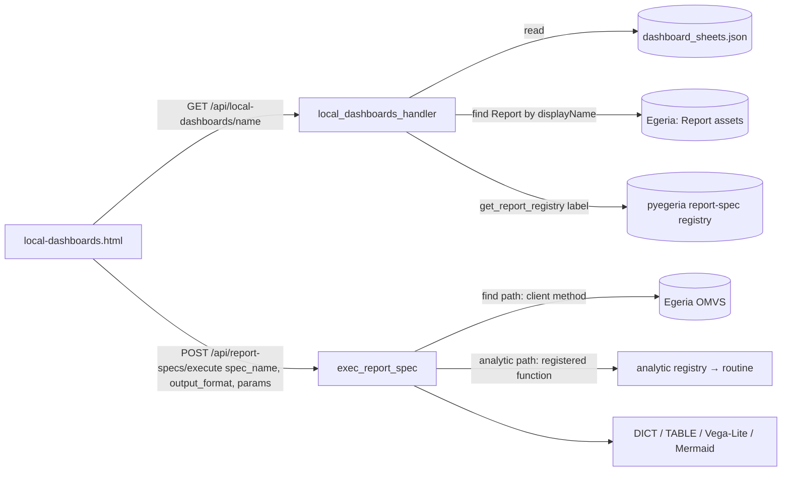
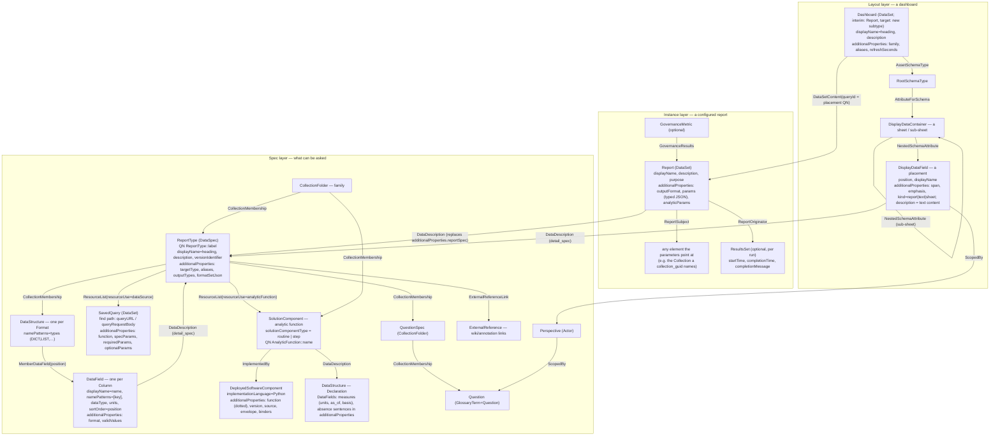
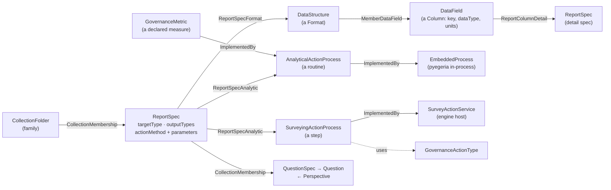
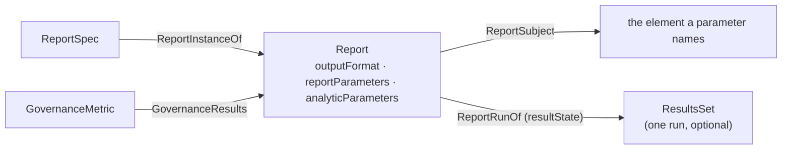
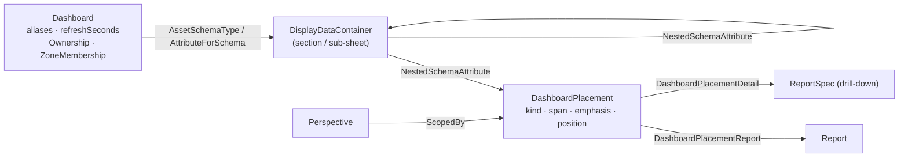

<!-- SPDX-License-Identifier: CC-BY-4.0 -->
# Report specs and local dashboards as Egeria metadata — review and proposal

*Draft 2026-11-05 (coordinator session, for Dan's review). Sources: pyegeria `docs/output-formats-and-report-specs.md`,
`pyegeria/view/_output_format_models.py`, `_output_dashboard_sheet_models.py`, `analytic_registry.py`,
`md_processing/v2/report.py`, `dashboard_sheet.py`, `commands/migrate_question_specs.py`; egeria-workspaces
`PyegeriaWebHandler/local_dashboards_handler.py`, `local-dashboards.html`, `OVERVIEW_REPORTING_MODEL.md` §8/§10/§13;
the live Egeria 6.3 type system read from the quickstart platform (`/api/types`).*

## 1. What exists today

Three layers, in three different places:

| Layer | Element | Where it lives today | Identity |
|---|---|---|---|
| Spec | `FormatSet` (report spec) with its `Format`s, `Column`s, `ActionParameter`, `QuestionSpec`, `annotations`, `family`, `aliases` | Python/JSON in pyegeria (BUILTINS, GENERATED), entry points and `~/.pyegeria/report_specs/*.json` (CONFIG), `register_report_specs` (RUNTIME) | the dict label (no `name` field on the model) |
| Spec | `AnalyticFunctionSpec` (+ `Declaration`) — what an `analytic_function` is and what its results mean | `analytic_registry.py` + `pyegeria.analytics` entry points | `name` |
| Spec | `ReportType` / `QuestionSpec` / `Question` / `Perspective` | **Egeria** (migrated from `FormatSet.question_spec` by `migrate_question_specs.py`; read back by `load_egeria_report_specs`) | `ReportType::<label>` |
| Instance | `Report` — a named run configuration: report spec + output format + default parameters | **Egeria** `Report` asset (Dr.Egeria `Create Report`); the spec name and every parameter sit in `additionalProperties` | `displayName` (matched exactly by the dashboard handler) |
| Layout | `DashboardSheet` with ordered `Placement`s (report / text / nested sheet) | one JSON file `~/.pyegeria/dashboard_sheets.json` (Dr.Egeria `Create Dashboard Sheet`, `Link Report to Dashboard Sheet`, `Add Text on Dashboard Sheet` write it; the web handler reads and deletes) | `name` / `aliases` |

Every cross-reference is a **name string resolved by the caller**: `Placement.ref` → Report `displayName`;
Report `additionalProperties.reportSpec` → FormatSet label; `Column.detail_spec` and `Placement.detail_spec` →
FormatSet label; `ActionParameter.analytic_function` → registered function name; `FormatSet.family` → a word.
Nothing has an owner, a zone or a version; a dashboard sheet has no refresh interval and no title of its own.

### 1.1 As-is element diagram

```mermaid
classDiagram
    direction LR

    class FormatSet {
      label (dict key)
      target_type
      heading
      description
      aliases[]
      family
      annotations wikilinks
      get_additional_props
    }
    class Format {
      types[] DICT LIST REPORT TABLE FORM MERMAID HTML ALL
    }
    class Column {
      name
      key (dot path, camelCase)
      format
      valid_values
      detail_spec → FormatSet label
    }
    class ActionParameter {
      function (find path)
      required_params[] optional_params[] spec_params
      analytic_function (registered name)
      analytic_spec_params analytic_binders
    }
    class QuestionSpec_local {
      perspectives[]
      questions[]
    }
    class AnalyticFunctionSpec {
      name  function(dotted)  description
      kind routine or step; source ods egeria resource
      version  envelope  generic
      annotation_type  resource_types[]  family  tags[]
      params[]  returns
    }
    class Declaration {
      result_kind
      measures[] name unit as_of value_field basis
      absence[] four sentences
    }

    class Report_Egeria {
      <<Egeria asset Report>>
      qualifiedName  displayName  description
      additionalProperties.reportSpec
      additionalProperties.outputFormat
      additionalProperties.find_params_camelCase_x22
      additionalProperties.analyticParams JSON
    }
    class ReportType_Egeria {
      <<Egeria ReportType, a DataSpec Collection>>
      qualifiedName = ReportType::label
    }
    class QuestionSpec_Egeria {
      <<Egeria CollectionFolder>>
    }
    class Question_Egeria {
      <<Egeria GlossaryTerm with Question classification>>
    }
    class Perspective_Egeria {
      <<Egeria Perspective, an Actor>>
    }

    class DashboardSheet {
      <<local JSON>>
      name  heading  description  aliases[]  family
    }
    class Placement {
      ref → Report displayName or sheet name
      span 1 2 full
      emphasis kpi panel
      content (text placement)
      perspectives[]
      detail_spec → FormatSet label
    }

    FormatSet "1" *-- "1..*" Format
    Format "1" *-- "1..*" Column
    FormatSet "1" o-- "0..1" ActionParameter
    FormatSet "1" o-- "0..1" QuestionSpec_local
    Column ..> FormatSet : detail_spec (by label)
    ActionParameter ..> AnalyticFunctionSpec : analytic_function (by name)
    AnalyticFunctionSpec "1" o-- "0..1" Declaration

    Report_Egeria ..> FormatSet : reportSpec (by label)
    ReportType_Egeria ..> FormatSet : same label
    ReportType_Egeria "1" --> "*" QuestionSpec_Egeria : CollectionMembership
    QuestionSpec_Egeria "1" --> "*" Question_Egeria : CollectionMembership
    Perspective_Egeria "1" --> "*" Question_Egeria : ScopedBy

    DashboardSheet "1" *-- "1..*" Placement
    Placement ..> Report_Egeria : ref (by displayName)
    Placement ..> DashboardSheet : ref (nested sheet)
    Placement ..> FormatSet : detail_spec (by label)
    Placement ..> Perspective_Egeria : perspectives (by name)
```

*Full-size image: [`01-as-is-elements.png`](../images/report-specs/01-as-is-elements.png)*

### 1.2 How a tile runs today

*Full-size image: [`02-as-is-tile-run.png`](../images/report-specs/02-as-is-tile-run.png)*

Gaps the survey confirmed (beyond the known ones in `OVERVIEW_REPORTING_MODEL.md` §13): one global sheet store with
no owner, no sharing, no zones; Report ↔ spec and Placement ↔ Report are string matches that break on a rename;
the Report's parameters are opaque `additionalProperties` (camelCase round-trip bugs already seen); a spec's
structure is invisible to Egeria (no lineage from a dashboard tile to the elements it reads); nothing records
that a run happened.

## 2. What Egeria already offers (live 6.3 types)

| Egeria type | Super | Fits |
|---|---|---|
| `ReportType` — "A template for generating report" | `DataSpec` ⊂ `Collection` | **the FormatSet itself** (already used, but only as the question holder) |
| `DataStructure` / `DataField` (`dataType`, `units`, `aliases`, `namePatterns`, `sortOrder`…) with `MemberDataField` (`position`), `NestedDataField`, `LinkedDataField`; a `DataSpec` holds `DataStructure`s by `CollectionMembership` | — | a `Format` and its `Column`s; the `Report-Spec-Schema` output (`attribute_path`, `data_type`) is literally a `DataField` list |
| `Report` — "an instance of a report" (`purpose`, `startTime`, `completionTime`, `createdTime`, `lastModifiedTime`) | `DataSet` ⊂ `DataAsset` | the Report asset we already create (keep) |
| `ReportSubject` (anything → Report), `ReportOriginator` (process → Report), `ReportDependency` (Report → Report) | relationships | what a report is about; which process produced it; prior/follow-on |
| `SavedQuery` (`queryURL`, `queryRequestBody`) ⊂ `DataSet`; `SmartQuery` (ResultsSet ← SavedQuery) | — | the **find path** (`ActionParameter.function` + `spec_params`): a RESTful query to Egeria |
| `ResultsSet` ⊂ `Collection` (`createdTime`, `startTime`, `completionTime`, `completionMessage`) | — | a recorded run's result set (optional) |
| `DataSetContent` (DataSet → Referenceable; `query`, `queryId`, `queryType`, `iscQualifiedName`) | relationship | "the assets that provide data for a data set" — a dashboard's tiles → the Reports they show, with the placement's own id in `queryId` |
| `DisplayDataContainer` / `DisplayDataField` (`inputField`) ⊂ `SchemaAttribute` (`position`, nesting) | — | "grouping of display data fields (and nested containers) for a **report, form or similar data display asset**" — a dashboard layout, natively ordered and nestable |
| `SolutionComponent` (`solutionComponentType`, `plannedDeployedImplementationType`) → `ImplementedBy` → `DeployedSoftwareComponent` (`implementationLanguage`) | — | an analytic function: the design element plus its Python implementation |
| `GovernanceMetric` (`measurement`, `target`) → `GovernanceResults` (`query`, `queryType`) → `Asset` | — | a governance metric fed by a Report |
| `Perspective` ⊂ `Actor`; `Question` classification on `GlossaryTerm`; `ScopedBy`; `CollectionFolder` | — | already in use for question specs — keep |
| `Ownership`, `ZoneMembership`, `Anchors` classifications; `ExternalReference` + `ExternalReferenceLink`; `ResourceList` (`resourceUse`); `SpecificationPropertyAssignment` → `ValidValueDefinition` (`propertyName`) | — | owner/visibility; wiki links; "this spec uses that function"; declared parameters |

Not in the live type system: `Dashboard`, `DashboardComponent`, `DeployedReport`, `Query`, `Template` (as an entity —
it is a classification), any `Report ↔ ReportType` relationship.

## 3. Proposal

Principle: **every name-string reference becomes a relationship; every record gets an owner and a zone; nothing is
lost on the way** (a lossless JSON copy travels in `additionalProperties` until the decomposed form is proven).

### 3.1 Target model

*Full-size image: [`03-existing-types-model.png`](../images/report-specs/03-existing-types-model.png)*

Classifications on every authored element: `Ownership` (the author), `ZoneMembership` (private / team / public —
the same secured-zone pattern Resource Explorer uses for private investigations), `Anchors` (fields anchored to
their ReportType or Dashboard so they are deleted with it).

### 3.2 Field-by-field mapping

**FormatSet → `ReportType`** (one per label; the label is the QN, the dict key problem goes away)

| pyegeria | Egeria |
|---|---|
| label | `qualifiedName = ReportType::<label>` (already the convention) |
| `heading` / `description` | `displayName` / `description` |
| `aliases` | `additionalProperties.aliases` (JSON list) — Egeria has no alias property on Collection |
| `target_type` | `additionalProperties.targetType`; optionally `SemanticAssignment` to the type's GlossaryTerm |
| `family` | `CollectionMembership` from a `CollectionFolder` named `Family::<family>` |
| `annotations` (wikilinks) | `ExternalReference` elements + `ExternalReferenceLink` |
| `formats[]` | one `DataStructure` per `Format`, member of the ReportType (`CollectionMembership`); `namePatterns` = the `types` list |
| `Column` | `DataField` under the `DataStructure` (`MemberDataField.position` = column order): `displayName=name`, `namePatterns=[key]`, `dataType` (from `Report-Spec-Schema`), `additionalProperties.format`, `valid_values` → `ValidValueDefinition` set |
| `Column.detail_spec` | `DataDescription` from the `DataField` to the detail `ReportType` |
| `action.function` + `spec_params`/`required_params`/`optional_params` | a `SavedQuery` (QN `SavedQuery::<label>`) linked by `ResourceList(resourceUse="dataSource")`; `queryURL` the OMVS path when known, `queryRequestBody` the fixed body; `additionalProperties.function` the pyegeria method; declared params as `SpecificationPropertyAssignment` → `ValidValueDefinition` (`propertyName`, required flag in `usage`) |
| `action.analytic_function` (+ `analytic_spec_params`, `analytic_binders`) | `ResourceList(resourceUse="analyticFunction")` to the function's `SolutionComponent`; defaults/binders in the relationship's `additionalProperties` |
| `question_spec` | unchanged: `QuestionSpec` folder → `Question` terms; `Perspective —ScopedBy→ Question` |
| whole FormatSet | `additionalProperties.formatSetJson` (lossless; the reader prefers the decomposed form when present and complete, else the JSON) |

**AnalyticFunctionSpec → `SolutionComponent` + `DeployedSoftwareComponent`**

| pyegeria | Egeria |
|---|---|
| `name`, `description`, `kind` | `SolutionComponent` QN `AnalyticFunction::<name>`, `solutionComponentType = routine | step` |
| `function` (dotted), `version`, `source`, `envelope`, `generic`, `binding_note`, `annotation_type`, `resource_types`, `tags` | `DeployedSoftwareComponent` via `ImplementedBy`; `implementationLanguage=Python`; the rest in `additionalProperties` |
| `family` | `CollectionFolder` membership (same folders as report specs) |
| `params[]` | `SpecificationPropertyAssignment` → `ValidValueDefinition` per parameter (`dataType`, `preferredValue` = default, `usage` = required/optional) |
| `declaration.measures[]` | a `DataStructure` (`DataDescription` from the component) whose `DataField`s carry `units`, `as_of` field name and basis in `additionalProperties` |
| `declaration.absence{}` | `additionalProperties` on that DataStructure (four sentences) |
| a `step` already declared to the engine host | the existing `GovernanceActionType` — link `SolutionComponent —ImplementedBy→ GovernanceActionType` so the two declarations meet |

**Report (exists) — make the links first-class**

| today | proposed |
|---|---|
| `additionalProperties.reportSpec` | `DataDescription` → `ReportType` (keep the property for one release) |
| 22 camelCase find params + `analyticParams` JSON string | keep in `additionalProperties`, typed JSON for non-scalars; **plus** `ReportSubject` → the element a GUID parameter names, so lineage works |
| nothing per run | optional `ResultsSet` per run (`ReportOriginator` from the Report; `createdTime`, `completionTime`, `completionMessage` = envelope state) — enables history, caching and "last run" words |
| nothing | `GovernanceMetric —GovernanceResults→ Report` when a report feeds a metric |

**DashboardSheet / Placement → Dashboard asset with a display schema**

| pyegeria | Egeria |
|---|---|
| sheet `name` | `qualifiedName = Dashboard::<name>` |
| `heading`, `description` | `displayName`, `description` |
| `aliases`, `family` | `additionalProperties.aliases`; `CollectionMembership` from the family folder |
| nested sheet | nested `DisplayDataContainer` |
| `Placement` | `DisplayDataField` under the container; list order = `position`; `span`, `emphasis`, `kind` in `additionalProperties` |
| `Placement.ref` (report) | `DataSetContent` from the Dashboard to the `Report`, `queryId` = the placement's QN, `queryType="placement"` |
| `Placement.content` (text) | the field's `description` (markdown), `kind=text` |
| `Placement.perspectives` | `ScopedBy` from the field to each `Perspective` |
| `Placement.detail_spec` | `DataDescription` from the field to the `ReportType` |
| (new) owner, visibility | `Ownership`, `ZoneMembership` on the Dashboard |
| (new) refresh | `additionalProperties.refreshSeconds` on the Dashboard or field |

Why a `DataSet` with a display schema rather than a `Collection` subtype (the plan in `_output_dashboard_sheet_models.py`):
`DisplayDataContainer`/`DisplayDataField` exist precisely for "a report, form or similar data display asset", give
ordering (`position`) and nesting for free, and `DataSetContent` already means "the assets this data set draws from";
a Collection would need `membershipRationale`/`expression` hacks for order, span and text. The lighter fallback if a
new subtype is slow to land: Dashboard as `CollectionFolder` + `CollectionMembership` with `expression` =
`position;span;emphasis` and `notes` = text content — workable, but every consumer parses strings again.

### 3.3 Type requests to raise with Egeria

1. A `Dashboard` entity (subtype of `DataSet`, sibling of `Report` and `Form`) — interim: use `Report` with
   `additionalProperties.kind=dashboard`, or `InformationView` if the "virtual view over other data" reading is preferred.
2. A `ReportTypeDefinition`-style relationship `ReportType → Report` ("instances of this type"); interim `DataDescription`.
3. Optional: `alias`/`aliases` on `Referenceable` (GlossaryTerm has it; Collections do not), so report specs and
   dashboards stop stuffing aliases into `additionalProperties`.

### 3.4 Migration path (each step leaves everything working)

| Step | Change | Retires |
|---|---|---|
| 1 | `migrate_question_specs.py` → `migrate_report_specs.py`: for every registered FormatSet create/update the `ReportType` with heading, description, `formatSetJson`, family folder, wiki links, the `SavedQuery` or `SolutionComponent` link. `load_egeria_report_specs` learns to rebuild a FormatSet from `formatSetJson` (today it only merges `question_spec`). Dr.Egeria: `Create Report Spec` (upsert) and `View Report Spec`. | nothing yet — Egeria becomes a fourth registry tier, `EGERIA`, that can win over CONFIG for the same label |
| 2 | Decompose `formats`/`columns` into `DataStructure`/`DataField` (driven by `Report-Spec-Schema` for `dataType`); Egeria Explorer's Reports tab reads them. `Create Report` writes `DataDescription` + `ReportSubject`. | `additionalProperties.reportSpec` lookup by label |
| 3 | `Create Dashboard` / `Place Report on Dashboard` / `Place Text on Dashboard` write the Dashboard asset + display schema; `local_dashboards_handler` reads Egeria first, the JSON file as fallback; delete goes through the asset. `Ownership` + `ZoneMembership` give per-user dashboards (the owner's stated Phase 2 of NEXT-14) and sharing. | `~/.pyegeria/dashboard_sheets.json` |
| 4 | Analytic registry entries published as `SolutionComponent`+`DeployedSoftwareComponent` with declarations; RE's engine-declared steps linked to them; optional `ResultsSet` per run and `GovernanceMetric` wiring. | the Explorer's separate "Analytic Functions" sub-tab data source (reads Egeria) |

### 3.5 Open questions (existing-types variant; superseded by 4.6)

- Dashboard as `DataSet`+display schema (recommended) or `Collection` subtype (the earlier plan)?
- Should a `Report` run be recorded (`ResultsSet`) at all, or stay ephemeral with client caching?
- Keep `ReportType` as a `DataSpec` (it is in the live types) or ask Egeria for a cleaner `ReportTemplate`?
- Private-by-default dashboards (secured zone, as RE's private investigations) or public with an owner?
- Which Egeria views should own the writes — Collection Manager / Asset Maker / Schema Maker via Dr.Egeria, or a new
  `report_manager` OMVS surface in pyegeria wrapping them?

## 4. Proposal with new Egeria types (revised 2026-11-05 after Dan's review)

> **Superseded in part (2026-11-05, later the same day).** The action side of this section (the nine inline action
> properties on `ReportSpec` and the `ReportSpecAnalytic` relationship) is replaced by the pipeline model in
> [report-spec-pipeline-model.md](report-spec-pipeline-model.md): producer, processor and formatter steps, routines as
> named pipeline fragments, and the mapping onto Egeria `Process` / `ProcessHierarchy` / `DataFlow` / `DataStructure`.
> The spec envelope (heading, description, target type, aliases, family, question spec, perspectives), the dashboard
> layer, the report-run elements and open point 1 (`ReportSpec` subtype vs `ReportType`) still stand as written here.

Dan's rulings taken into this revision: new Egeria elements may be created where needed; **no saved query per
report spec** (most specs are "call a pyegeria find method with parameters"; the per-type output processors are
pyegeria code, not metadata); master–detail and the other spec patterns need an explicit answer; the Trellis
extensibility model (`SUMMARY-EXTENSIBILITY-AND-EGERIA-OBJECTS-2026-11-03.md`) already settles how analytics map to
Egeria and this note adopts it; analytic functions therefore map to **process elements with implementations**, not to
solution components.

Rule kept from both documents: use an existing Egeria type before a new one; a new type only where no existing type
carries the fact without bending it; never a structured value in `additionalProperties`.

### 4.1 Three new entity types (and nothing else new)

| New type | Supertype | Own properties | Replaces |
|---|---|---|---|
| **`ReportSpec`** | `ReportType` (⊂ `DataSpec` ⊂ `Collection`) | `targetType`, `aliases` (array), `outputTypes` (array), `includePreamble` (bool); the inline action: `actionMethod` (pyegeria client method, e.g. `AssetCatalog.find_assets`), `requiredParameters` (array), `optionalParameters` (array), `fixedParameters` (map); `additionalPropertiesFunction` (name of the registered extractor, see 4.4) | `FormatSet` + `ActionParameter` (find path) |
| **`Dashboard`** | `DataSet` (sibling of `Report`, `Form`) | `aliases` (array), `refreshSeconds` (int), `layoutStyle` (string) | `DashboardSheet` (top level) |
| **`DashboardPlacement`** | `DisplayDataField` (⊂ `SchemaAttribute`) | `placementKind` (enum REPORT, TEXT, SECTION), `span` (enum ONE, TWO, FULL), `emphasis` (enum KPI, PANEL), `markdownContent` (TEXT only); `position`, `displayName` inherited | `Placement` |

Reused as-is (existing types, new elements): `DataStructure` for a `Format` (`namePatterns` = its output types),
`DataField` for a `Column` (`displayName` = name, `namePatterns` = [key], `dataType`, `units`), `DisplayDataContainer`
for a nested sheet / section, `Report` (gains three typed properties: `outputFormat`, `reportParameters` map,
`analyticParameters` map — replacing the camelCase `additionalProperties` round trip), `ResultsSet` for an optional
run record, `CollectionFolder` for a family, `QuestionSpec` folder / `Question` term / `Perspective`,
`ExternalReference` for wiki links, `Ownership` / `ZoneMembership` / `Anchors` classifications.

From the extensibility model, unchanged: a **step** is a `GovernanceActionType` (`ResourceExplorerSurvey::<request
type>`) plus a `SurveyingActionProcess`; a **routine** is an `AnalyticalActionProcess`; each process is
`ImplementedBy` the thing that actually runs it — an `EmbeddedProcess` per in-process host (pyegeria's
`exec_report_spec`, a Portal tile, a notebook) or the engine host's `SurveyActionService`; a **declared measure** is a
`GovernanceMetric` linked `ImplementedBy` to the process and `GovernanceResults` to the resource. The report spec's
analytic path therefore points at the **process element**, never at code, and which executor runs it is a fact on
the process, not on the spec.

### 4.2 New relationship types

| New relationship | End 1 → End 2 | Properties | Replaces |
|---|---|---|---|
| `ReportSpecFormat` | `ReportSpec` → `DataStructure` | — | the `formats` list |
| `ReportColumnDetail` | `DataField` → `ReportSpec` | — | `Column.detail_spec` (master–detail) |
| `ReportSpecAnalytic` | `ReportSpec` → `AnalyticalActionProcess` \| `SurveyingActionProcess` | `defaultParameters` (map), `binders` (map param → reader factory name) | `analytic_function`, `analytic_spec_params`, `analytic_binders` |
| `ReportInstanceOf` | `ReportSpec` → `Report` | — | `additionalProperties.reportSpec` (the missing `ReportType ↔ Report` link) |
| `ReportRunOf` | `Report` → `ResultsSet` | `resultState` (enum MEASURED, NOTHING_FOUND, NOT_ESTABLISHED, NOT_APPLICABLE), `resultStateReason`, `resultLocation` | — (optional run history) |
| `DashboardPlacementReport` | `DashboardPlacement` → `Report` | — | `Placement.ref` by display name |
| `DashboardPlacementSection` | `DashboardPlacement` → `DisplayDataContainer` | — | `Placement.ref` naming a nested sheet |
| `DashboardPlacementDetail` | `DashboardPlacement` → `ReportSpec` | — | `Placement.detail_spec` |

Existing relationships do the rest: `MemberDataField` (format → column, with `position`), `CollectionMembership`
(family → spec; spec → question-spec folder → question), `ScopedBy` (perspective → question; perspective →
placement), `AssetSchemaType` / `AttributeForSchema` / `NestedSchemaAttribute` (dashboard → sections → placements),
`ReportSubject`, `ReportOriginator`, `ExternalReferenceLink`, `ImplementedBy`, `GovernanceResults`.

### 4.3 Diagrams (one per layer; full-size PNGs under `portal-docs/images/report-specs/`)

**Spec layer — a report spec and what it runs**

*Full-size image: [`04-spec-layer.png`](../images/report-specs/04-spec-layer.png)*

**Instance layer — a configured report and its runs**

*Full-size image: [`05-instance-layer.png`](../images/report-specs/05-instance-layer.png)*

**Layout layer — a dashboard**

*Full-size image: [`06-layout-layer.png`](../images/report-specs/06-layout-layer.png)*

### 4.4 The report-spec patterns, each with its answer

| Pattern (pyegeria doc) | In Egeria |
|---|---|
| Find path: `action.function` + `required_params` / `optional_params` / `spec_params` | inline properties on `ReportSpec` (`actionMethod`, the three parameter properties). No separate query element. |
| Analytic path: `analytic_function` by registered name, `analytic_spec_params` (defaults), `analytic_binders` | `ReportSpecAnalytic` to the process element; defaults and binders on the relationship |
| Both paths on one spec (analytic only for SERIES / BAR / PIE) | both links present; `outputTypes` says which formats exist; the executor rule is unchanged |
| Several `Format` rows; the `ALL` shorthand; precedence of a type-specific row | one `DataStructure` per row, `namePatterns` = its types (`ALL` is a value); precedence stays an executor rule |
| Master–detail (`Column.detail_spec`); schema-driven promotion keyed on the detail spec's `target_type` | `ReportColumnDetail` from the column to the detail `ReportSpec`; promotion keys on that spec's `targetType` as today |
| REPORT-GRAPH (any spec with `types: ["ALL"]` renders as a linked graph) | an output type; nothing to model |
| Mermaid / Vega-Lite columns recognised by camelCase key | ordinary `DataField`s; the key is the `namePatterns` entry; recognition stays in the formatter |
| FORM output (summaries only) | an output type |
| Dot-notation keys; `Report-Spec-Schema` discovery (`attribute_path`, `data_type`) | the `DataField` list *is* that output; `dataType` filled from discovery |
| `aliases`, `heading`, `description`, `family`, `annotations` (wiki links) | `aliases` property; `displayName` / `description`; family folder; `ExternalReference` |
| `get_additional_props` (names an extractor function) and the per-type output processors | **pyegeria code, not metadata**: `additionalPropertiesFunction` holds the registered name only. The generic redesign of per-type extraction (dot-path materialization for everything) is a pyegeria item independent of this model — see 4.6 |
| `question_spec` | unchanged: `QuestionSpec` folder, `Question` terms, `Perspective —ScopedBy→ Question` |
| User JSON specs, entry-point specs, runtime registration | all become `ReportSpec` elements; the registry gains an `EGERIA` tier; a label collision is now a QN collision |
| Generated specs from compact commands (`gen_report_specs`) | the generator writes `ReportSpec` elements (or the Dr.Egeria document that creates them), so the command set and Egeria stay in step |

### 4.5 What this buys

- One anchored graph per spec and per dashboard (`Anchors`): delete the spec, its formats and columns go; a rename
  changes nothing because every link is a GUID relationship.
- Lineage end to end: dashboard placement → Report → ReportSpec → process element → executor (in-process or engine
  host) → GovernanceActionType; and Report → ReportSubject → the element it is about.
- Explorer and `Report-Spec-Schema` show the same columns.
- Per-user and shared dashboards from `Ownership` + `ZoneMembership`; optional run history with the envelope state.
- pyegeria's Pydantic models stay as they are: `load_egeria_report_specs` rebuilds a `FormatSet` from one
  related-elements walk and registers it in an `EGERIA` tier.

### 4.6 Delivery order

1. Egeria types: `ReportSpec`, `Dashboard`, `DashboardPlacement`; the eight relationships; the three `Report`
   properties. (Steps, routines, `GovernanceMetric` elements come from the extensibility generators already planned.)
2. pyegeria: typed bodies for the new types in the relevant OMVS clients; `migrate_report_specs.py` (idempotent,
   `--dry-run`, `--label`); `load_egeria_report_specs` walks the graph; Dr.Egeria `Create / Update / View Report Spec`,
   `Create Dashboard`, `Create Dashboard Section`, `Place Report on Dashboard`, `Place Text on Dashboard`;
   `gen_report_specs` emits `ReportSpec` elements.
3. Portal: `local_dashboards_handler` reads `Dashboard` elements (JSON store as fallback for one release); Egeria
   Explorer's Reports / Analytic Functions / Dashboards sub-tabs read the types; per-user dashboards via `Ownership`.
4. pyegeria, separately: the generic per-type extraction redesign (so `get_additional_props` and the `_extract_*`
   processors stop being code the spec has to name).

### 4.7 Points still open for discussion

1. `ReportSpec` as a subtype of `ReportType`, or properties added to `ReportType` itself (then the existing
   question-holder `ReportType` elements are updated in place).
2. Decomposition depth: every column of every format as a `DataField`, or only the primary format's columns with the
   rest kept as the lossless JSON copy (element volume vs. a complete schema in Egeria).
3. `EmbeddedProcess`: one per host (Portal, RE, notebook — versions differ per deployment) or one with the host as a
   property. Lean: one per host.
4. Run history (`ReportRunOf` → `ResultsSet`) from day one, or only when a dashboard asks for it (write volume).
5. Dashboards private by default (secured zone, as RE's investigations) or public with an owner.
6. Whether the Overview dashboard's Python-defined specs migrate in the same pass.
