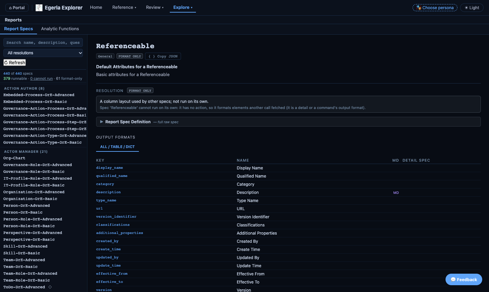
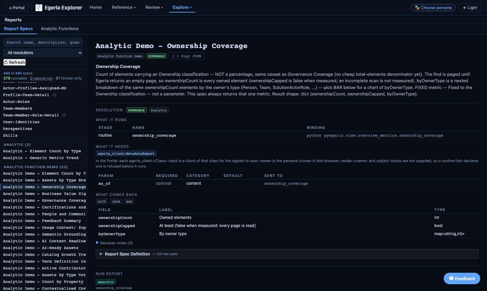
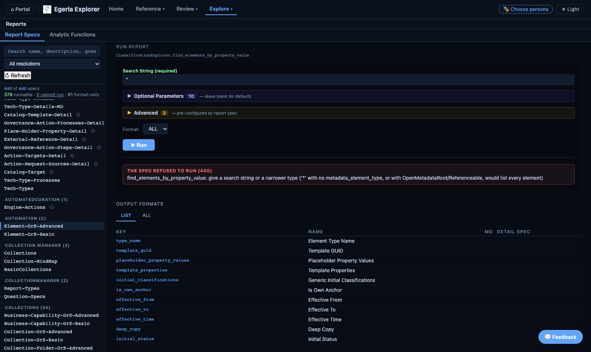
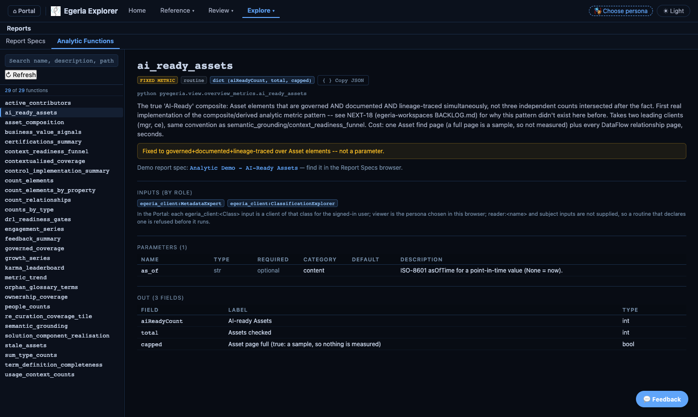

# Egeria Explorer

Egeria Explorer is the primary browser-based interface for navigating Egeria metadata. It provides tab-by-tab views of types, glossary terms, lineage, governance blueprints, digital products, and more.

Access it from the portal tile or directly at `/egeria-explorer`.

---

## Search

A full-width **Search** card sits at the top of the Home screen — keyword search across *every* element type in one call, not scoped to whichever tab you're in.

- After a search runs, a "Types in these results" row of chips shows the real types actually found (e.g. `RelationalColumn (12)`, `GlossaryTerm (4)`) — not a fixed pre-search category list, since Egeria has several hundred entity types and a curated picker can only ever cover a slice of them.
- Clicking a chip re-runs the search scoped to that exact type, giving you a complete count for it rather than whatever fit in the first page of unscoped results.
- Results are headed by their real type name, so even uncommon types get their own clearly labelled section instead of being lumped under a generic "Other" heading.

---

## Tabs overview

### Explore

A quick-start subset of the most commonly used tabs, shown on the splash screen for fast access.

| Tab | What it shows |
|---|---|
| **Glossary** | Business glossaries, terms, definitions, and semantic relationships — folders, cross-glossary search, synonyms, antonyms, and related terms. A term's detail panel includes **"Where is this used?"** — every physical (schema column, etc.) and logical (Data Field, etc.) element assigned that term, shown together even though they live in different tabs |
| **Collections** | The collection hierarchy — digital products, families, blueprints, folios, dictionaries, and more, regardless of collection subtype. Defaults to **Root Collections only**; uncheck the box to see all collections with no parent (a broader, noisier set) |
| **Reports** | Two sub-tabs: **Report Specs** (report specifications, whether each can run, what it runs, needs and returns, and a Run Report panel) and **Analytic Functions** (the registry of Python routines a report spec's `analytic_function` can run — each marked GENERIC or FIXED METRIC, with its declared inputs, parameters and output fields, cross-linked to its demo report spec). See [Reports: what a report spec will do](#reports-what-a-report-spec-will-do) |
| **Digital Products** | Data products with governance metadata, lineage, and associated glossary terms |
| **Dr. Egeria Commands** | The full library of Dr. Egeria markdown command templates, organised by level and family — see [Dr. Egeria Execute panel](#dr-egeria-execute-panel) below |

### Review

The full set of element-category browsers — most support search, filtering, cross-navigation, and full property/relationship detail.

| Tab | What it shows |
|---|---|
| **Glossary** | Same as above |
| **Reference Data** | Valid value sets and definitions — the allowed values for property fields in your Egeria environment |
| **Data Design** | Data Specs, Data Structures, Data Fields, and Data Grains, cross-referenced with glossary terms — a field's assigned glossary term(s) and data class(es) are called out distinctly (🧠 / 🏷️) rather than buried among other relationships |
| **Collections** | Same as above |
| **Solution Architect** | Solution blueprints and component hierarchies — actor assignments, wiring relationships, concrete implementations — plus a **Patterns** tab for the design-pattern library (general/specialized, consumed/consuming, and related pattern relationships, grouped by category) |
| **Information Supply Chains** | ISC scope, segments, and concrete technical implementations as Mermaid diagrams. From Egeria 6.3 a supply chain has up to five graphs, each shown only when it has content: **ISC Implementation** (context, solution design and implementation status), **ISC Data Mesh** (digital products and their dependencies), **ISC System Fabric** (infrastructure and software capabilities), **ISC Data Fabric** (data assets, processes and actions linked by lineage) and **ISC Data Mapping** (elements linked by data mappings, such as columns) |
| **Locations** | Physical, cyber, and secure locations — parent/child hierarchies, peer links, locally hosted assets, assigned roles |
| **Actors** | Actor profiles (people, teams, organizations, IT profiles), the roles they perform, and their user identities |
| **Communities** | Communities of interest and the roles/people assigned to them |
| **Business Capabilities** | Business capabilities (functions, capability or skill sets) and the collections, members, and actors linked to them — connects Solution Architect's blueprints/components to business strategy |
| **Note Logs** | Note logs and their dated entries, each attached to a subject element |
| **Naming Vocabulary** | Elements classified `PrimeWord`, `ClassWord`, or `Modifier` — the naming-standard word vocabulary, grouped by classification |
| **Policy Enforcement** | Elements carrying a Policy\*Point classification (Management/Administration/Decision/Enforcement/Information/Retrieval) — an XACML-style policy architecture, grouped by classification |
| **Action Center** | Notification, Meeting, ToDo, and Review actions — the "Actions For People" model, paginated, with cross-links to every related element |
| **Duplicate Review** | Candidate duplicate elements paired via PeerDuplicateLink pending steward review, and already-consolidated elements with the sources they absorbed |
| **Perspectives & Questions** | Governance perspectives (viewpoints held by actors) and the Questions they must address |
| **Governance Definitions** | Governance drivers, policies, and controls, with relationships between definitions |
| **Projects** | Projects and their hierarchies, distinguished by classification (Campaign, StudyProject, PersonalProject, Task, etc.) |
| **Informal Tags** | Informal tags applied across the metadata ecosystem — public/private filter, jump to any tagged element |
| **Context Events** | TimeKeeper-managed events — planned/actual dates, durations, effects, dependent/related event relationships |
| **External References** | General links, related media, cited documents, external data sources, and external model sources |
| **Agreements** | General agreements, data sharing agreements, and digital subscriptions |
| **External Identifiers** | Records that a catalogued element also has an identifier in a third-party system — key, source, and every linked element |

### Reference

Read-only reference material; most don't require a live server connection.

| Tab | What it shows |
|---|---|
| **Type Explorer** | The open metadata type system — entities, classifications, relationships, and full inheritance hierarchy. Relationship types are grouped by [relationship purpose](#relationship-purposes) |
| **REST APIs** | REST endpoints exposed by the view server — operations, parameters, and response shapes |
| **Valid Values** | Registered valid metadata values for a specific Egeria property name |
| **Python API** | The pyegeria Python client API — classes by functional domain, methods with docstrings, inherited-vs-own filter |

---

## Reports: what a report spec will do

The **Reports** tab shows what pyegeria knows about every report spec *before* you run it. pyegeria resolves each spec when it loads, and the Portal shows that answer: it does not re-check anything itself. The screenshots below were taken from the deployed Portal on **2026-11-09** (pyegeria 6.2.28, quickstart).

### Three states, never two

Every spec is in exactly one of three states. The **Resolution** filter above the list, and the counts line under it, use the same three words.

| State | Mark | Meaning |
|---|---|---|
| **RUNNABLE** | green badge | Every check that could run at load passed. |
| **CANNOT RUN** | red badge, ⚠ | The resolver refused the spec at load. The panel shows its own words and the number of the check that failed. |
| **FORMAT ONLY** | grey badge, ◇ | The spec has no action: it is a column layout (a detail view or a command's output format) that other specs use. **It is not broken**, and it is never counted as "cannot run". |

On the quickstart on 2026-11-09 the counts line read **379 runnable · 0 cannot run · 61 format-only** (440 specs). Choosing **Cannot run** in the filter, or clicking the *N cannot run* link, lists only the specs the resolver refused; today that list is empty. (pyegeria 6.2.27 had two, `Asset-Graph` and `Data-Classes`; 6.2.28 repointed both.)



*Report Specs tab, deployed Portal, 2026-11-09. The selected spec, `Referenceable`, is format-only: its box says so and gives the resolver's words.*

If a spec cannot run, the red box under **Resolution** reads `Cannot run — failed check N` followed by one sentence per failed check, copied from pyegeria. Those sentences are the explanation; for how to read them, see [Will this spec run?](https://github.com/odpi/egeria-python/blob/main/docs/output-formats-and-report-specs.md#will-this-spec-run-load-time-resolution) in the pyegeria docs.

A spec that still carries the removed `analytic_binders` key is tagged **BINDERS IGNORED**, with the resolver's warning under the Resolution panel. pyegeria no longer reads that key: declare those arguments as the routine's inputs instead (see [the migration recipe](https://github.com/odpi/egeria-python/blob/main/docs/output-formats-and-report-specs.md#routines-declarations-and-roles)). No spec on the quickstart shows the tag today.

### The Resolution panel

Select a spec and scroll to **Resolution**. For a runnable spec it has four parts:

| Part | What it shows |
|---|---|
| **What it runs** | The stages, each with its kind (a `producer` find method, or a `routine`) and its binding (for example `python pyegeria.view.overview_metrics.ownership_coverage`). |
| **What it needs** | The **role inputs** the routine declares, such as `egeria_client:MetadataExpert`, followed by every parameter: required or optional, its **category** (`content`, `shape` or `performance`), its default and which stage receives it. |
| **What comes back** | The output formats the spec offers, and the routine's declared **out** fields (name, label, type). A find spec declares no `out`: its columns are element properties, listed under Output Formats. A shape name that only the analytic library knows is shown as the shape name, not as "no output". |
| **Resolver notes** | Folded. What the resolver recorded, for example which checks did not apply (`a single stage, so there is no previous stage's shape to check against`). |



*Resolution panel of `Analytic Demo - Ownership Coverage`, deployed Portal, 2026-11-09: one routine stage, one role input, one parameter in category `content`, and three declared out fields.*

### What the Portal supplies to a routine

A routine declares its inputs by role; the environment supplies them. The Portal's supply is shown under **What it needs**:

- Each `egeria_client:<Class>` input is a client of that class. It acts as the user the run is made as: the Explorer's Connection Settings user, or the server's service user (see *Which user runs it* below). The Portal's own supply note says "signed-in user" and means that.
- `viewer` is the **persona chosen in this browser**. With no persona chosen, a routine that declares `viewer` is refused before it runs, and the refusal says so.
- `reader:<name>` and `subject` inputs are **not supplied**. A routine that declares one is refused before it runs.

None of the built-in routines declares `viewer`, a reader or a subject today.

**Which user runs it.** The browser does not yet send an `X-Egeria-Token` header to the execute route, so a report spec does not run as a token-holding user:

- From the **Explorer**, the client signs in with the user and password in the Explorer's Connection Settings (or the server's default service user when those are blank). The Explorer's Run panel does not send the persona.
- From **Local Dashboards**, the persona chosen in this browser is sent with every run (for `viewer`), and the clients use the server's service user.
- From **Governance Metrics**, the run uses the service user `erinoverview` and sends no persona.

This was checked against the code on 2026-11-09. When the browser starts sending a token, the server already uses it (the client then holds no password, and an expired token is refused with the 401 words below), but no page does that yet.

### Running a spec, and when it refuses

**▶ Run** is disabled, with the reason beside it, when it cannot work: `Required: <param>` for a required parameter left blank, or `Cannot run:` followed by the resolver's words for a spec it refused. The Resource Explorer curation-coverage routine, for one, needs its `slug` filled in before Run is enabled. **▶ Run** posts to the Portal, which calls pyegeria. A refusal comes back as a non-2xx response, and the Portal shows the server's own words verbatim in a box labelled by the status:

| Status | Box label | Typical cause |
|---|---|---|
| 400 | THE SPEC REFUSED TO RUN | pyegeria raised a `ValueError`: a role that is not supplied, a method not on the allowlist, or a parameter value it will not accept. |
| 401 | SIGN-IN NEEDED | `Not authorized for this operation — the current user does not have permission for this report`. Egeria returned 401, or the caller's token has expired. |
| 504 / 408 / 524 | TIMED OUT | The operation took longer than the proxy allows. |
| 500 | SERVER ERROR | Anything else; the box shows `Execution failed:` and the error. |



*`Element-DrE-Advanced` run with the search string `*`, deployed Portal, 2026-11-09. pyegeria refuses before any request reaches Egeria: a `*` search over the root type would list every element.*

Two refusals you may meet on pyegeria 6.2.28:

- **`*` with no type, or with `OpenMetadataRoot` or `Referenceable`** is refused (`give a search string or a narrower type`). `*` with a real type lists at most 100 elements of that type per call.
- **A find method that is not on the allowlist** is refused with words. Specs held in Egeria may name only the find methods on pyegeria's positive allowlist (`FIND_METHOD_ALLOWLIST`), whatever the method's prefix. pyegeria loads such specs when it is set up to; the Portal lists whatever pyegeria has loaded and does not mark where a spec came from, and none of the 440 on the quickstart on 2026-11-09 has an `egeria:` name.

### Technology parameter and type filters

pyegeria 6.2.28 made the generic-search `*-DrE-*` specs name their type. The nine technology commands (Kafka, Postgres server and database, the Unity Catalog elements) take an optional run parameter **`deployed_implementation_type`**. The default is the spec's own technology (an exact match, ignoring case). Set it to `*` to search every element of the type, whatever its technology; any other value is an exact match on that technology, ignoring case. On pyegeria 6.2.28 these specs are slow, about 18 s a run; a fix is planned. You see it under *Optional Parameters* in the Run panel, and as a parameter in the Resolution table.

The type filters are spelt one way across pyegeria: `metadata_element_type` and `metadata_element_subtypes`. The old spellings still work in code, with a deprecation warning; report specs that use them keep working.

### Counts that were not measured

A figure that pyegeria could not measure (a count whose query failed, or a scan that did not read every page) now comes back as `None` with an `unmeasured` note, never as `0`. The Explorer, Local Dashboards and Governance Metrics show that as **not measured** and list the note under the result. A tile that was never measured is not the same as a tile that measured nothing.

### Analytic Functions

The **Analytic Functions** sub-tab is the registry of routines a report spec can run (there is no separate "analytics registry" page). It reads the same declarations the Resolution panel uses. Each function shows:

- its kind and binding, and **GENERIC** or **FIXED METRIC**;
- **Inputs (by role)**, with the same Portal supply note;
- its **Parameters**, each with type, required or optional, category and default (`content` changes what is counted, `shape` changes how the result is laid out, `performance` changes only how fast or how much is read, never a value);
- its **Out** fields.



*Analytic Functions, `ai_ready_assets`, deployed Portal, 2026-11-09. It declares two client inputs, `egeria_client:MetadataExpert` and `egeria_client:ClassificationExplorer`. 29 functions were registered.*

### Where a report spec comes from (coming soon)

> **Status: being built (2026-11-10).** This section describes a Portal change that has not shipped yet
> (branch `feat/portal-report-specs-egeria-held`). The `pyegeria report-specs sync` command below is in
> pyegeria 6.2.29 today; the Portal labels and folders are not. Until the change lands, the Portal does
> not show report specs held in Egeria.

<!-- TODO(report-specs-egeria-held): replace the label names, folder wording and any button text below with
     the exact UI wording once feat/portal-report-specs-egeria-held lands, add a screenshot, and remove the
     "coming soon" status note. -->

Report specs can come from four places. Each spec in the Reports tab will carry a label saying which one:

| Label | Where the spec comes from |
|---|---|
| **builtin** | Ships with pyegeria, for example `Analytic Demo - Element Count by Type` |
| **local** | Added by the Portal itself (its own spec files), for example `Analytic - Generic Metric Trend` |
| **egeria** | Held in Egeria as a report spec element, filed in a folder (a `CollectionFolder`) |
| **user** | Your own spec files <!-- TODO(report-specs-egeria-held): confirm what "user" covers --> |

**Specs held in Egeria are grouped by folder.** In Egeria, report specs are filed in folders. The
Reports tab will show those folders, so you can find a team's specs together.

**The Portal reads Egeria-held specs from a local copy.** `pyegeria report-specs sync` reads the specs
held in Egeria and saves a copy in a local cache, which is what the Portal uses:

```bash
pyegeria report-specs sync                      # every configured folder
pyegeria report-specs sync --folder QN          # one folder, by its qualified name (repeatable)
pyegeria report-specs sync --spec "LABEL"       # just this spec; leaves every other cached spec alone
pyegeria report-specs sync --include-drafts     # also DRAFT and PROPOSED specs, kept apart in drafts/
```

- `sync` only **reads** Egeria. It writes to the local cache
  (`PYEGERIA_REPORT_SPEC_CACHE_DIR`, default `~/.pyegeria/cache/report_specs/<platform>/<server>`), not to Egeria.
- Without `--include-drafts`, only specs that are ready for use are copied.
- After someone changes a spec in Egeria, run `sync` again to see the change.

**The duplicate count spec is gone.** The Portal used to add its own spec, *Analytic - Element Count by Type*,
which did the same as pyegeria's built-in *Analytic Demo - Element Count by Type*. It was removed on
2026-11-10. Use the built-in one and set `type_name` in its `Analytic Parameters` to count any type. A
Report that still names the old spec has to be re-created with the new name.

### Further reading

- pyegeria: [Routines, declarations and roles](https://github.com/odpi/egeria-python/blob/main/docs/output-formats-and-report-specs.md#routines-declarations-and-roles) and [Will this spec run? Load-time resolution](https://github.com/odpi/egeria-python/blob/main/docs/output-formats-and-report-specs.md#will-this-spec-run-load-time-resolution) (the declarations, the seven checks, `supply=`, and migrating off `analytic_binders`).
- [Report specs as micro-flows](../Internals/report-spec-pipeline-model.md): the design this is built from, with what is shipped and what is still design.
- [Local Dashboards](local-dashboards.md): how a placement shows a refusal.

---

## Detail panel features

Most detail panels (Glossary, Solution Architect, Locations, Actors, Communities, Projects, Governance Definitions, Reference Data, External References, External Identifiers, Agreements, Note Logs, and more) share a common set of controls in their header row:

- **ℹ Header** — pops up the element's header metadata common to every type: GUID, type name, status, version, and who created/last updated it and when.
- **{ } Copy JSON** — copies the complete raw JSON payload for the selected element to the clipboard. Shows **✓ Copied** (green) on success or **✕ Failed** (red), resetting after two seconds.
- **☐ / ☑ bookmark** — saves the item to **My Bookmarks** on the portal home page, linking back to this exact element. Requires an active persona (Quickstart) or a logged-in account (Freshstart); the toggle is hidden otherwise.
- **♡ feedback** — like/comment on the element via Egeria's built-in feedback API (separate from the portal's own per-page feedback button).

**Resizing.** Every column and pane width can be changed, in the Explorer and in the other portal pages:

- Drag the divider between a sidebar and its detail pane.
- Drag the right edge of a table's header cell to resize that column. Double-click the edge to reset the table.
- On dashboard pages (Overview, Resource Browser, Governance Metrics, Local Dashboards), drag the gap between two columns, or the edge of a side drawer. Double-click to reset.

Your browser remembers each width for that page. Grids still switch to a single column on narrow windows.

Every list-driven tab's sidebar also has a **↻ Refresh** button below its filter box, to reload that list on demand (e.g. after adding something via Dr. Egeria or Obsidian) without waiting for a full page reload.

Properties are shown generically — any scalar property Egeria returns for an element (including `authors`, `contentStatus`, and other `AuthoredReferenceable` fields) is displayed automatically, without needing per-type code changes. Relationships not otherwise shown in a dedicated section appear in a catch-all **Relationships** block at the bottom of the panel, so nothing linked to an element is silently hidden. That block is grouped into [relationship purpose](#relationship-purposes) families.

---

## Relationship purposes

Egeria gives every relationship type a **purpose**: why the type exists. Purpose also decides whether
operations that start on an anchored element (delete, copy, scope checks) follow the relationship. See
Egeria's [relationship purpose](https://egeria-project.org/concepts/relationship-purpose/) concept page.

Egeria defines eleven purposes. The portal groups them into six **families**:

| Family | Purposes | What it holds |
|---|---|---|
| **Composition** | Structural, Attachment | The element's own anchored graph: what it *is* and what it *owns* |
| **Governance & Description** | Assignment | Independent things that describe or govern it: terms, policies, owners, tags |
| **Organization** | Membership | Collections, folders and groupings it belongs to or contains |
| **Associations** | Association, Peer | Independent elements linked by an ordinary or equal-standing relationship |
| **Design & Deployment** | Definition, Deployment, Design Lineage | Specification to implementation, where it runs or is stored, designed flows |
| **Operations** | Action, Activity | Actions to take, and records of actions taken |
| **Unclassified** | — | Relationship types the server reports no purpose for |

A coloured **purpose badge** shows a relationship's exact purpose. Hover over it for Egeria's description.
Structural and Attachment relationships are part of the element's **anchored graph**.

### In the Type Explorer

- **Relationship type pages** show the purpose badge, Egeria's description, the family, and an
  **⚓ anchored graph** chip for Structural and Attachment types.
- **An entity type's Relationships tab** groups relationship types by family (all open). Use **Group** to
  switch to a flat list. The **Purpose** chips filter to one or more purposes, together with the text filter
  and **Show inherited**. Each card has its purpose badge.
- **The sidebar's RELATIONSHIPS list** is grouped into folded families. They open while you search.

A subtype can have a different purpose from its supertype. For example, `ActionRequester` is Activity
although its supertype `LineageRelationship` is Design Lineage. Each type shows its own purpose.

### On detail panels

The **Relationships** block on detail panels, and the relationships in **Data Mesh** and **The Catalog**,
are grouped into families:

- Every family starts **folded**. Click a family to open it. The browser remembers which families you
  opened, for every panel and app.
- Each group of related elements (for example *Member Of Collections*) sits in the family that most of its
  relationships belong to. A group is never split across families.
- A row shows its purpose badge where it adds information: in families with more than one purpose, for a
  row whose purpose belongs to a different family from its group, and in sections outside the families.

If the Egeria server doesn't report relationship purposes (older servers), panels keep a flat list and say
*"This Egeria server doesn't report relationship purposes, so relationships aren't grouped."* If the
purpose lookup fails, panels show the flat list without that message.

---

## Switching personas

The persona you select in the portal determines which Egeria user ID is used for Explorer queries. Different personas may have different visibility into governance zones and classified assets.

---

## Dr. Egeria Execute panel

Every command template in Egeria Explorer has an **Execute** tab alongside the parameter reference. It lets you run individual Dr. Egeria commands directly from the browser without needing Obsidian or a markdown file.

### Using it

1. Select a command family and template from the left-hand list.
2. Switch to the **Execute** tab in the detail panel.
3. Choose a **directive**:
   - **Display** — preview current metadata; no changes made.
   - **Validate** — check parameters without writing anything.
   - **Process** — create or update metadata in Egeria. ⚠ Irreversible.
4. For Create/Update/Link commands, a **Verb** toggle lets you switch to the counterpart verb (e.g. Create ↔ Update, Link ↔ Unlink) without leaving the template.
5. Fill in the required parameters (highlighted in green) and any optional ones you need.
6. Click **▶ Run**.

### Reading the result

After execution the panel shows a status banner, then any errors, then the full output document:

| Banner | Meaning |
|---|---|
| ✓ **Completed** — *N of N commands succeeded* | All commands ran without errors |
| ⚠ **Partial** — *X of N commands succeeded — Y failed* | Mixed outcome; metadata may be partially updated |
| ✗ **Failed** — *N of N commands failed* | Nothing was written; safe to retry after fixing inputs |

**Validation Errors** (amber) — parameter problems caught before any Egeria call. Fix the inputs and re-run; no metadata was changed.

**Execution Errors** (red) — Egeria returned an error mid-run. The plan may be partially applied; investigate before retrying.

The output document below the error lists is the full augmented plan markdown — the same content that would be saved to the Dr. Egeria outbox in Obsidian.

### When to use Obsidian instead

The Execute panel is designed for testing individual commands. For production workflows — especially multi-command sequences with narrative prose — write a Dr. Egeria markdown document in Obsidian and send it via the **Call Dr. Egeria** plugin. See [Dr. Egeria overview](dr-egeria/overview.md) for details.

---

## Links from documentation

Where documentation refers to a specific type or glossary term, you can explore it directly:

- Type System: `/egeria-explorer` → Type System tab → search for the type name
- Glossary term: `/egeria-explorer` → Glossary tab → search for the term

---

## Further resources

- [Tech Catalog](tech-catalog.md) — browse and search technical assets; includes schemas, lineage sub-pane, and context diagrams
- [Lineage Explorer](lineage-explorer.md) — full-featured data lineage tracing tool
- [Egeria project documentation](https://egeria-project.org) — full open metadata type reference
