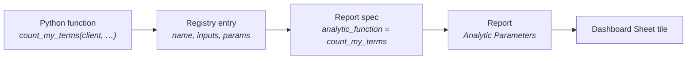

<!-- SPDX-License-Identifier: CC-BY-4.0 -->
<!-- Copyright Contributors to the ODPi Egeria project. -->

# Add and Use Analytic Functions

An **analytic function** is a Python function that works out a number, a series or a small table from
Egeria: how many glossary terms there are, how ownership coverage changed over six months, which assets
have gone stale. A report spec runs it, a Report gives it its parameters, and a Dashboard Sheet shows the
answer as a tile.

This tutorial shows how to use the functions that already exist, how to write your own, and how to add it
in each place pyegeria runs: your own Python or Jupyter, the quickstart Portal, freshstart and Egeria
Advisor.

> **What was checked.** Unless a step says *not verified*, it was checked on 2026-11-10 against the
> quickstart (Portal at commit 81d6e636, pyegeria 6.2.32). The "write your own" steps were run in a
> throwaway Python process in the quickstart's Jupyter container. Nothing was written to Egeria.

---

## How the pieces fit



- The **function** is ordinary Python. Its first argument is an Egeria client that is already signed in.
- The **registry entry** gives the function a short registered name (for example `count_elements`) and
  says what it needs. pyegeria keeps the registry in `pyegeria.view.analytic_registry`.
- A **report spec** names the function by its registered name. A spec never names a Python path:
  pyegeria refuses dotted paths in report specs from 6.2.19.
- A **Report** is a named use of the spec with its parameters filled in. Its `Analytic Parameters` go
  to the function.
- A **Dashboard Sheet** places the Report as a tile.

---

## Step 1: see what is already there

In the Portal, open **Egeria Explorer → Reports → Analytic Functions**. Each function shows whether it is
**GENERIC** (what it counts is a parameter) or a **FIXED METRIC** (what it counts is built in), its
declared inputs, its parameters and its output fields. On the quickstart, 29 functions were registered
on 2026-11-10, including `count_elements`, `metric_trend`, `growth_series` and `stale_assets`.

The same list comes from the Portal's API:

```
https://localhost:8843/api/analytics
```

and from Python:

```python
from pyegeria.view.analytic_registry import get_analytic_registry
sorted(get_analytic_registry())
```

## Step 2: use an existing function without writing code

Most needs are met by a **generic** function. `count_elements` counts any element type, and pyegeria's
built-in report spec *Analytic Demo - Element Count by Type* runs it. To count projects, make a Report
that points at that spec and sets `type_name`:

```markdown
## Create Report
### Display Name
Project Count

### Description
How many projects there are.

### Report Spec
Analytic Demo - Element Count by Type

### Output Format
DICT

### Analytic Parameters
type_name : Project
```

Then place it on a sheet with `Link Report to Dashboard Sheet` (see
[Building a Local Dashboard](local-dashboards.md)). The quickstart's *Project Count* Report is built
this way. A value you pass when you run the Report overrides the spec's default.

`metric_trend` turns any registered function into a trend over time. The Portal's spec
*Analytic - Generic Metric Trend* runs it; set `metric_path` to a registered name (for example
`count_elements`) and `metric_params` to that function's parameters.

---

## Step 3: write your own function

Write it when no existing function computes what you need.

```python
# my_analytics.py
def count_my_terms(client, contains: str = "Patient") -> int:
    """Count glossary terms whose name contains a word."""
    terms = client.find_glossary_terms(contains, output_format="DICT") or []
    return len(terms) if isinstance(terms, list) else 0
```

Three rules decide whether it will run:

1. **The client comes first.** The leading parameter that receives the client must be named `client`,
   `mgr`, `ce` or `expert`. Everything after it is an ordinary keyword parameter that a Report can set.
2. **Declare the client as an input.** The registry entry lists one `egeria_client:<Class>` input for
   each leading client parameter, in the same order. `egeria_client:EgeriaTech` gives the function a
   client with every pyegeria method. A function that takes no client declares no inputs.
3. **Give it a registered name.** A report spec names the function by that name, never by its Python
   path.

The registry entry:

```python
{
    "count_my_terms": {
        "name": "count_my_terms",
        "function": "my_analytics.count_my_terms",      # where Python imports it from
        "inputs": ["egeria_client:EgeriaTech"],        # one per leading client parameter
        "description": "Count glossary terms whose name contains a word.",
        "returns": "scalar (int)",
        "generic": False,
        "params": [
            {"name": "contains", "type": "str", "default": "Patient",
             "description": "The word to look for in the term's name."}
        ],
        "family": "Glossary"
    }
}
```

If you break a rule, pyegeria says so when it loads the report spec, and the spec is listed as unable to
run. These are the words it gave in the check:

- Inputs not declared: *"routine bad_inputs's binding takes 1 leading client argument(s) and its
  declaration lists 0 egeria_client input(s)."*
- A Python path in the spec: *"Report spec names analytic function 'my_analytics.count_my_terms', which
  is not a registered name; use its registered name … (dotted paths are refused from pyegeria 6.2.19)."*

In the Portal the same words appear in the spec's **Resolution** panel in Egeria Explorer.

---

## Step 4: register it

pyegeria builds the registry from four places. A name may be used only once across them.

| Way | How | When the registry sees it |
|---|---|---|
| **At runtime** | `register_analytic_functions({...})` in your own code | At once |
| **Installed package** | A package that declares a `pyegeria.analytics` entry point | The first time the registry is used in a process |
| **Config files** | `PYEGERIA_ANALYTIC_FUNCTIONS_JSON` (JSON files) or `PYEGERIA_ANALYTIC_FUNCTIONS_MODULES` (`pkg.module:function` returning entries) | **Only after your code calls `refresh_analytic_functions()`**. Setting the variable alone does nothing. |
| **Built in** | Ships with pyegeria | Always |

An installed package whose name clashes with a built-in or config entry is skipped, not fatal;
`analytic_entry_point_errors()` names it. Any other clash raises `AnalyticRegistryCollision`.

### The installed-package way

This is the way to share a function: install the package and the function is registered.

```toml
# pyproject.toml
[project]
name = "my-analytics-pkg"
version = "0.1.0"

[project.entry-points."pyegeria.analytics"]
my_analytics_pkg = "my_analytics_pkg.manifest:functions"
```

```python
# src/my_analytics_pkg/manifest.py
from pyegeria.view.analytic_registry import AnalyticFunctionSpec

def functions():
    return [AnalyticFunctionSpec(
        name="count_my_terms",
        function="my_analytics_pkg.count_my_terms",
        inputs=["egeria_client:EgeriaTech"],
        description="Count glossary terms whose name contains a word.",
        returns="scalar (int)",
    )]
```

An entry point may name one `AnalyticFunctionSpec`, a list of them, or a function that returns either.
The `trellis.analytics` entry-point group was removed in pyegeria 6.2.19; use `pyegeria.analytics`.
Trellis' own analytic steps are packaged this way (`trellis/packages/trellis-analytics/examples/steps/`).

---

## Step 5: add it in your environment

Where the function is registered decides who can use it. A report spec that names a function only runs
in a process where that function is registered.

### Your own Python, or a Jupyter notebook

*Verified 2026-11-10 in the quickstart Jupyter container (pyegeria 6.2.32).*

Any of the four ways works. In a notebook the quickest is at runtime:

```python
import sys; sys.path.insert(0, "/home/jovyan/work")      # wherever my_analytics.py is
from pyegeria.view.analytic_registry import register_analytic_functions
register_analytic_functions({"count_my_terms": {
    "name": "count_my_terms", "function": "my_analytics.count_my_terms",
    "inputs": ["egeria_client:EgeriaTech"], "description": "Count glossary terms by name.",
    "returns": "scalar (int)"}})
```

It lasts until the kernel restarts. To make it permanent, install the package with `%pip install`
(it lasts until the Jupyter container is re-created), or keep the registration cell at the top of the
notebook. The quickstart Jupyter container sets no `PYEGERIA_*` variables, so the config-file way needs
both the variable and a `refresh_analytic_functions()` call in the notebook.

To run it, register a report spec that names it (see [Report Specs](report-specs.md)) and call
`exec_report_spec`:

```python
from pyegeria.view.format_set_executor import exec_report_spec
exec_report_spec("Demo - My Term Count", output_format="DICT", params={"contains": "Patient"})
```

*The registration and the spec check were verified; running the function against Egeria was not.*

### The quickstart Portal

The Portal runs in the `quickstart-pyegeria-web` container. Its code directory `/app` is the host
directory `compose-configs/egeria-quickstart/PyegeriaWebHandler`, mounted into the container.

- **Installed package (the clean way).** Add the package to
  `compose-configs/egeria-quickstart/PyegeriaWebHandler/requirements.txt` and rebuild the image
  (`docker compose … build pyegeria-web`, then recreate the container). The Portal reads the entry point
  on its first use of the registry. *Not verified: it needs an image rebuild.*
- **Portal code.** The Portal registers its own function this way: `re_analytics.py` calls
  `register_analytic_functions` for `re_curation_coverage_tile`. This is a change to the Portal's code,
  so it goes through the Portal's normal review. Saving a `.py` file in `/app` reloads the running Portal
  at once (it runs with `--reload`), so a mistake takes the Portal down until it is fixed.
- **Config files do not work on their own.** The Portal does not call `refresh_analytic_functions()`
  (checked in commit 81d6e636), so setting `PYEGERIA_ANALYTIC_FUNCTIONS_JSON` in `egeria-quickstart.yaml`
  registers nothing.

After the Portal restarts, the function appears under **Egeria Explorer → Reports → Analytic Functions**
and in `/api/analytics`. Then give the Portal a report spec that names it: either a spec held in Egeria
in the Portal's folder, or a user spec file (see [Report Specs](report-specs.md)).

### Freshstart

*Not verified: freshstart was not running on 2026-11-10.*

Freshstart's Portal pins pyegeria `>=6.2.21,<6.2.27` and has no Analytic Functions view, no
`/api/analytics` and no Local Dashboards. The registry and the `pyegeria.analytics` entry point exist in
those versions, so the installed-package way is the one to use: add the package to
`compose-configs/egeria-freshstart/PyegeriaWebHandler/requirements.txt` and rebuild. Report specs that
name the function run from Egeria Explorer's Report Specs view (`POST /api/report-specs/execute`).

### Egeria Advisor

*Not verified: checked from the trellis source only (trellis main 0947d1a2).*

Egeria Advisor (`trellis/packages/egeria-advisor`, pyegeria `>=6.2.31`) runs report specs in its own
process with pyegeria's registry. Install the package with the `pyegeria.analytics` entry point into
Egeria Advisor's Python environment (for trellis, add it as a dependency and run `uv sync`), then
restart Egeria Advisor. As in the Portal, a function registered only in a notebook or in the Portal is
not visible to Egeria Advisor.

---

## Things to know

- **The function runs as the viewer.** In the Portal, the client handed to the function is signed in as
  the person looking at the dashboard, so Egeria's zones decide what the function can see.
- **Absence is not zero.** A function that could not measure something should say so (return `None`, or
  a result with a state such as *not measured*), not return `0`. The built-in functions declare their
  absence sentences in their `declaration`.
- **One name, one function.** Register under a new name rather than reusing a built-in's name; a clash is
  refused.

## Where next

- [Worked Examples](worked-examples.md): several end-to-end examples of different kinds, with their outputs.
- [Report Specs](report-specs.md): write a report spec that runs your function, locally or held in Egeria.
- [Building a Local Dashboard](local-dashboards.md): put the result on a Dashboard Sheet.
- [Egeria Explorer: Reports](../tools/egeria-explorer.md#reports-what-a-report-spec-will-do): the
  Resolution panel and the Analytic Functions view.
- pyegeria: [Routines, declarations and roles](https://github.com/odpi/egeria-python/blob/main/docs/output-formats-and-report-specs.md#routines-declarations-and-roles).
