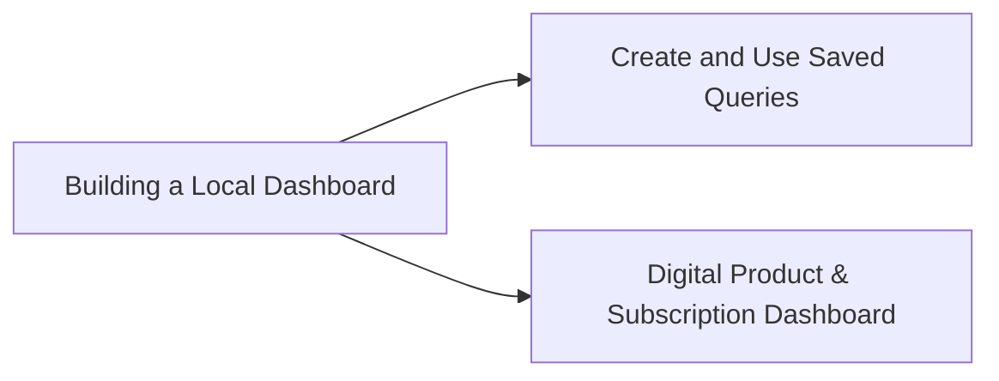

<!-- SPDX-License-Identifier: CC-BY-4.0 -->
<!-- Copyright Contributors to the ODPi Egeria project. -->

# Tutorials

Step-by-step, worked guides for getting things done in the Egeria Workspaces portal. Each one builds a real example you can reproduce on the Quickstart environment, with screenshots and diagrams where they help.

| Tutorial | What you will do | Uses |
|----------|------------------|------|
| [Building a Local Dashboard](local-dashboards.md) | Author a Dashboard Sheet: pick a Report Spec, create a Report, place it on the sheet, add KPI tiles and analytic charts, set perspectives and drill-downs. | [Local Dashboards](../tools/local-dashboards.md), Dr.Egeria |
| [Create and Use Saved Queries](saved-queries.md) | Build a faceted query, save it as a real Egeria `SavedQuery`, refresh it, and show its results on a Local Dashboard. | [Query tool](../tools/egeria-insights.md), [Local Dashboards](../tools/local-dashboards.md) |
| [Digital Product & Subscription Dashboard](digital-product-subscription.md) | Track Data Product adoption and historic growth with analytic trends and relationship diagrams. | [Local Dashboards](../tools/local-dashboards.md), Dr.Egeria |

## Suggested order

Start with **Building a Local Dashboard**: the other two reuse its Report, Report Spec and Dashboard Sheet concepts.

## Prerequisites

- The Quickstart stack is running (`./quick-start-local`) and the portal is open at `https://localhost:8843`.
- For the Dr.Egeria steps, either the `dr_egeria` CLI or the **▶ Run Dr.Egeria Document** panel in [Local Dashboards](../tools/local-dashboards.md).

## Adding a tutorial

Put the Markdown file in `portal-docs/tutorials/`, put its screenshots in `portal-docs/images/` (reference them as `../images/name.png`), and add it to the table above and to the Tutorials section of `portal-docs/index.html`. See [Adding Documentation](../contributing.md).
