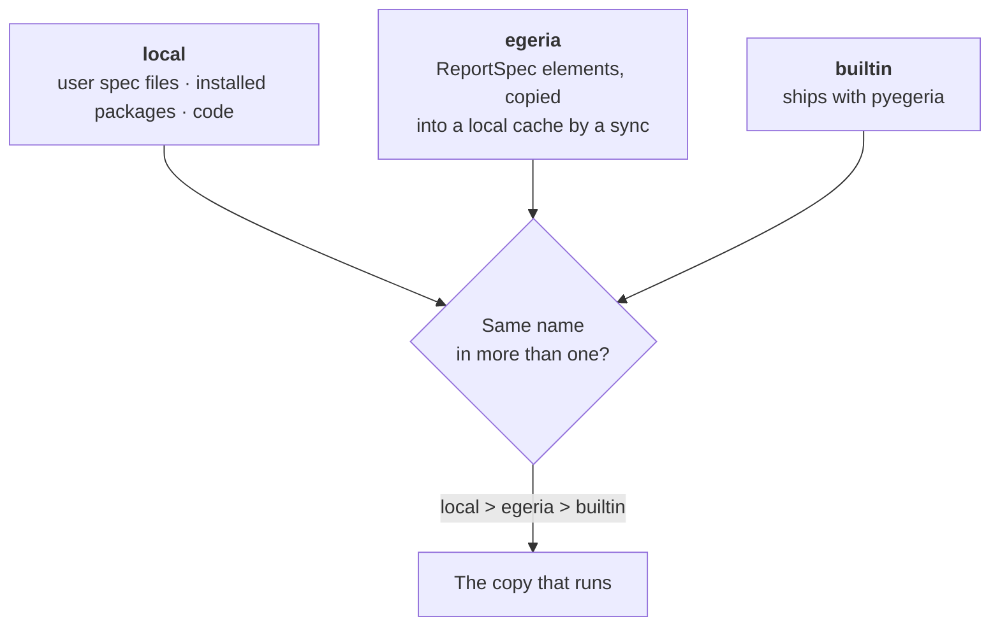

<!-- SPDX-License-Identifier: CC-BY-4.0 -->
<!-- Copyright Contributors to the ODPi Egeria project. -->

# Report Specs: Local and Held in Egeria

A **report spec** says how to produce a report: what to fetch from Egeria (or which analytic function to
run), and which columns to show for each output format (TABLE, DICT, MD, a chart). pyegeria ships more
than 400 of them. You can add your own in two ways:

- **locally**, as a file or in code, for one machine or one application;
- **held in Egeria**, as a `ReportSpec` element that every tool reading the same Egeria can use.

This tutorial covers both, how pyegeria decides which copy to use when two have the same name, and how
the Portal shows where each spec came from.

> **What was checked.** Unless a step says *not verified*, it was checked on 2026-11-10 against the
> quickstart (Portal at commit 81d6e636, pyegeria 6.2.32). The local-file steps were run in a throwaway
> Python process in the quickstart's Jupyter container. The Dr.Egeria document in Part B was run with
> `--validate` only. Nothing was written to Egeria.

> **Report or report spec?** A *report spec* is the recipe. A *Report* is an Egeria element that uses
> one recipe with its parameters filled in, so it can go on a dashboard. See
> [Building a Local Dashboard](local-dashboards.md).

---

## Where specs come from, and which one wins



pyegeria puts every spec into one registry, in three tiers. When two tiers hold a spec with the same name,
**local beats egeria, and egeria beats builtin**. The hidden copy can still be run by adding a prefix to
its name: `builtin:Collections` or `egeria:Collections`.

The Portal shows each spec's source as a badge in **Egeria Explorer → Reports → Report Specs**:

| Badge | Tier | Where it comes from |
|---|---|---|
| **pyegeria built-in** | builtin | Ships with pyegeria (437 on the quickstart on 2026-11-10) |
| **held in Egeria** | egeria | A `ReportSpec` element in one of the folders the Portal reads (2 on the quickstart) |
| **Portal (local)** | local | Registered by the Portal's own code |
| **user spec file** | local | A JSON file in the user report specs directory |

---

## Part A: local report specs

### A1. Write a spec as a JSON file

A user spec file holds one or more specs, keyed by name. The easiest way to get the format right is to
build the spec in Python and save it:

```python
from pyegeria.view._output_format_models import (
    ActionParameter, Column, Format, FormatSet, FormatSetDict)

specs = FormatSetDict({"Demo - Terms by Name": FormatSet(
    heading="Terms by name",
    description="Glossary terms whose name contains a word.",
    family="Demo",
    target_type="GlossaryTerm",
    formats=[Format(types=["TABLE", "DICT"], attributes=[
        Column(name="Display Name", key="display_name"),
        Column(name="Qualified Name", key="qualified_name")])],
    action=ActionParameter(function="GlossaryManager.find_glossary_terms",
                           required_params=["search_string"]),
)})
specs.save_to_json("my_specs.json")
```

To run an analytic function instead of a find, leave `function` empty and set `analytic_function` to the
function's registered name, with its default parameters in `analytic_spec_params`. See
[Add and Use Analytic Functions](analytic-functions.md).

### A2. Put the file where pyegeria looks

pyegeria reads every JSON file in the **user report specs directory**:

1. `PYEGERIA_USER_REPORT_SPECS_DIR`, if set (the older name `PYEGERIA_USER_FORMAT_SETS_DIR` also works);
2. otherwise config.json's `"Pyegeria User Report Specs Dir"`;
3. otherwise `~/.pyegeria/report_specs`.

pyegeria reads the directory the first time a process uses the registry. A file added later is read
after a restart, or when your code calls `refresh_report_specs()`.

*Verified:* with `PYEGERIA_USER_REPORT_SPECS_DIR` pointing at a folder holding the file above, the spec
was registered with tier `local`.

| Environment | User report specs directory |
|---|---|
| Your own Python | `~/.pyegeria/report_specs`, unless set otherwise |
| Quickstart Jupyter | `/home/jovyan/.pyegeria/report_specs` (does not exist until you create it; lost when the container is re-created) |
| Quickstart Portal | `/root/.pyegeria/report_specs` in the container, which is `runtime-volumes/quickstart-pyegeria-state/report_specs/` on the host. It does not exist today. *Not verified in the Portal:* create it, add the file, and restart the Portal; the spec should then show the **user spec file** badge. |

### A3. Other local ways

- **An installed package** declares a `pyegeria.report_specs` entry point that returns a `FormatSetDict`.
  Use this to ship specs with an application.
- **Code** calls `register_report_specs(specs, source="my-app")`. The Portal registers its own specs this
  way.

These settings were removed in pyegeria 6.2.19 and are no longer read: `PYEGERIA_REPORT_SPEC_MODULES`,
`PYEGERIA_REPORT_FORMATS_JSON`, `PYEGERIA_REPORT_FORMATS_MODULES`, config.json's
`"Pyegeria Report Spec Modules"` and the `trellis.report_specs` entry-point group. If one is still set,
pyegeria logs a warning naming it.

### A4. Override a built-in spec

A local spec with the same name as a built-in one replaces it everywhere, with one warning per process.

*Verified:* a user spec file defining `Collections` made `Collections` resolve to the local copy, while
`builtin:Collections` still reached pyegeria's own.

Use this with care: anything that runs that name gets your copy.

---

## Part B: report specs held in Egeria

A spec held in Egeria is a `ReportSpec` element (a kind of collection). Each tool copies the specs it
needs into a local cache with a **sync**, and runs them from there. Running a report never reads the spec
from Egeria.

### B1. How specs are organised: consumer folders

Report specs in Egeria are filed by the tool that uses them:

```
RootCollection  "Report Specs"            RootCollection::ReportSpecs
 ├─ "Portal"              ReportSpecFolder::Consumer::Portal
 ├─ "Egeria Advisor"      ReportSpecFolder::Consumer::EgeriaAdvisor
 ├─ "Resource Explorer"   ReportSpecFolder::Consumer::ResourceExplorer
 ├─ "pyegeria"            ReportSpecFolder::Consumer::Pyegeria
 ├─ "My Egeria"           ReportSpecFolder::Consumer::MyEgeria
 └─ "Jupyter"             ReportSpecFolder::Consumer::Jupyter
```

**Putting a spec in a tool's folder publishes it to that tool.** A spec can be in several folders. On the
quickstart this tree was built on 2026-11-10 by
`compose-configs/egeria-quickstart/PyegeriaWebHandler/egeria-held-specs/REPORT_SPEC_CONSUMER_FOLDERS.dr-egeria.md`.
The Portal's folder was renamed from `ReportSpecFolder::EgeriaPortal`; it is the same element.

> **⚠ Do not put a zoned spec in a consumer folder yet.** A spec with **Zone Membership** set is meant
> for only some people. The Portal copies its folder into one cache that every viewer reads, and
> pyegeria 6.2.32's sync does not leave zoned specs out. So until per-user reading of restricted specs
> lands (work item B6), every spec in a consumer folder must be public: leave **Zone Membership** empty.
> (The pyegeria release after 6.2.32 skips zoned specs in a shared cache and reports them as
> "zoned: not synced into a shared cache".)

### B2. Write the spec in Egeria with Dr.Egeria

`Create Report Spec` creates or updates a `ReportSpec`. How its fields are read back by the sync:

| Dr.Egeria attribute | What it holds |
|---|---|
| `Display Name` | The spec's name (its label). It must match the text after `ReportSpec::` in the qualified name, or the sync skips the spec. |
| `Qualified Name` | `ReportSpec::<the same name>` |
| `Purpose` | The heading |
| `Category` | The family |
| `Content Status` | Must be `ACTIVE`. A `DRAFT` or `PROPOSED` spec is only copied with `--include-drafts`. |
| `Output Types` | The output formats it offers |
| `Microflow` | The spec itself, as `microflow/1` JSON: its parameters, stages and formatters |
| `Target Type Name` | The element type it reports on (leave out for an analytic spec) |
| `Parent ID` | The consumer folder, so the new spec is a member of it |
| `Zone Membership` | Leave empty for a spec in a consumer folder (see the warning above) |

You do not have to write the `Microflow` by hand. Build the spec in Python (as in A1) or take an
existing one, and convert it:

```python
from pyegeria.view.base_report_formats import get_report_registry
from pyegeria.view.microflow import format_set_to_microflow

spec = get_report_registry()["Analytic Demo - Element Count by Type"]
print(format_set_to_microflow(spec).model_dump_json(exclude_none=True))
```

which prints (verified):

```json
{"format":"microflow/1","params":{},"stages":[{"stage":"producer/analytic","function":"count_elements","params":{"type_name":"GlossaryTerm","strict":true}}],"formatters":{"DICT":{"columns":[]},"JSON":{"same_as":"DICT"}}}
```

A Dr.Egeria document that creates a spec and files it in the Portal's folder:

```markdown
## Create Report Spec
### Display Name
Tutorial Demo - Glossary Term Count

### Qualified Name
ReportSpec::Tutorial Demo - Glossary Term Count

### Description
Counts glossary terms.

### Purpose
Glossary term count

### Category
Tutorial

### Content Status
ACTIVE

### Output Types
DICT, JSON

### Microflow
{"format":"microflow/1","params":{},"stages":[{"stage":"producer/analytic","function":"count_elements","params":{"type_name":"GlossaryTerm"}}],"formatters":{"DICT":{"columns":[]},"JSON":{"same_as":"DICT"}}}

### Parent ID
ReportSpecFolder::Consumer::Portal
```

*Verified with `dr_egeria --validate` (no changes made): "Validated Create Report Spec".*

> **Writing to Egeria is a shared change.** On a shared Egeria, check with the people who use it before
> you run `--process`, and run `--validate` first.

**To publish a spec that already exists**, do not re-run it with a new `Parent ID`: on an update, Dr.Egeria
can remove one of the spec's existing folder memberships before adding the new one. Use
`Add Member to Collection` instead, which leaves other memberships alone:

```markdown
## Add Member to Collection
### Collection Id
ReportSpecFolder::Consumer::Portal

### Element Id
ReportSpec::Tutorial Demo - Glossary Term Count

### Membership Status
VALIDATED
```

**To unpublish**, remove the membership (`Remove Member from Collection`, with the same three attributes)
or delete the spec, then sync. The sync drops the spec from the cache and names it as *pruned*.

*Both membership commands were checked with `dr_egeria --validate` only.*

### B3. Sync it into the tool

A spec held in Egeria reaches a tool only after that tool syncs its folders.

**The quickstart Portal** syncs the folders in `PYEGERIA_REPORT_SPEC_FOLDERS` (default
`ReportSpecFolder::Consumer::Portal`, set in `egeria-quickstart.yaml`):

- about 30 seconds after it starts, in the background (`PORTAL_REPORT_SPEC_SYNC_AT_STARTUP=0` turns this off);
- when an administrator clicks **⇣ Sync from Egeria** in the Report Specs view
  (`POST /api/report-specs/sync`; `GET` gives the last result).

The sync only reads Egeria, as the Portal's service user. On 2026-11-10 the last sync said: *synced,
folder ReportSpecFolder::Consumer::Portal, unchanged: Resource Explorer - Curation Coverage, Analytic -
Generic Metric Trend.*

**Your own Python or Jupyter** syncs with pyegeria's command, which writes to a local cache
(`~/.pyegeria/cache/report_specs/<platform>/<view server>/`, or `PYEGERIA_REPORT_SPEC_CACHE_DIR`):

```bash
pyegeria report-specs sync --folder ReportSpecFolder::Consumer::Jupyter
pyegeria report-specs sync --spec "Tutorial Demo - Glossary Term Count"
pyegeria report-specs sync --include-drafts
```

With no `--folder`, it syncs `PYEGERIA_REPORT_SPEC_FOLDERS` (or config.json's
`"Pyegeria Report Spec Folders"`); pyegeria's own default is no folders, so set one. The quickstart Jupyter
container sets neither today. *The command exists in 6.2.32; a sync from Jupyter was not run.*

**Egeria Advisor** syncs `ReportSpecFolder::Consumer::EgeriaAdvisor` at startup and from its admin
**Sync Report Specs from Egeria** action (`ADVISOR_REPORT_SPEC_FOLDERS`, else
`PYEGERIA_REPORT_SPEC_FOLDERS`). *Not verified: read from the trellis source (main 0947d1a2).*

**Freshstart** does not sync specs from Egeria. Its Portal (pyegeria `<6.2.27`) runs built-in and local
specs only.

### B4. Check it in the Portal

Open **Egeria Explorer → Reports → Report Specs**:

- The banner says how many specs are held in Egeria and which folders were read. When there are none it
  says why (no folders configured, no sync yet, folders not found or not visible, or no active specs).
- The spec carries the **held in Egeria** badge (list tag **EG**), its qualified name and when it was
  last synced. A draft says *DRAFT*.
- **Used by** lists the tools whose folders hold the spec. With pyegeria 6.2.32 every spec says
  *Used by: not read* (hover for the reason: the consumer index arrives in the release after 6.2.32).
  It never shows *none* when it simply could not read the folders.
- The **Resolution** panel says whether the spec can run, in pyegeria's own words if not.

### B5. The Portal's own two specs

The Portal defines two specs in its code and also holds copies in its Egeria folder: *Analytic - Generic
Metric Trend* and *Resource Explorer - Curation Coverage*. It uses the Egeria copy while its cache holds
one, and registers its own copy only when Egeria does not, so these tiles keep working if the folder is
emptied or a sync has not run yet.

---

## Troubleshooting

| What you see | Why | What to do |
|---|---|---|
| The spec is not in the list | No sync since it was added, or it is not `ACTIVE`, or its `Display Name` does not match its qualified name | Check the banner and the last sync result; fix the element and sync again |
| *None held in Egeria: the configured folders were not found in Egeria (or are not visible to the Portal's user)* | The folder does not exist on this Egeria, or it is in a zone the Portal's user cannot see | On a new Egeria, run `REPORT_SPEC_CONSUMER_FOLDERS.dr-egeria.md` once |
| A different copy runs from the one you edited | A local copy with the same name shadows it | The spec's details say which copy is shadowed; run the other with `egeria:` or `builtin:` |
| The spec cannot run (Resolution panel) | It names an analytic function that is not registered in this process, or a Python path | Register the function where the spec runs; name it by its registered name |
| A Report shows "cannot run" after a spec was removed | The Report still names the old spec, for example *Analytic - Element Count by Type* | Re-run its `Create Report` naming the replacement, *Analytic Demo - Element Count by Type* |

## Where next

- [Add and Use Analytic Functions](analytic-functions.md): write the function a spec runs.
- [Building a Local Dashboard](local-dashboards.md): put a spec on a dashboard through a Report.
- [Egeria Explorer: where a report spec comes from](../tools/egeria-explorer.md#where-a-report-spec-comes-from).
- pyegeria: [Output formats and report specs](https://github.com/odpi/egeria-python/blob/main/docs/output-formats-and-report-specs.md).
