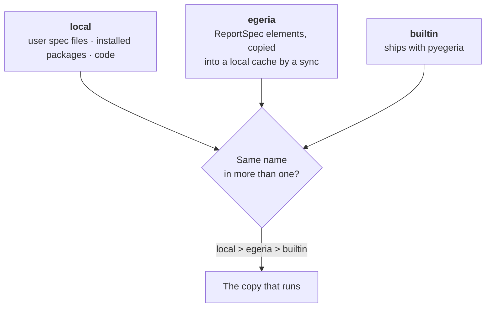

<!-- SPDX-License-Identifier: CC-BY-4.0 -->
<!-- Copyright Contributors to the ODPi Egeria project. -->

# Report Specs: Local and Held in Egeria

A **report spec** says how to produce a report: what to fetch from Egeria (or which analytic function to
run), and which columns to show for each output format (TABLE, DICT, MD, a chart). pyegeria ships more
than 400 of them. You can add your own in two ways:

- **locally**, as a file or in code, for one machine or one application;
- **held in Egeria**, as a `ReportSpec` element that every tool reading the same Egeria can use.

This tutorial covers both, how pyegeria decides which copy to use when two have the same name, how
the Portal shows where each spec came from (Parts A and B), and how a spec's output looks, which output
type to choose, and how a column can say how its values are drawn (Part C).

> **What was checked.** Unless a step says *not verified*, it was checked on 2026-11-10 against the
> quickstart (Portal at commit 81d6e636, pyegeria 6.2.32). The local-file steps were run in a throwaway
> Python process in the quickstart's Jupyter container. The Dr.Egeria document in Part B was run with
> `--validate` only. Nothing was written to Egeria.
>
> Part C describes pyegeria 6.2.37 and 6.2.38 (from their release notes) and the Portal as of
> 2026-11-11 (upstream main 73c329de). Its Portal behaviour was checked that day in a read-only preview
> against the quickstart. Screenshots will follow once the quickstart's data has been re-seeded.

> **Report or report spec?** A *report spec* is the recipe. A *Report* is an Egeria element that uses
> one recipe with its parameters filled in, so it can go on a dashboard. See
> [Building a Local Dashboard](local-dashboards.md).

---

## Where specs come from, and which one wins



pyegeria puts every spec into one registry, in three tiers. When two tiers hold a spec with the same name,
**local beats egeria, and egeria beats builtin**. The hidden copy can still be run by adding a prefix to
its name: `builtin:Collections` or `egeria:Collections`.

The Portal shows each spec's source as a badge in **Egeria Explorer → Reports → Report Specs**:

| Badge | Tier | Where it comes from |
|---|---|---|
| **pyegeria built-in** | builtin | Ships with pyegeria (437 on the quickstart on 2026-11-10) |
| **held in Egeria** | egeria | A `ReportSpec` element in one of the folders the Portal reads (2 on the quickstart) |
| **Portal (local)** | local | Registered by the Portal's own code |
| **user spec file** | local | A JSON file in the user report specs directory |

---

## Part A: local report specs

### A1. Write a spec as a JSON file

A user spec file holds one or more specs, keyed by name. The easiest way to get the format right is to
build the spec in Python and save it:

```python
from pyegeria.view._output_format_models import (
    ActionParameter, Column, Format, FormatSet, FormatSetDict)

specs = FormatSetDict({"Demo - Terms by Name": FormatSet(
    heading="Terms by name",
    description="Glossary terms whose name contains a word.",
    family="Demo",
    target_type="GlossaryTerm",
    formats=[Format(types=["TABLE", "DICT"], attributes=[
        Column(name="Display Name", key="display_name"),
        Column(name="Qualified Name", key="qualified_name")])],
    action=ActionParameter(function="GlossaryManager.find_glossary_terms",
                           required_params=["search_string"]),
)})
specs.save_to_json("my_specs.json")
```

To run an analytic function instead of a find, leave `function` empty and set `analytic_function` to the
function's registered name, with its default parameters in `analytic_spec_params`. See
[Add and Use Analytic Functions](analytic-functions.md).

### A2. Put the file where pyegeria looks

pyegeria reads every JSON file in the **user report specs directory**:

1. `PYEGERIA_USER_REPORT_SPECS_DIR`, if set (the older name `PYEGERIA_USER_FORMAT_SETS_DIR` also works);
2. otherwise config.json's `"Pyegeria User Report Specs Dir"`;
3. otherwise `~/.pyegeria/report_specs`.

pyegeria reads the directory the first time a process uses the registry. A file added later is read
after a restart, or when your code calls `refresh_report_specs()`.

*Verified:* with `PYEGERIA_USER_REPORT_SPECS_DIR` pointing at a folder holding the file above, the spec
was registered with tier `local`.

| Environment | User report specs directory |
|---|---|
| Your own Python | `~/.pyegeria/report_specs`, unless set otherwise |
| Quickstart Jupyter | `/home/jovyan/.pyegeria/report_specs` (does not exist until you create it; lost when the container is re-created) |
| Quickstart Portal | `/root/.pyegeria/report_specs` in the container, which is `runtime-volumes/quickstart-pyegeria-state/report_specs/` on the host. It does not exist today. *Not verified in the Portal:* create it, add the file, and restart the Portal; the spec should then show the **user spec file** badge. |

### A3. Other local ways

- **An installed package** declares a `pyegeria.report_specs` entry point that returns a `FormatSetDict`.
  Use this to ship specs with an application.
- **Code** calls `register_report_specs(specs, source="my-app")`. The Portal registers its own specs this
  way.

These settings were removed in pyegeria 6.2.19 and are no longer read: `PYEGERIA_REPORT_SPEC_MODULES`,
`PYEGERIA_REPORT_FORMATS_JSON`, `PYEGERIA_REPORT_FORMATS_MODULES`, config.json's
`"Pyegeria Report Spec Modules"` and the `trellis.report_specs` entry-point group. If one is still set,
pyegeria logs a warning naming it.

### A4. Override a built-in spec

A local spec with the same name as a built-in one replaces it everywhere, with one warning per process.

*Verified:* a user spec file defining `Collections` made `Collections` resolve to the local copy, while
`builtin:Collections` still reached pyegeria's own.

Use this with care: anything that runs that name gets your copy.

---

## Part B: report specs held in Egeria

A spec held in Egeria is a `ReportSpec` element (a kind of collection). Each tool copies the specs it
needs into a local cache with a **sync**, and runs them from there. Running a report never reads the spec
from Egeria.

### B1. How specs are organised: consumer folders

Report specs in Egeria are filed by the tool that uses them:

```
RootCollection  "Report Specs"            RootCollection::ReportSpecs
 ├─ "Portal"              ReportSpecFolder::Consumer::Portal
 ├─ "Egeria Advisor"      ReportSpecFolder::Consumer::EgeriaAdvisor
 ├─ "Resource Explorer"   ReportSpecFolder::Consumer::ResourceExplorer
 ├─ "pyegeria"            ReportSpecFolder::Consumer::Pyegeria
 ├─ "My Egeria"           ReportSpecFolder::Consumer::MyEgeria
 └─ "Jupyter"             ReportSpecFolder::Consumer::Jupyter
```

**Putting a spec in a tool's folder publishes it to that tool.** A spec can be in several folders. On the
quickstart this tree was built on 2026-11-10 by
`compose-configs/egeria-quickstart/PyegeriaWebHandler/egeria-held-specs/REPORT_SPEC_CONSUMER_FOLDERS.dr-egeria.md`.
The Portal's folder was renamed from `ReportSpecFolder::EgeriaPortal`; it is the same element.

> **⚠ Do not put a zoned spec in a consumer folder yet.** A spec with **Zone Membership** set is meant
> for only some people. The Portal copies its folder into one cache that every viewer reads, and
> pyegeria 6.2.32's sync does not leave zoned specs out. So until per-user reading of restricted specs
> lands (work item B6), every spec in a consumer folder must be public: leave **Zone Membership** empty.
> (The pyegeria release after 6.2.32 skips zoned specs in a shared cache and reports them as
> "zoned: not synced into a shared cache".)

### B2. Write the spec in Egeria with Dr.Egeria

`Create Report Spec` creates or updates a `ReportSpec`. How its fields are read back by the sync:

| Dr.Egeria attribute | What it holds |
|---|---|
| `Display Name` | The spec's name (its label). It must match the text after `ReportSpec::` in the qualified name, or the sync skips the spec. |
| `Qualified Name` | `ReportSpec::<the same name>` |
| `Purpose` | The heading |
| `Category` | The family |
| `Content Status` | Must be `ACTIVE`. A `DRAFT` or `PROPOSED` spec is only copied with `--include-drafts`. |
| `Output Types` | The output formats it offers |
| `Microflow` | The spec itself, as `microflow/1` JSON: its parameters, stages and formatters |
| `Target Type Name` | The element type it reports on (leave out for an analytic spec) |
| `Parent ID` | The consumer folder, so the new spec is a member of it |
| `Zone Membership` | Leave empty for a spec in a consumer folder (see the warning above) |

You do not have to write the `Microflow` by hand. Build the spec in Python (as in A1) or take an
existing one, and convert it:

```python
from pyegeria.view.base_report_formats import get_report_registry
from pyegeria.view.microflow import format_set_to_microflow

spec = get_report_registry()["Analytic Demo - Element Count by Type"]
print(format_set_to_microflow(spec).model_dump_json(exclude_none=True))
```

which prints (verified):

```json
{"format":"microflow/1","params":{},"stages":[{"stage":"producer/analytic","function":"count_elements","params":{"type_name":"GlossaryTerm","strict":true}}],"formatters":{"DICT":{"columns":[]},"JSON":{"same_as":"DICT"}}}
```

A Dr.Egeria document that creates a spec and files it in the Portal's folder:

```markdown
## Create Report Spec
### Display Name
Tutorial Demo - Glossary Term Count

### Qualified Name
ReportSpec::Tutorial Demo - Glossary Term Count

### Description
Counts glossary terms.

### Purpose
Glossary term count

### Category
Tutorial

### Content Status
ACTIVE

### Output Types
DICT, JSON

### Microflow
{"format":"microflow/1","params":{},"stages":[{"stage":"producer/analytic","function":"count_elements","params":{"type_name":"GlossaryTerm"}}],"formatters":{"DICT":{"columns":[]},"JSON":{"same_as":"DICT"}}}

### Parent ID
ReportSpecFolder::Consumer::Portal
```

*Verified with `dr_egeria --validate` (no changes made): "Validated Create Report Spec".*

> **Writing to Egeria is a shared change.** On a shared Egeria, check with the people who use it before
> you run `--process`, and run `--validate` first.

**To publish a spec that already exists**, do not re-run it with a new `Parent ID`: on an update, Dr.Egeria
can remove one of the spec's existing folder memberships before adding the new one. Use
`Add Member to Collection` instead, which leaves other memberships alone:

```markdown
## Add Member to Collection
### Collection Id
ReportSpecFolder::Consumer::Portal

### Element Id
ReportSpec::Tutorial Demo - Glossary Term Count

### Membership Status
VALIDATED
```

**To unpublish**, remove the membership (`Remove Member from Collection`, with the same three attributes)
or delete the spec, then sync. The sync drops the spec from the cache and names it as *pruned*.

*Both membership commands were checked with `dr_egeria --validate` only.*

### B3. Sync it into the tool

A spec held in Egeria reaches a tool only after that tool syncs its folders.

**The quickstart Portal** syncs the folders in `PYEGERIA_REPORT_SPEC_FOLDERS` (default
`ReportSpecFolder::Consumer::Portal`, set in `egeria-quickstart.yaml`):

- about 30 seconds after it starts, in the background (`PORTAL_REPORT_SPEC_SYNC_AT_STARTUP=0` turns this off);
- when an administrator clicks **⇣ Sync from Egeria** in the Report Specs view
  (`POST /api/report-specs/sync`; `GET` gives the last result).

The sync only reads Egeria, as the Portal's service user. On 2026-11-10 the last sync said: *synced,
folder ReportSpecFolder::Consumer::Portal, unchanged: Resource Explorer - Curation Coverage, Analytic -
Generic Metric Trend.*

**Your own Python or Jupyter** syncs with pyegeria's command, which writes to a local cache
(`~/.pyegeria/cache/report_specs/<platform>/<view server>/`, or `PYEGERIA_REPORT_SPEC_CACHE_DIR`):

```bash
pyegeria report-specs sync --folder ReportSpecFolder::Consumer::Jupyter
pyegeria report-specs sync --spec "Tutorial Demo - Glossary Term Count"
pyegeria report-specs sync --include-drafts
```

With no `--folder`, it syncs `PYEGERIA_REPORT_SPEC_FOLDERS` (or config.json's
`"Pyegeria Report Spec Folders"`); pyegeria's own default is no folders, so set one. The quickstart Jupyter
container sets neither today. *The command exists in 6.2.32; a sync from Jupyter was not run.*

**Egeria Advisor** syncs `ReportSpecFolder::Consumer::EgeriaAdvisor` at startup and from its admin
**Sync Report Specs from Egeria** action (`ADVISOR_REPORT_SPEC_FOLDERS`, else
`PYEGERIA_REPORT_SPEC_FOLDERS`). *Not verified: read from the trellis source (main 0947d1a2).*

**Freshstart** does not sync specs from Egeria. Its Portal (pyegeria `<6.2.27`) runs built-in and local
specs only.

### B4. Check it in the Portal

Open **Egeria Explorer → Reports → Report Specs**:

- The banner says how many specs are held in Egeria and which folders were read. When there are none it
  says why (no folders configured, no sync yet, folders not found or not visible, or no active specs).
- The spec carries the **held in Egeria** badge (list tag **EG**), its qualified name and when it was
  last synced. A draft says *DRAFT*.
- **Used by** lists the tools whose folders hold the spec, read from pyegeria's consumer index
  (pyegeria 6.2.33 and later). With 6.2.32 or earlier every spec says *Used by: not read* (hover for the
  reason). It never shows *none* when it simply could not read the folders.
- The **Resolution** panel says whether the spec can run, in pyegeria's own words if not.

### B4a. Publish a spec to a tool, or withdraw it, from the Portal

Under a spec's badges in **Report Specs**, **Publish to / Withdraw from** puts the spec in a tool's consumer
folder, or takes it out (pyegeria 6.2.40 and later; public specs only). Pick the action and the folder (each
says whether the spec is in it now), then:

1. **Preview** shows the exact Dr.Egeria document, read-only, and what it does in words. Nothing is sent.
   Publishing is `Create Report Spec` (or `Update Report Spec` when Egeria already holds the spec) and
   `Add Member to Collection`, never a Parent ID. Withdrawing is `Remove Member from Collection`; the spec
   itself stays in Egeria.
2. **Validate** runs Dr.Egeria's checks on it.
3. Tick **I confirm** and press **Publish** (or **Withdraw**). The document runs **as you**, with your own
   sign-in, never as the Portal's service account, so Egeria records who did it and decides whether you may
   write that folder. If Egeria refuses, its words are shown.

The Portal refuses, and says why:

- you are not signed in;
- a **built-in** spec: built-ins are published later, after consumer-folders phase 3;
- a spec held with **zones**: restricted publish comes later, after the zone proof (it is never made
  public by this control);
- the consumer folders were not read (run the sync first), or the folder is not one of them;
- **the document changed since your preview** (the spec, or what Egeria holds): preview it again;
- a spec held in Egeria that someone changed **after the Portal's last sync**: publishing would write the
  older copy back, so sync first;
- withdrawing a spec Egeria does not hold.

After a successful publish or withdraw, the Portal drops its cached results for that spec and starts the
report-spec sync; **Used by** shows the change when the sync finishes.

The documents and their checks are pyegeria's (`pyegeria.view.report_spec_publish`), the same ones Egeria
Advisor uses, so the two tools publish a spec the same way.

### B5. The Portal's own two specs

The Portal defines two specs in its code and also holds copies in its Egeria folder: *Analytic - Generic
Metric Trend* and *Resource Explorer - Curation Coverage*. It uses the Egeria copy while its cache holds
one, and registers its own copy only when Egeria does not, so these tiles keep working if the folder is
emptied or a sync has not run yet.

---

## Part C: how a spec's output looks

pyegeria 6.2.37 changed how report specs draw **complex values**: lists, maps (key/value properties)
and related elements. This part explains, in plain terms, what you now see, which output type to pick for
where the report will be read, and the optional column settings that control how a value is drawn.

### C1. Which output type for which surface

The output type says what the report is *for*. It never says where it will be shown: each surface has
its own renderer for each type, so the same spec works everywhere.

| Surface | What it does with the output |
|---|---|
| **The Portal** (Local Dashboards, Report Specs, the Explorer), **Trellis** (Egeria Advisor, Resource Explorer) and **the terminal** (`run_report`, the Textual TUI) | Render it: a table is drawn as a table, a chart as a chart, markdown as formatted text |
| **MCP and A2A** (agents) | Take the un-rendered result, usually DICT, and nothing else |

To choose an output type:

- **A number** (a KPI): DICT, from an analytic function. **A trend:** SERIES. **Proportions:** BAR or PIE.
- **Rows of things with a few fields, perhaps with lists in them:** TABLE (or LIST in a markdown
  document). Every surface draws it as a table and copes with lists and small sub-tables.
- **One thing in depth, or prose:** REPORT (FORM for an editable record).
- **A quick list of names with links to drill into:** LIST.
- **Relationships as a picture:** MERMAID.
- **A file in a published standard** (for example a DCAT catalog): DOCUMENT (C5).
- **Data for a program:** DICT, which follows the spec's columns. **JSON** is Egeria's raw answer and
  ignores the spec's columns, by design.

**Two levels deep, at most, in a table.** A row is level one; a cell holding a list, a map or a small
sub-table is level two. Anything deeper (an object inside a sub-table) is not drawn as a table: it is
shown as a count and names, with a note. For real hierarchies use REPORT, MERMAID, or a LIST with
drill-down. A TREE-VIEW output type for hierarchies may come later; it does not exist today.

### C2. What changed in rendered output with pyegeria 6.2.37

These are changes to **rendered text** (LIST, REPORT, MD, FORM, HTML and the terminal table). The rows
of DICT and JSON results keep their shape.

- **LIST table cells are drawn by what the value is,** not always as one comma-joined string:
  - a list of plain values is drawn as **bullets**: one item per line, with "+N more" past 10;
  - related elements are **joined**: "a, b (+3 more: c, d, e)" past 10;
  - a map (properties) is **key: value**, one pair per line;
  - a column set to `count` shows the **number**.

  In a markdown table the line breaks are `<br>`. The Portal draws them as line breaks (Local
  Dashboards, The Catalog and the Explorer's markdown views).
- **Classifications** read "Confidentiality, Criticality", without the stray line break before each comma.
- **`False` and `0` show** in REPORT, MD and FORM. They used to be dropped, as if the value were missing.
- **A capped result says so.** When a query fills its page, the output says "Showing the first 100: the
  query stopped at its page size of 100; more may exist." A short page is not promised to be the last
  (Egeria's paging contract), so pyegeria never claims a total it did not count.
  - In LIST, REPORT and MD output it is a line in the text.
  - In DICT and TABLE results it is a `notes` list beside the rows. The Portal shows these notes under the
    result: on Local Dashboards tiles, in the drill-down drawer and in the Explorer's Run Report panel.
- **The terminal table** (`run_report --output-format TABLE`) keeps the author's column order and names
  the columns it cannot fit ("+2 more columns: …") instead of dropping them silently.

Anything that **parses** pyegeria's rendered text (rather than reading DICT or JSON) should be checked
again after the upgrade.

### C3. Telling a column how to draw its values

A column can carry four optional settings. You rarely need them: when a setting is not given, pyegeria
picks from the kind of value (a plain value is text, a list of values is bullets, a map is key/value,
related elements are joined).

| Setting | What it does | Default |
|---|---|---|
| `render` | How the value is drawn: `text`, `join`, `bullets`, `kv` (key/value), `subtable`, `count` or `link` | from the value's kind |
| `max_items` | List items shown before "+N more" | 10 |
| `max_lines` | Lines of long text shown before it is cut: with "…" in the terminal table, and with a **more** / **less** toggle in the Portal's TABLE. REPORT and LIST are documents and are not cut | 3 |
| `label` | Which name a related element shows in text outputs: `qualified_name` or `display_name`. The Portal's TABLE shows the display name unless the column says `qualified_name`, and always puts the qualified name in the tooltip | `qualified_name` (text outputs) |

Example: a risk register where the implications are a list, the authors are names, and the description
is long:

```python
Format(types=["LIST", "TABLE", "DICT"], attributes=[
    Column(name="Risk", key="display_name"),
    Column(name="Implications", key="implications", render="bullets", max_items=5),
    Column(name="Authors", key="authors", render="join"),
    Column(name="Description", key="description", max_lines=2)])
```

In a JSON spec file the same column is
`{"name": "Implications", "key": "implications", "render": "bullets", "max_items": 5}`.

Choosing `render`:

- **bullets** for short lists of values;
- **join** for names;
- **kv** for property maps;
- **subtable** for related elements with a few fields of their own (give it a `detail_spec`);
- **count** for long lists.

`label: "display_name"` is set per column, never globally, because some programs split qualified
names. The built-in *Digital-Products* spec sets it on Product Manager and License, so those show
"Data for Internal Use" rather than the full qualified name.

The four settings are kept in a spec **held in Egeria** too (in its microflow; `label` is stored as
`related_label`). Dr.Egeria's `Create Report Spec` has no attribute for them yet, so set them in a local
spec file or in code.

### C4. Asking for native values (opt-in)

By default every result keeps its old shape, so existing programs keep working. A program that wants
the values themselves, rather than strings, asks for them:

- **A structured table:** `exec_report_spec(name, output_format="TABLE", table_shape="structured")`
  returns `kind: "table"`. It has the columns (each with its kind and how it renders), the rows with
  native values, `total`/`shown` and `notes` for every cap. An empty relationship cell says "none"
  when the relationship was read and "not read" when it was not.

  ```python
  from pyegeria import exec_report_spec
  r = exec_report_spec("Risk-DrE-Basic", output_format="TABLE", table_shape="structured",
                       params={"search_string": "CocoPharma::Risk::"})
  r["rows"][0]["implications"]   # ['Implication one', 'Implication two'], a list, not a string
  ```
- **Native DICT rows:** `exec_report_spec(name, output_format="DICT", dict_shape="native")`. Lists stay
  lists, related elements are objects with both names, and classifications and zones are lists.

  ```python
  r = exec_report_spec("Digital-Products", output_format="DICT", dict_shape="native")
  [m["displayName"] for m in r["data"][0]["members"]]
  ```

Neither is a spec setting: the program that calls asks for it. **The Portal asks for the structured table
for every TABLE** (Local Dashboards placements and Report Specs → Run), see C6. Egeria Advisor still uses
the default shapes and will switch to the same renderer.

### C5. DOCUMENT output and the DCAT catalog

A **DOCUMENT** spec produces one file in a published standard instead of columns. pyegeria 6.2.37 ships
two: **DCAT Catalog** (JSON-LD) and **DCAT Catalog (Turtle)**, a DCAT-AP 3 catalog of the Assets in a
collection.

```bash
run_report --report "DCAT Catalog" --output-format DOCUMENT --output ./out \
           --param scope=DashboardFolder::Consumer::Portal
```

- It writes the file and prints a **validation** line: `valid`, `invalid` (with the findings), or
  `not_validated` with the reason. An unvalidated file is never presented as conforming.
- **Notes** say what was left out and why: for example a DigitalProduct, which is not a DCAT dataset,
  or an Asset with no licence. An Asset Egeria will not show you is noted as "not visible", never as
  absent.
- pyegeria 6.2.38: a catalog can be scoped by `search_string` instead of `scope`. The file is named after
  whichever of the two you gave.

The Portal has no viewer for DOCUMENT results yet: run them with `run_report` or from Python
(`exec_report_spec(name, output_format="DOCUMENT", params=...)`).

---

### C6. How the Portal draws a TABLE

A **TABLE** in Local Dashboards, or from **Report Specs → Run**, is drawn in the browser from the
structured table (C4), by one shared renderer (`static/egeria-table.js`; Egeria Advisor will use the same
file). Each column is drawn by its `render` (C3):

| render | In the Portal |
|---|---|
| `text` | the text; long text shows its first 3 lines (`max_lines`) and a **more** / **less** toggle. A line break in the value is kept |
| `join` | names separated by commas; past `max_items` (10) a **+N more** that opens to the rest |
| `bullets` | a bulleted list in the cell (the rest behind **+N more**, past `max_items`) |
| `kv` | a small two-column key/value table in the cell |
| `subtable` | **▸ N rows** in the cell; clicking it opens a table under the row, titled "*row* · *column*" |
| `count` | the number, with the first names as a tooltip |
| `link` | the element's name as a link |

Related elements show their display name, with the qualified name as the tooltip, and link to The
Catalog, which opens the element's own view (or says that there is none).

What the table says, and never hides:

- **No column limit.** A wide table scrolls sideways, in the author's column order. Every column edge can
  be dragged to resize it, and cell text wraps.
- **Every row the result carries.** pyegeria pages; the footer says how many there are:
  "First 100; more may exist." when the query filled its page, "First N of M." when more were counted,
  and "N rows (one page; Egeria doesn't promise it is the last)." for a single short page (Egeria only
  promises that an empty page is the last).
- **Every note** pyegeria sent, and every note of the renderer, listed under the table.
- **"none"** in a relationship cell means it was read and there is none; a dash means no value in that
  row (the notes say "not read" where the relationship was not asked for).
- **Two levels at most.** Something nested inside a sub-table shows as a count and names, with a note.
- Values are text: markdown in a cell is not interpreted (a `<br>` in a text cell is a line break).

DICT and JSON results are drawn as before (a table of up to 200 rows and 20 columns, with the rest
named).

## Troubleshooting

| What you see | Why | What to do |
|---|---|---|
| The spec is not in the list | No sync since it was added, or it is not `ACTIVE`, or its `Display Name` does not match its qualified name | Check the banner and the last sync result; fix the element and sync again |
| *None held in Egeria: the configured folders were not found in Egeria (or are not visible to the Portal's user)* | The folder does not exist on this Egeria, or it is in a zone the Portal's user cannot see | On a new Egeria, run `REPORT_SPEC_CONSUMER_FOLDERS.dr-egeria.md` once |
| A different copy runs from the one you edited | A local copy with the same name shadows it | The spec's details say which copy is shadowed; run the other with `egeria:` or `builtin:` |
| The spec cannot run (Resolution panel) | It names an analytic function that is not registered in this process, or a Python path | Register the function where the spec runs; name it by its registered name |
| A table cell shows "a&lt;br&gt;b" as text | pyegeria 6.2.37 or later, with a Portal from before its `<br>` support | Update the Portal (egeria-workspaces after 2026-11-11) |
| "Showing the first 100: …; more may exist." under a result | The query filled its page, so Egeria may hold more | Narrow the Report's `Search String`, or raise its page size |
| A Report shows "cannot run" after a spec was removed | The Report still names the old spec, for example *Analytic - Element Count by Type* | Re-run its `Create Report` naming the replacement, *Analytic Demo - Element Count by Type* |

## Where next

- [Worked Examples](worked-examples.md): several end-to-end examples of different kinds, with their outputs.
- [Add and Use Analytic Functions](analytic-functions.md): write the function a spec runs.
- [Building a Local Dashboard](local-dashboards.md): put a spec on a dashboard through a Report.
- [Egeria Explorer: where a report spec comes from](../tools/egeria-explorer.md#where-a-report-spec-comes-from).
- pyegeria: [Output formats and report specs](https://github.com/odpi/egeria-python/blob/main/docs/output-formats-and-report-specs.md)
  ("Structured tables and native rows", "Document outputs"), and the
  [6.2.37](https://github.com/odpi/egeria-python/blob/main/docs/release-notes/6.2.37.md) and
  [6.2.38](https://github.com/odpi/egeria-python/blob/main/docs/release-notes/6.2.38.md) release notes.
