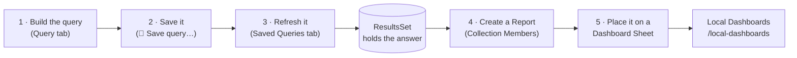
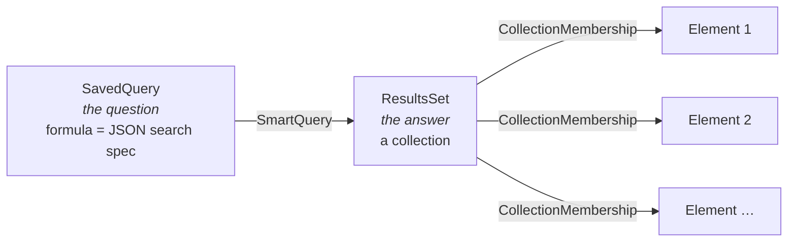
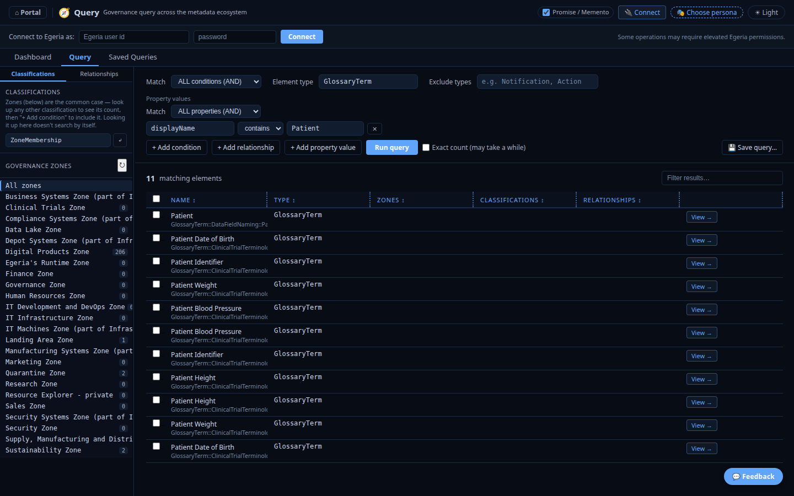
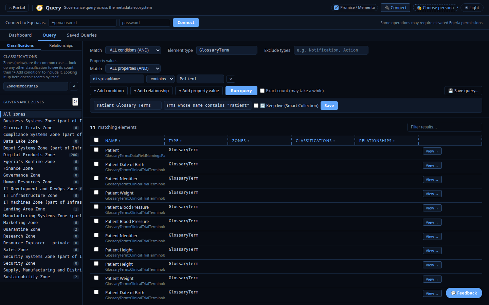
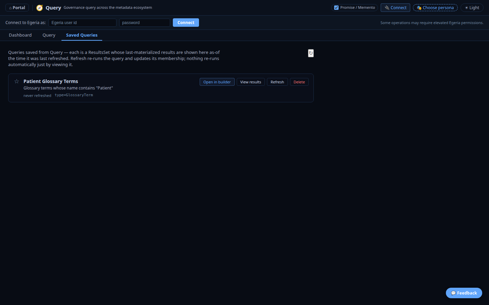
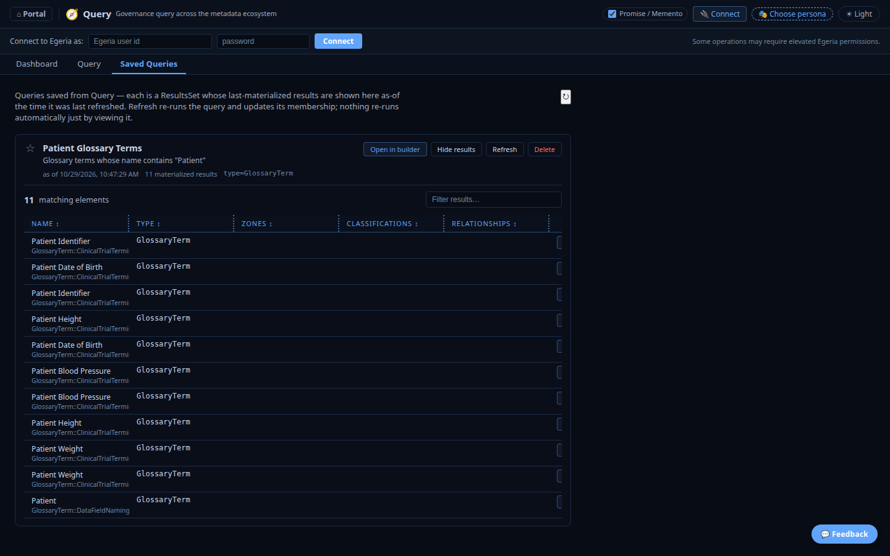
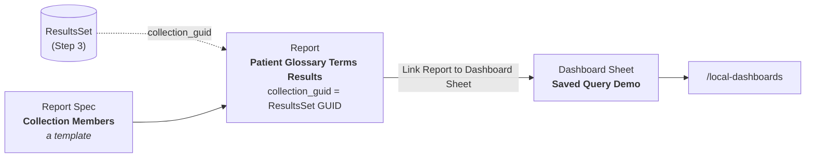
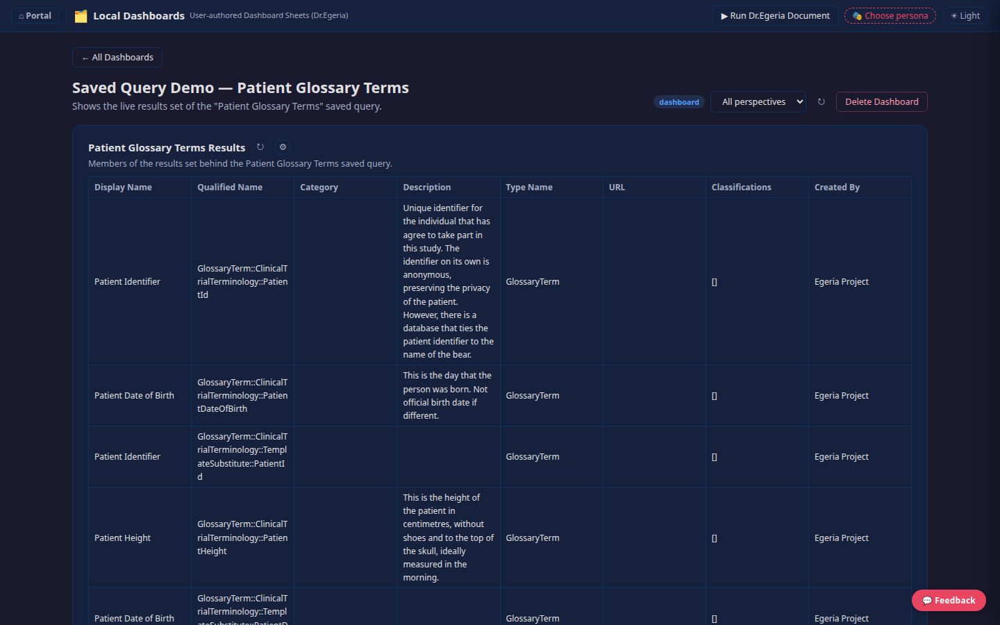
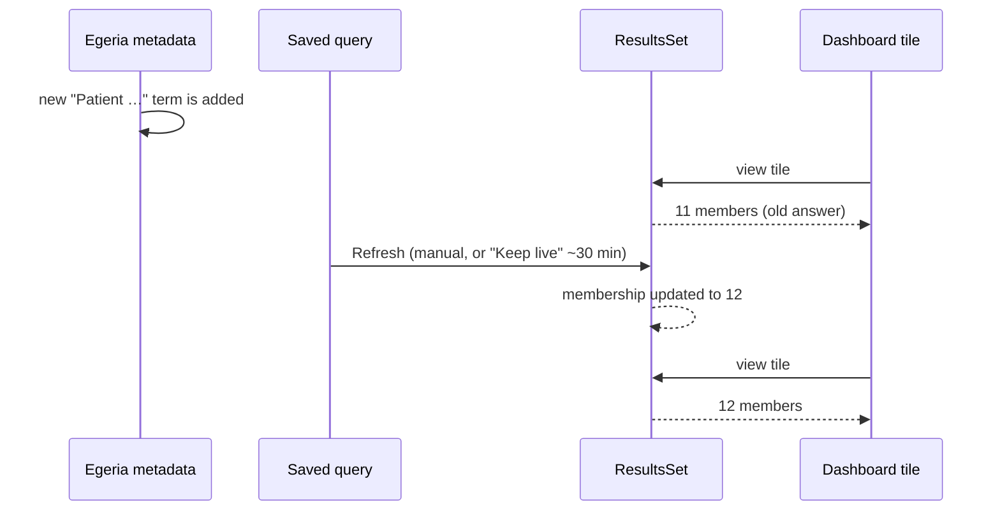

<!-- SPDX-License-Identifier: CC-BY-4.0 -->
<!-- Copyright Contributors to the ODPi Egeria project. -->

# Create and Use Saved Queries

A **saved query** is a question you have already worked out — "which glossary
terms mention *Patient*?", "which assets have no lineage?" — stored in Egeria so
you can re-run it, share it, and put its answer on a dashboard without
rebuilding the filter each time.

You build one in the portal's **Query** tool (`/egeria-insights`), save it, and
**refresh** it to capture the answer. This tutorial walks through that whole
loop with a worked example, then shows how to put the saved answer on a
**Local Dashboard**.

> **Where this fits.** This is the companion to
> [Building a Local Dashboard](local-dashboards.md). That tutorial
> covers Dashboard Sheets, Reports and Report Specs in depth; this one covers
> the saved-query half and hands off to it in [Step 5](#step-5--show-the-saved-answer-on-a-local-dashboard).
> For the design background see [`EGERIA_INSIGHTS_QUERY_MODEL.md`](https://github.com/odpi/egeria-workspaces/blob/main/compose-configs/egeria-quickstart/PyegeriaWebHandler/EGERIA_INSIGHTS_QUERY_MODEL.md).

---

## What you will build

A saved query called **Patient Glossary Terms** that finds every glossary term
whose name contains "Patient", and a Local Dashboard that shows those terms as a
table.



Steps 1–3 are done entirely in the browser. Step 5 uses a short Dr.Egeria
document, the same way every example in the
[Local Dashboards tutorial](local-dashboards.md) does.

---

## How a saved query is stored

It helps to know what "saved" actually creates, because the dashboard step
depends on it.



- The **`SavedQuery`** element holds the *question*: the search spec (element
  type, conditions, how they combine) as JSON in its `formula`. It stores no
  results.
- The **`ResultsSet`** is an ordinary Egeria *collection* that holds the
  *answer*. The two are tied together by a **`SmartQuery`** relationship.
- **Refresh** runs the question again and updates the `ResultsSet`'s members to
  match — adding new matches, removing ones that no longer match.

Because the answer is just a collection, anything in the portal that can show a
collection's members can show a saved query's answer. That is how it reaches a
dashboard in Step 5.

---

## Prerequisites

- The quickstart stack is running (`./quick-start-local`) and you can open
  `https://localhost:8843` (freshstart: `https://localhost:7843`).
- Some metadata to query. The example below uses the Coco Pharmaceuticals
  glossary that the quickstart loads. On freshstart, substitute any type and
  property that exist in your repository.

---

## Step 1 — Build the query

Open **Query** from the portal (or go straight to `/egeria-insights`) and select
the **Query** tab.

1. In **Element type**, type `GlossaryTerm`.
2. Click **+ Add property value**.
3. Set the property to `displayName`, the operator to **contains**, and the value
   to `Patient`.
4. Click **Run query**.



You get 11 matching terms. Nothing is saved yet — this is an ordinary, ephemeral
search, and you can keep adjusting it.

### The kinds of condition you can combine

| Button | What it filters on | Example |
|--------|--------------------|---------|
| **Element type** | The Egeria type (and its subtypes) | `GlossaryTerm`, `Asset`, `DigitalProduct` |
| **+ Add condition** | A classification the element carries, optionally with a property value | carries `Confidentiality` |
| **+ Add relationship** | Whether the element **has** or **lacks** a relationship type, optionally on a specific end | `Asset` that **lacks** `DataFlow` |
| **+ Add property value** | A property of the element itself | `displayName` **contains** `Patient` |
| **Exclude types** | Types to drop from the results (matches subtypes too) | `Notification, Action` |

Each group has its own **Match** selector — **ALL** (AND), **ANY** (OR) or
**NONE** — so you can express, for example, "carries classification A *or* B, and
lacks relationship C".

> **Tip:** the type, classification and relationship fields offer type-ahead
> lists drawn live from your server, so you only see names that actually exist.
> A query with no scope at all is deliberately not allowed — it would try to
> match the whole repository — so **Run query** stays disabled until you add a
> type, classification, relationship or property value.

---

## Step 2 — Save the query

Click **💾 Save query…** at the right of the button row. A small panel opens:



1. **Query name** — `Patient Glossary Terms`
2. **Description** *(optional)* — `Glossary terms whose name contains "Patient"`
3. **🔄 Keep live (Smart Collection)** — leave unticked for now (see below).
4. Click **Save**. You will see **Saved ✓**.

### Keep live (Smart Collection)

Ticking this registers the query with Egeria's *SmartCollectionsMembershipManager*
integration connector, which refreshes the `ResultsSet` for you roughly every 30
minutes (or on demand), so the answer never goes stale by itself. Use it for
queries a dashboard depends on.

It is only offered when the query has a type, classification or property-value
condition. A **relationship-only** query (for example, "assets that lack
lineage") is resolved across several types inside this app and can't be
expressed as the single REST call the connector needs, so the checkbox is
disabled for it. Those queries are refreshed manually.

---

## Step 3 — Refresh it and look at the answer

Open the **Saved Queries** tab. Your query is there — but notice what it says:



> ⚠️ **A newly saved query is empty until you refresh it.** *Save* stores the
> question; *Refresh* runs it and fills the `ResultsSet`. Until then the card says
> **never refreshed** and **View results** shows nothing. Opening a saved query
> never re-runs it silently, so you always know how old the answer is.

Click **Refresh**. When it finishes the card reads **as of \<time\>** with the
count of materialized results. Then click **View results**:



What the card gives you:

| Control | What it does |
|---------|--------------|
| ☆ / ★ | Star the query. Starred queries appear in a **Favorite Queries** section on the Query tool's **Dashboard** tab. |
| **Open in builder** | Loads the saved conditions back into the Query tab so you can change them. |
| **View results** / **Hide results** | Shows the last materialized answer (no re-run). |
| **Refresh** | Re-runs the query and updates the `ResultsSet`. |
| **Delete** | Removes the `SavedQuery`, its `SmartQuery` link, and its `ResultsSet` with all its memberships. |

### Edit, re-save, or save a copy

Click **Open in builder**. A **📌 Patient Glossary Terms** chip shows which saved
query you are editing. Change a condition, click **Save…**, and choose:

- **Update** — overwrite the saved query in place.
- **Save as new** — keep the original and create a variant under a new name.

Click **+ New query** to leave the saved query and start from a blank builder.

---

## Step 4 — Get the `ResultsSet` GUID

A dashboard refers to the saved answer by the GUID of its `ResultsSet`. The
Saved Queries tab does not display it, but the app's own API does. Open this in
your browser:

```
https://localhost:8843/api/insights/queries
```

Find your query and copy its `resultsSetGuid`:

```json
{
  "name": "Patient Glossary Terms",
  "guid": "e901d840-3040-46c3-b3b8-ac16df0619d9",
  "resultsSetGuid": "33c48c2d-6b36-4bb8-be70-ddc70e27515a",
  "resultCount": 11
}
```

Use `resultsSetGuid` — not `guid` (that is the `SavedQuery` itself, which has no
members to show). The GUIDs above are from the tutorial's run; yours will differ.

---

## Step 5 — Show the saved answer on a Local Dashboard

This step uses the building blocks from the
[Local Dashboards tutorial](local-dashboards.md). If any of them are
unfamiliar, read that tutorial's *Report vs. Report Spec* section first.



The existing **Collection Members** Report Spec already knows how to list the
members of any collection. A **Report** is a named instance of a spec with its
parameters filled in — here, with `collection_guid` set to your `ResultsSet`. So
the saved query needs no special dashboard support: you point a normal Report at
its answer collection.

### The Dr.Egeria document

Save this as `my-saved-query-dashboard.dr-egeria.md`, replacing the GUID with the
`resultsSetGuid` from Step 4:

```markdown
## Create Dashboard Sheet
### Display Name
Saved Query Demo

### Dashboard Sheet Heading
Saved Query Demo — Patient Glossary Terms

### Dashboard Sheet Description
Shows the live results set of the "Patient Glossary Terms" saved query.

### Dashboard Sheet Family
dashboard

___

## Create Report
### Display Name
Patient Glossary Terms Results

### Description
Members of the results set behind the Patient Glossary Terms saved query.

### Report Spec
Collection Members

### Output Format
TABLE

### Report Parameters
collection_guid : 33c48c2d-6b36-4bb8-be70-ddc70e27515a

___

## Link Report to Dashboard Sheet
### Dashboard Sheet Name
Saved Query Demo

### Report Name
Patient Glossary Terms Results

### Placement Span
full

### Placement Emphasis
panel
```

`Collection Members` supports the `TABLE` and `DICT` output formats. The three
commands are the same ones used throughout the
[Local Dashboards tutorial](local-dashboards.md) ("Step 1" covers
`Create Report`, the following steps cover the sheet and placement).

### Run it

The simplest route is the browser. Open `/local-dashboards`, click
**▶ Run Dr.Egeria Document**, paste the document, then **Validate** and
**Process**. (Other ways to run a document — the `dr_egeria` CLI inside the
container, or dropping the file in the shared *Local Dashboards* folder — are
described in the
[Local Dashboards tutorial](local-dashboards.md#no-shelldocker-access-run-it-from-the-browser-instead).)

Then open the sheet:

```
https://localhost:8843/local-dashboards?sheet=Saved%20Query%20Demo
```



All 11 terms from the saved query appear as a dashboard tile. From here you can
use everything the Local Dashboards tutorial covers on this placement: change its
`Placement Span`/`Placement Emphasis`, restrict it with `Placement Perspectives`,
add a `Placement Detail Spec` drill-down, or tailor it per viewer with the **⚙**
button.

### Keeping the tile up to date

The dashboard tile reads the `ResultsSet` **as it currently is**. It does not
re-run your query. So the tile is only as fresh as the last refresh:



- For a tile that must track the data, tick **🔄 Keep live** when you save the
  query (Step 2), or click **Refresh** on the Saved Queries tab after the data
  changes.
- When you want the dashboard to run the query *live on every view* instead,
  use a Report Spec that queries Egeria directly (for example `Collections`,
  or an analytic report) as described in the Local Dashboards tutorial.

---

## More query ideas

These are starting points to adapt; they were not all run against the Coco data
for this tutorial, so check the counts on your own repository.

| Goal | Element type | Conditions | Notes |
|------|--------------|------------|-------|
| Terms mentioning a word | `GlossaryTerm` | property value `displayName` **contains** *word* | The worked example above. |
| Assets with no lineage yet | `Asset` | relationship `DataFlow` — **lacks** | Relationship-only, so refresh manually. Use **Exclude types** (e.g. `Notification, Action`) to drop noise. |
| Digital products | `DigitalProduct` | *(type only)* | Add a property condition to narrow by status. |
| Anything carrying a classification | *(any)* | **+ Add condition**, pick the classification | Add a property to filter by its value. |
| "Either of two things" | — | Set **Match** to **ANY** | Use **NONE** for "none of these". |

---

## Authoring with Dr.Egeria instead of the UI

Dr.Egeria also has commands for saved queries — `Create Saved Query`,
`Update Saved Query`, and `Link Saved Query to Results Set`. Their templates are
in `templates/basic/Views & Reports/` (`Create_Saved_Query.md`,
`Link_Saved_Query_to_Results_Set.md`). They let you define a `SavedQuery` with a
**Query URL** and **Query Request Body** (a raw Egeria REST call) and attach it
to a results set.

Be aware of the difference: the **Query** tool tags the queries it saves with a
marker and stores its own search spec, which is what its **Refresh** and **Open
in builder** understand. A `SavedQuery` authored through Dr.Egeria is a real
Egeria element, but is not managed by the Saved Queries tab. For the
build-save-refresh-dashboard workflow in this tutorial, use the Query tool.

---

## Things to know

- **Refresh materializes one page.** Refresh stores what the query returns for
  its stored page size (200 results by default), so a very broad query is
  truncated. Narrow it with more conditions rather than relying on a huge
  `ResultsSet`.
- **Refresh is not instant for big answers.** Each new member is a separate call
  to Egeria; a few hundred results take on the order of tens of seconds. Keeping
  a query narrow helps here too.
- **Relationship conditions apply to the fetched page.** When a relationship
  condition is combined with other filters it is evaluated over the elements the
  rest of the query returned (a capped page), not the whole repository — the
  Query tab shows a note when this applies. Tick **Exact count** to get a
  complete answer.
- **Excluding types is client-side.** Egeria has no "not this type" search, so
  **Exclude types** filters the fetched page. It matches subtypes too — excluding
  `Action` drops every `ToDo`, `Meeting`, `Review` and `Notification`.
- **Deleting is final.** **Delete** removes the saved query *and* its
  `ResultsSet`. Any Report that points at that `ResultsSet`'s GUID will then
  show nothing — update or remove those placements.
- **A new saved query means a new `ResultsSet`.** **Update** keeps the same
  `ResultsSet`, but **Save as new**, or deleting and recreating a query, gives you
  a new `resultsSetGuid`. Update the Report's `collection_guid` and re-run its
  `Create Report` command (it upserts).

---

## Where next

- **[Building a Local Dashboard](local-dashboards.md)** — Reports, Report
  Specs, KPI tiles, analytic charts, perspectives, drill-downs.
- **[Digital Product & Subscription Dashboard](digital-product-subscription.md)**
  — a business-oriented dashboard example.
- **[Query tool](../tools/egeria-insights.md)** — user-facing
  reference for the Dashboard, Query and Saved Queries tabs.
- **[`EGERIA_INSIGHTS_QUERY_MODEL.md`](https://github.com/odpi/egeria-workspaces/blob/main/compose-configs/egeria-quickstart/PyegeriaWebHandler/EGERIA_INSIGHTS_QUERY_MODEL.md)** — design
  history: why `SavedQuery`/`ResultsSet`/`SmartQuery`, and what is still planned
  (such as using a saved query directly as a dashboard data source).
